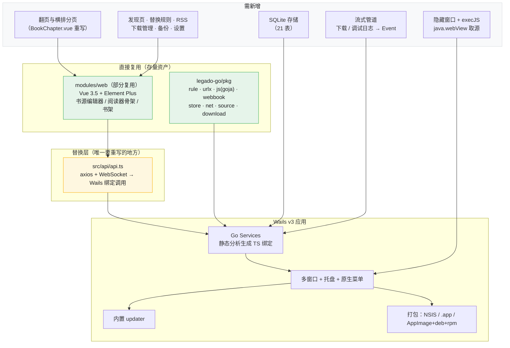

# Wails v3 桌面端实现 Legado · 调研

> 调研时间：2026-10-29
> 调研对象：[Wails v3](https://v3.wails.io)（v3.0.0 于 **2026-10-26 正式发布**）
> 关联文档：`MyGo桌面端可行性调研.md`

---

## 一、结论速览

**Wails v3 是比 MyGo 更稳、更快能落地的选择；但若坚持「无 cgo」或要原生 UI 手感，MyGo 仍有不可替代的位置。**

三条决定结论的事实：

1. **Wails v3.0.0 已于 2026-10-26 转 stable**，桌面三平台进入兼容性契约；背后有 v2 长期生产验证与大体量社区。相比 2026-09 才开源、2.6k star 的 MyGo，生态风险低一个量级。
2. **`modules/web` 只有 5,655 行 Vue，而安卓端 UI 层是 62,323 行 Kotlin + 183 个 layout XML（零 Compose，纯 View Binding）**。Web 模块仅覆盖书源编辑 + 简化阅读器 + 简化书架，约为安卓端 UI 的 **9%**。可复用资产真实存在（书源编辑器最值钱），但它撑不起整个 app——**约 90% 的界面仍需从 Kotlin + XML 重写**。这一点最初被高估了，下文第四节已据实修正。
3. **代价是 cgo**：Linux 上 Wails v3 需要 gcc + GTK4/WebKitGTK 6.0 开发包，且默认栈要求 Ubuntu 24.04+/Debian 13+。这会打破 `legado-go` 目前引以为傲的 `CGO_ENABLED=0` 纯净性。

**一句话建议：先走 Wails v3，把 `legado-go` 引擎 + `modules/web` 前端拼起来做 P0 验证；若后续发现必须摆脱 cgo 或需要原生级书源编辑体验，再评估 MyGo 作为第二方案。**

---

## 二、Wails v3 能力基线（v3.0.0）

| 维度 | 值 |
|---|---|
| 状态 | **v3.0.0 stable（2026-10-26）**；v2 为上一稳定版仍在修 |
| 桌面平台 | Windows amd64/arm64（WebView2）、macOS 10.15+ Intel / 11.0+ AS（WKWebView）、Linux amd64/arm64（**GTK4 + WebKitGTK 6.0** 默认） |
| 移动端 | **iOS / Android（实验性，不在桌面兼容契约内）** |
| Go 版本 | 路线图要求 **Go 1.26+**；部分文档写 1.25+（`legado-go` 为 1.27，均满足） |
| cgo | **Linux 需要**（gcc + GTK/WebKit 开发包）；`-tags server` 才是 CGO-free |
| UI 模式 | **仅 Web**（系统 WebView），无原生 UI 工具包 |
| 产物体积 | ~10-15 MB，基线内存 ~10 MB，启动 <0.5s |

### v3.0.0 主要能力

- **多窗口**：运行时创建/管理/关闭，各自生命周期
- **系统托盘**：菜单、明暗图标、macOS 模板图标、窗口可挂到托盘
- **原生菜单与对话框**：应用菜单、右键菜单、各平台原生对话框
- **服务与生成的绑定**：后端是普通 Go 代码，绑定通过**静态源码分析**生成，注释与参数名能带到前端；`wails3 dev` 自动重生成
- **事件系统**：`app.Event.Emit` ↔ `Events.On`（双向）
- **`execJS`**：`webviewWindowImpl` 接口含 `execJS(js string)`，**可在窗口内执行任意 JS**
- **内置 updater**：可插拔 provider、加密校验、原子交换、可换默认 UI
- **打包与签名**：Windows NSIS / MSIX、macOS .app、Linux AppImage + deb + rpm；各平台代码签名指南
- **Server build**：`-tags server`，无 GUI、无 cgo，同一应用跑成 HTTP 服务
- **Taskfile 构建系统**：构建过程可见、可扩展、可调试
- **开发体验**：`wails3 dev` 热重载、右键开 DevTools、`wails3 doctor` 环境自检

### 移动端（实验性，值得单独一提）

同一份 `main.go` 与前端可编译到 iOS/Android：Android 为 Android WebView + `WebViewAssetLoader`，Go 编译为 `libwails.so`（NDK 26.3.x + JDK）。

能力清单中有几项与 Legado 相关：**Text-to-speech**、本地通知、剪贴板、设备信息、安全存储、Share sheet、保持唤醒、亮度、生物识别、触觉反馈、地理位置。

但限制明确：**仅第一个窗口**（无多窗口）、窗口几何/菜单/托盘为 no-op、无保存文件对话框（写沙盒）。

---

## 三、对 Legado 的逐项影响

### 3.1 ✅ 利好项

| 项 | 说明 |
|---|---|
| **复用 `modules/web` Vue 资产** | 书架、书源编辑器、阅读器骨架可直接搬，只需把 `src/api/*` 的 axios/WebSocket 换成 Wails 绑定调用 |
| **阅读页排版** | 走 WebView，CJK 排版、`writing-mode` 竖排、CSS 分栏与 transform 动画全部由浏览器承担——与 MyGo 结论一致，这条路线是对的 |
| **`execJS` 补齐 `java.webView`** | 可开独立/隐藏窗口加载源网页，执行 JS 取回 HTML，覆盖网页登录、Cloudflare 验证、`webViewGetSource` |
| **网络无 CORS** | 书源请求在 Go 侧发起，不受浏览器同源限制 |
| **内置 updater** | 省掉自己做更新通道的工作量 |
| **打包签名链路完整** | NSIS/MSIX/.app/AppImage+deb+rpm + 各平台签名指南 |
| **生态与风险** | stable 版本、大体量社区、多语言文档、`wails3 doctor` |
| **Server build** | 可顺带产出「无 GUI 的 HTTP 服务」形态 |
| **移动端可能性** | 若未来想统一代码库，Wails 是唯一能同时覆盖桌面+安卓的方案（MyGo 不支持移动端） |

### 3.2 ⚠️ 需改造 / 有代价

| 项 | 代价 |
|---|---|
| **cgo（Linux）** | 需 gcc + GTK4/WebKitGTK 6.0 开发包；破坏 `CGO_ENABLED=0`。Windows/macOS 官方未明确要求 gcc（Windows 走 WebView2 封装，macOS 需 Xcode CLT） |
| **Linux 覆盖变窄** | 默认栈要求 Ubuntu 24.04+ / Debian 13+ / Fedora 40+；Ubuntu 22.04、Debian 12、RHEL 9 只能走 `-tags gtk3`，且该标签 **v3.1 将移除**。对比 MyGo 只需 WebKitGTK 4.1，覆盖面更窄 |
| **无原生 UI 工具包** | 书源编辑只能用前端编辑器（CodeMirror/Monaco 之类需自己接），拿不到 MyGo 那种开箱即用的高亮/多光标/折叠/诊断 Code editor；设置页、表格、树、虚拟列表全部靠 Element Plus 或自研 |
| **流式需自搭** | MyGo 有 `Channel[T]` 流式参数 + 背压；Wails 只有事件系统，下载进度/调试日志流式管道要自己封装 |
| **阅读页翻页要重写** | `modules/web` 的 `BookChapter.vue` 是**纵向滚动 + 无限加载**，没有安卓端的分页/仿真/覆盖翻页与分章预加载调度。正文渲染、排版设置、目录、进度记录可复用，**翻页交互与横排分页必须全新开发** |
| **WebSocket 通道改造** | 现有 `/searchBook`、`/bookSourceDebug` 走 WS；桌面端改为 Go 服务 + 事件推送 |
| **`navigator.sendBeacon`** | `api.ts` 用其保存阅读进度，桌面端需改同步调用 |
| **URL 依赖脆弱** | `api.ts` 用 `/bookSource/i.test(location.href)` 判断，hash 路由在桌面端能跑但建议参数化 |

### 3.3 ❌ 与 MyGo 相同的取舍（框架无关）

相机扫码（砍）、系统 TTS（Wails 移动端有 TTS，桌面端仍需平台适配或走 HTTP TTS）、ExoPlayer/MediaSession、Android 进程模型（Service/广播/appCtx）。

---

## 四、修正：`modules/web` 的真实覆盖度

> **重要修正**：初版调研把「复用 5,400 行 Vue」当作决定性优势，这是高估。实测体量对比如下。

### 4.1 体量对比

| 侧 | 规模 | 技术栈 |
|---|---|---|
| **安卓端 UI 层** | **62,323 行** Kotlin（359 文件）+ **183 个** layout XML | 纯 Kotlin + XML + View Binding，**零 Compose** |
| `modules/web` | 5,655 行 TS/Vue（15 个 `.vue`） | Vue 3.5 + Element Plus + Pinia |
| 覆盖比 | **约 9%** | — |

安卓端 UI 行数分布（`app/.../ui/`）：`book` **32,624**（占 52%，阅读器是大头）、`widget` 10,869（自定义控件）、`rss` 4,191、`association` 3,745、`main` 3,638、`config` 2,023、`file` 1,131、`replace` 1,100、`about` 834、`dict` 760、`browser` 485、`login` 432、`font` 279、`qrcode` 118、`welcome` 94。

最大单文件：`ReadBookActivity.kt` 1,732、`PhotoView.kt` 1,259、`ChapterProvider.kt` 1,053、`DragSelectTouchHelper.kt` 1,000、`ReadMangaActivity.kt` 855、`TextChapterLayout.kt` 834、`BookSourceActivity.kt` 779。

### 4.2 `modules/web` 实际构成（5,655 行切分）

| 主题 | 约行数 | 占比 | 可复用性 |
|---|---|---|---|
| **书源 / 订阅源编辑** | ~1,700 | 30% | **可直接搬**（`bookSourceEditConfig.ts` 585 + `rssSourceEditConfig.ts` 222 + SourceList/TabForm/Debug/Help/Item/Json/Editor + sourceStore） |
| 阅读器骨架 | ~2,100 | 37% | 部分复用：正文渲染、排版设置、目录、进度可留；**翻页与分页必须重写** |
| 书架 | ~900 | 16% | 可直接搬（简化版，无分组） |
| 通信与基建 | ~500 | 9% | 只换 `api.ts` 一层 |
| 类型定义 | ~450 | 8% | 可直接搬（`source.d.ts`、`book.d.ts`） |

结论：**书源编辑器确实是这座仓库最值钱的可复用资产**（表单最密集、最繁琐），但它连同阅读器骨架一共只覆盖安卓端 UI 的约 6%。**发现页、书架分组、替换规则、下载管理、备份恢复、WebDAV、设置中心、RSS 阅读、漫画阅读、音频播放、导入关联等绝大多数界面，在 Web 侧根本没有对应，需要全新重写。**

### 4.3 这一修正改变了什么

初版结论「Wails v3 因为能复用 Vue 所以更快」的**理由被削弱**，但**结论方向不变**，理由换成下面这条更硬的：

> 既然约 90% 的界面要重写，那么决定成败的不再是「能复用多少存量」，而是**「在重写 6 万行量级界面的漫长过程中，哪个框架更不容易翻车」**。答案偏向成熟生态：v3.0.0 stable + v2 长期生产验证 + 大社区 + 多语言文档 + `wails3 doctor`，以及 Element Plus 这类成熟前端组件库的供给能力。MyGo 的原生组件（Table/Tree/Code editor）确实能省一部分事，但它只有一个月历史、2.6k star，在 6 万行量级的工程里，这个风险敞口远大于它省下的工作量。

### 4.4 必须做功能裁剪

62,323 行原生 UI 全量复刻到桌面既不现实也不必要。建议桌面端只保留核心三件套，其余裁剪：

| 优先级 | 模块 | 处理 |
|---|---|---|
| **P0 必做** | 阅读器（`book/read`，安卓端最大头）、书架、书源管理 | 全新实现，阅读器走 Web 模式 |
| P1 应做 | 发现/探索、搜索、替换规则、目录与书签 | 移植 |
| P2 可选 | RSS、备份恢复、WebDAV、本地书导入、EPUB 导出 | 按需 |
| **建议砍掉** | 漫画阅读（`ReadMangaActivity` 855 行）、音频播放、相机扫码、`widget/` 中 1,089 行里的大部分 Android 控件特效（拖拽多选、快滑条等） | 桌面端无对应场景或用现成前端库替代 |

技术栈：Vue 3.5 + TypeScript 5.5 + Vite 5 + Element Plus 2.8.5 + Pinia + vue-router（hash）+ axios + `@vueuse/core` + `hotkeys-js`。

**有利条件**：`src/api/axios.ts` 的 baseURL 可取 `VITE_API` 环境变量或 localStorage，只要实现**兼容现有 REST + WS 协议的 Go 服务**即可直接联调——甚至可以先让 Wails 后端复用安卓端的同一套 API 契约。

---

## 五、Wails v3 vs MyGo 正面对比

| 维度 | Wails v3.0.0 | MyGo | 谁更优 |
|---|---|---|---|
| 成熟度 | **stable（2026-10-26）+ v2 长期验证 + 大社区** | 2026-09 开源，2.6k star | **Wails** |
| UI 模式 | 仅 Web | Web + GPU 原生 UI（可混用） | MyGo |
| 原生组件 | 无，靠前端库 | Code editor / Table / Tree / 虚拟 List / Rich text editor / Form / Chart | **MyGo** |
| cgo | **Linux 需要**（GTK4+WebKitGTK 6.0） | **完全无 cgo** | **MyGo** |
| Linux 覆盖面 | Ubuntu 24.04+（旧版靠 gtk3 标签，v3.1 移除） | WebKitGTK 4.1，覆盖到 Ubuntu 22.04 | **MyGo** |
| 前端资产复用 | 都能跑 Vue，可复用 `modules/web`（仅约覆盖安卓端 UI 9%，主体是书源编辑器） | 同左（但选 Web 模式等于放弃原生 UI 优势） | 平手 |
| 移动端 | **Android/iOS（实验性）** | 不支持 | **Wails** |
| 多窗口 / 托盘 / 菜单 / 对话框 | ✅ | ✅ | 平手 |
| 绑定生成 | 静态源码分析，保留注释与参数名 | 自动生成 TS，保留注释 | 平手 |
| 流式 | 事件系统，需自搭 | **Channel[T] + 背压** | **MyGo** |
| 执行 JS | `execJS` | `Page.Eval` / `EvalAs[T]` | 平手 |
| 自动更新 | 内置 updater（加密校验、原子交换） | 内置（delta 更新） | 平手 |
| 打包分发 | NSIS/MSIX/.app/AppImage+deb+rpm | dmg/exe/deb | **Wails**（Linux 格式更多） |
| Go 版本 | 1.26+（部分文档 1.25+） | 1.27+ | 平手 |
| 产物体积 | ~10-15 MB | 数 MB | MyGo |

**关键判断**：如果采用「Web 模式 + 复用 Vue」这条路线，那么 Wails v3 在**同等路线下严格优于 MyGo**——更成熟、生态更好、分发更完整，而 MyGo 的原生 UI 优势根本没被用到。MyGo 只在两种情况下反超：① 必须坚持无 cgo；② 愿意为原生 UI 手感重写工具型界面。

---

## 六、推荐架构（Wails v3）

**要点**

1. **唯一必须重写的是通信层**：`src/api/api.ts`。保持现有 REST 契约（getBookshelf / getChapterList / getBookContent / saveBookSource …）不变，把 axios 换成 Wails 绑定调用，前端其余代码零改动。
2. **引擎零改动**：`legado-go/pkg` 直接作为 Go 服务的实现。
3. **流式用事件系统自封装**：下载进度与源调试日志走 `app.Event.Emit`，前端 `Events.On` 订阅，补上 MyGo `Channel[T]` 的位置。
4. **`java.webView` 用隐藏窗口 + execJS**：这是 Wails v3 相对纯 Go CLI 的关键加成，需在 P0 验证。

---

## 七、风险清单

| 风险 | 等级 | 说明与缓解 |
|---|---|---|
| **cgo 与 Linux 门槛** | **中高** | Linux 需 gcc + GTK4/WebKitGTK 6.0；默认栈排除 Ubuntu 22.04/Debian 12。缓解：主力先发 Windows/macOS；Linux 提供 `-tags gtk3` 构建，或评估同时产出 `-tags server` 的 CGO-free 服务形态 |
| **v3.0.0 刚发布** | 中 | 发布仅 3 天，虽经 alpha→beta→stable 长周期打磨，仍可能有初期问题。缓解：锁定 v3.0.0，关注周更与 nightly；`wails3 doctor` 做环境自检 |
| **翻页需全新开发** | 中 | 现有 `BookChapter.vue` 是滚动式，安卓端的 6 种翻页动画与分章调度要重写。这是最大的单项新增工作量 |
| **无原生 Code editor** | 中 | 书源 JS 规则编辑体验弱于 MyGo。缓解：前端接 CodeMirror 6 / Monaco，或用可视化表单（`bookSourceEditConfig.ts` 已有 585 行元数据，表单路线其实已经够用） |
| **Linux gtk3 标签 v3.1 移除** | 低中 | 需提前规划 Linux 支持策略 |
| **移动端是实验性** | 低（若不用） | 不应用作 Legado 安卓端替代：单窗口、无菜单托盘、WebView 阅读体验低于现有原生实现 |
| **框架耦合** | 低 | 保持 `legado-go/pkg` 与 UI 严格解耦，API 契约对齐 `api.md`，框架可替换 |

---

## 八、落地路线

| 阶段 | 目标 | 关键点 |
|---|---|---|
| **P0 · 垂直切片** | Go 服务实现现有 REST 契约 → `modules/web` 书架与书源编辑器跑起来 | 验证「引擎 + Vue 复用」链路；**只改 `src/api/api.ts`** |
| **P1 · 阅读器** | 补分页与翻页交互，接 SQLite 存储 | 最大单项工作量；先做滚动，再做分页/仿真 |
| **P2 · java.webView** | 隐藏窗口 + execJS 取源，补 Cloudflare/网页登录 | 验证 Wails 窗口能否离屏执行 |
| **P3 · 缺口补齐** | 发现页、替换规则、RSS、下载管理、备份、设置中心 | 参照安卓端移植 |
| **P4 · 分发** | NSIS / .app / AppImage+deb+rpm + 签名 + updater | |

---

## 九、结论

**选 Wails v3，但理由要换。**

MyGo 在无 cgo、原生 UI 组件、流式管道、Linux 覆盖面四项上确实更优，这一点不变。但本轮修正后，「复用 Vue 资产」已不能作为主要理由——它只覆盖约 9%。

新的理由是：**约 90% 的界面必须从 Kotlin + XML 重写，这是一个 6 万行量级的长期工程；在这种体量下，「框架的成熟度与生态供给」比「有没有现成组件」重要得多。** Wails v3 有 v3.0.0 stable、v2 的长期生产验证、大社区与多语言文档、`wails3 doctor`，且能直接用 Element Plus 这类成熟前端组件库来批量重建表格/表单/树；MyGo 只有一个月历史，在同等工程量下风险敞口显著更大。

此外 Wails v3 的分发链路更完整（NSIS/MSIX/AppImage+deb+rpm + 签名 + 内置 updater），并保留了移动端这条 MyGo 完全没有的退路。

真正需要为此付出的代价只有两条：**Linux 上引入 cgo**，以及**书源编辑拿不到原生级 Code editor**（但 `bookSourceEditConfig.ts` 已有 585 行表单元数据，可视化编辑路线已足够）。

**建议立即做 P0**：用 `legado-go/pkg` 实现 `api.md` 的 REST 契约，把 `modules/web` 跑起来。如果只改一个文件就能让书架和书源编辑器亮起来，这条路的成本就已经证明了一大半。
