# Legado Desktop 数据流与 UI 跳转图

> 基于 `desktop/` 当前代码绘制，覆盖 Wails v3 桌面端的真实调用链与路由跳转。
> 约定：**实线**表示同步调用或用户点击，**虚线**表示事件推送、返回或异步回调。

---

## 1. 分层数据流总览

前端只经 `src/api/*.ts` 访问后端；`internal/app` 只面向 `internal/port` 接口；
所有具体实现（SQLite、文件系统、书源引擎、WebDAV）都在 `internal/adapter` 落地。

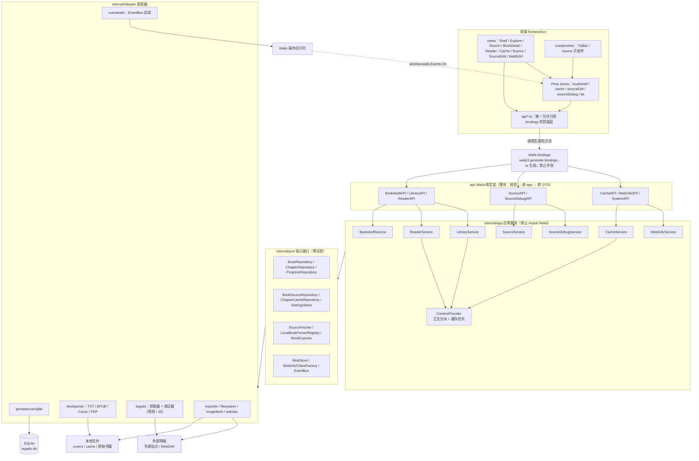

---

## 2. 启动与依赖装配

`main.go` 是 Wails 宿主组合根；`internal/bootstrap` 是与宿主无关的业务组合根，
CLI 与桌面端共用同一套装配，保证行为一致。

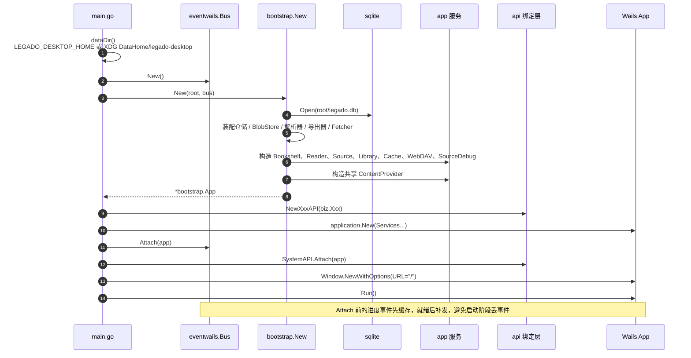

---

## 3. 本地书导入数据流

支持 TXT / EPUB / PDF / 漫画目录或压缩包。重复导入同一路径会更新元数据与目录，
不会产生重复书籍。

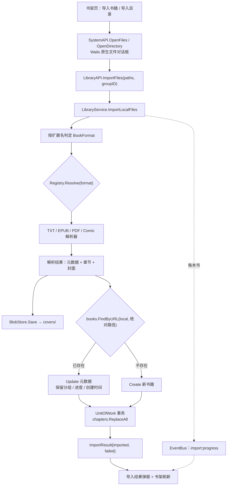

漫画导入时，解析器会把压缩包解压到 `cache/comic/`，章节地址直接指向
`/local/cache/comic/...`；本地书始终读取原文件，不进入章节缓存。

---

## 4. 网络书：发现 / 搜索 / 入架

搜索与发现共用 `SourceService` 与 `legado` 抓取器。**点击结果行会先自动入架，
拿到本地 book id 后再跳详情页**；「加入书架」按钮则留在原页。

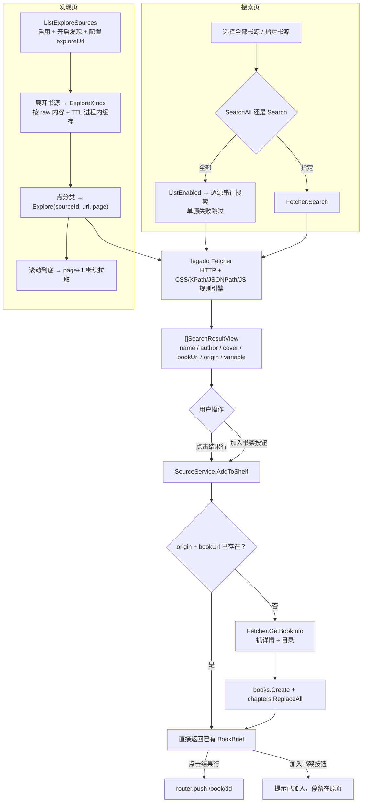

> 发现页的「书源列表 → 分类 → 书单」是页内状态切换，不产生路由；
> `ExploreView` 被 `keep-alive` 缓存，进详情再返回时展开状态与滚动位置仍在。

---

## 5. 阅读正文获取数据流

`ContentProvider` 屏蔽「本地文件」与「网络书源」的差异。网络书优先读缓存，
缓存按章节地址校验，地址变化即视为失效，避免读到旧版正文。

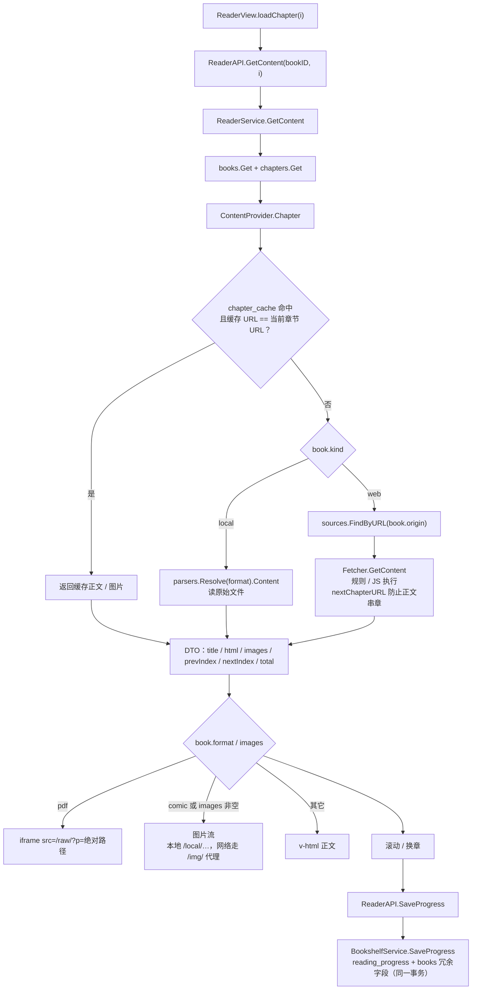

---

## 6. 章节缓存任务

缓存是**手动触发**的后台任务，每本书同一时刻最多一个任务；文本入
`chapter_cache`，漫画图片落盘到 `cache/chapter/<bookId>/<index>/`。

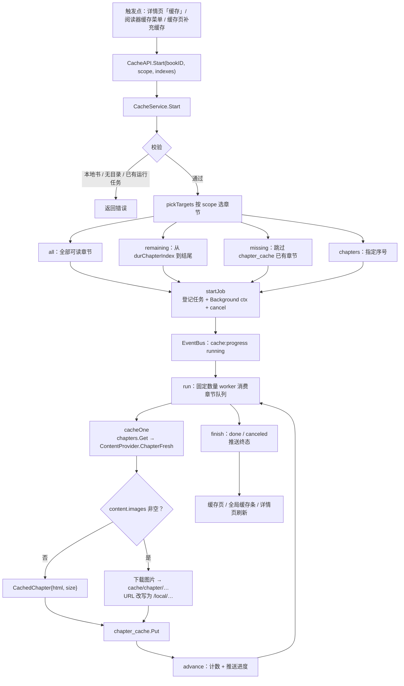

缓存管理页的删除动作：按章删除 → `deleteChapters`；清空某书 → `purgeBook`
（同时停任务、删 DB 记录与图片目录）；全清 → `clear`。删除书籍时
`BookshelfService.DeleteBook` 会先 `PurgeBook` 再删书。

---

## 7. 书源管理与调试

书源以「原始 JSON」持久化，管理字段（名称 / 分组 / 启用 / 排序）冗余成列。
调试支持「未保存的 JSON 直接跑」，因此编辑页改完不必先保存。

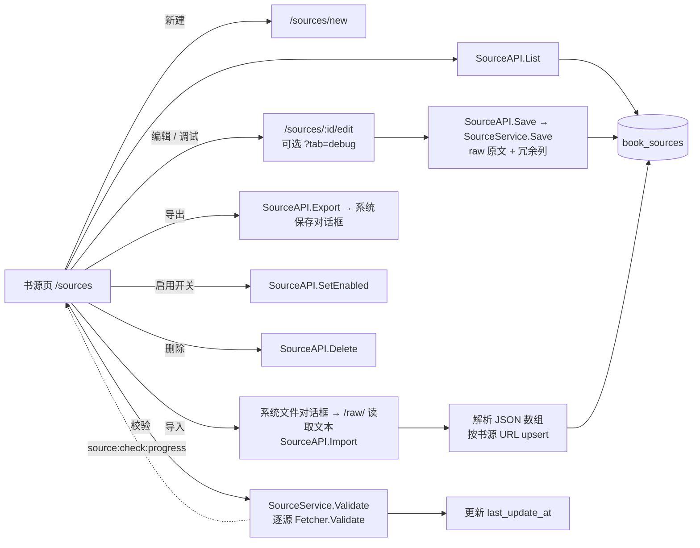

### 7.1 书源调试时序

调试是**全局单会话**，输出通过事件总线逐条推给前端；`App.vue` 在挂载时订阅，
所以切页面不会丢日志（前端日志缓冲上限 3000 行）。

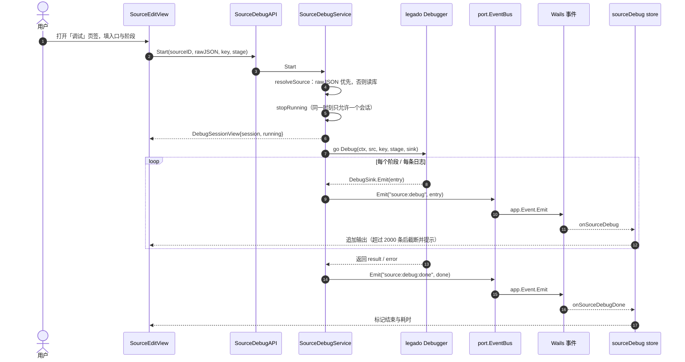

---

## 8. WebDAV 备份数据流

配置存 `app_settings`（键 `webdav.config`）。上传的是数据库文件快照，
下载只保存到本地目录，**不会替换运行中的数据库**。

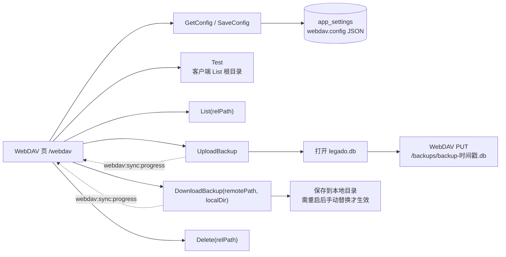

> `List` 返回的 `Path` 一律**相对工作根目录**（如 `novels/a.txt`）。前端会把它原样回传给
> `List` / `DownloadBackup` / `Delete`，而这三处内部都会再拼一次 `remoteRoot`——
> 若这里给完整路径就会拼成 `/legado-desktop/legado-desktop/...` 而 404。

---

## 8.1 从 WebDAV 选书导入

与备份下载刻意分开：备份是「存一份」，导入是「成为书架上一本书」。
下载落点固定为 `<数据根>/webdav/<远端相对路径>`——因为书架记录的是**本地绝对路径**，
放系统临时目录里重启后书就打不开了。

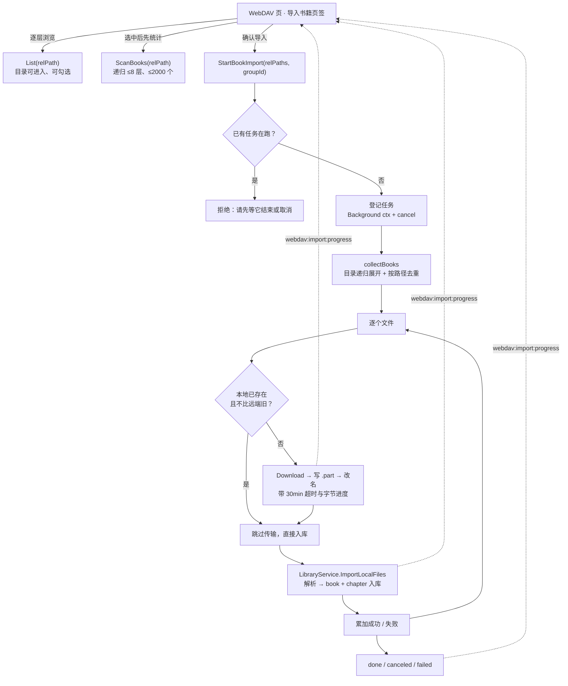

要点：

- **单任务互斥**：下载是带宽密集的，并行只会互相拖慢；第二个请求直接报错并返回当前任务。
- **取消**：半成品用 `.part` 后缀，取消时删除；已下载完成的书保留（它们已经入库）。
- **路径安全**：远端路径逐段 `sanitizeFileName` 并拒绝 `..`，防止写到数据目录之外。
- **幂等**：本地路径由远端路径推导，重复导入同一文件会走 `LibraryService` 的「按 URL 更新」，
  不会产生重复书籍。
- **前端进度是双通道**：事件 + 1s 轮询 `BookImportStatus`。打包后的 `@wailsio/runtime`
  事件注册表与运行时注入的那份互不相通，只靠事件会出现"进度不动"。

---

## 9. 事件总线

`internal/app` 只依赖 `port.EventBus`；`eventwails` 把事件桥接到 Wails，
App 就绪前收到的事件会先缓存再补发。

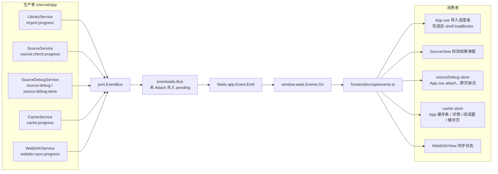

> `download:progress` 在 `port/event.go` 与前端事件表中有定义，但当前桌面端
> 没有生产者与订阅者，属于预留事件。

---

## 10. 持久化与资源布局

### 10.1 数据库表关系

```mermaid
erDiagram
  book_groups ||--o{ books : "group_id"
  books ||--o{ book_chapters : "book_id"
  books ||--|| reading_progress : "book_id"
  books ||--o{ chapter_cache : "book_id"

  books {
    INTEGER id PK
    TEXT name
    TEXT author
    TEXT kind "web | local"
    TEXT format "epub | txt | pdf | comic"
    TEXT origin "书源 URL 或 local"
    TEXT book_url
    INTEGER group_id
    INTEGER total_chapters
    INTEGER dur_chapter_index
    DATETIME last_read_at
  }
  book_groups {
    INTEGER id PK
    TEXT name
    INTEGER sort_order
    INTEGER show
  }
  book_chapters {
    INTEGER id PK
    INTEGER book_id
    INTEGER idx
    TEXT title
    TEXT url
    INTEGER is_volume
  }
  reading_progress {
    INTEGER book_id PK
    INTEGER chapter_index
    TEXT chapter_title
    REAL scroll_percent
    DATETIME updated_at
  }
  chapter_cache {
    INTEGER book_id PK
    INTEGER idx PK
    TEXT title
    TEXT url
    TEXT html
    TEXT images "JSON 数组"
    INTEGER size
    INTEGER created_at
  }
  book_sources {
    INTEGER id PK
    TEXT name
    TEXT group_name
    TEXT url
    INTEGER enabled
    TEXT raw "Legado 原始 JSON"
  }
  source_subscriptions {
    INTEGER id PK
    TEXT name
    TEXT url
    INTEGER enabled
  }
  replace_rules {
    INTEGER id PK
    TEXT name
    TEXT raw
  }
  txt_toc_rules {
    INTEGER id PK
    TEXT name
    TEXT rule
  }
  app_settings {
    TEXT key PK
    TEXT value
  }
```

> `source_subscriptions`、`replace_rules`、`txt_toc_rules` 为表结构预留/管理能力，
> 与当前书籍数据没有外键关系。

### 10.2 文件系统与本地资源路由

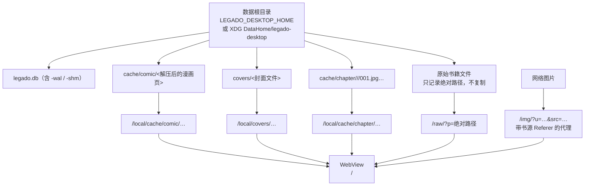

---

## 11. UI 路由级跳转总图

路由表定义在 `frontend/src/router/index.ts`。左侧导航常驻，内容区由
`<router-view>` 渲染；只有 `ExploreView` 被 `keep-alive` 缓存。

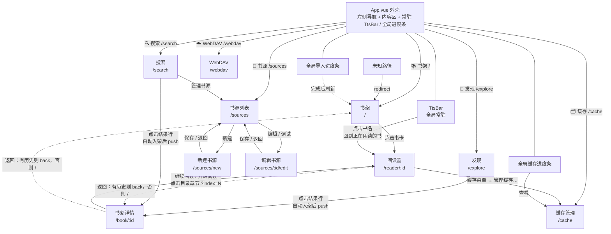

> 注意：**书架卡片直接进阅读器**，不经过详情页；`/book/:id` 的入口只有
> 发现页与搜索页（以及手工输入地址）。

---

## 12. 页面内功能与跳转细节

### 12.1 书架页

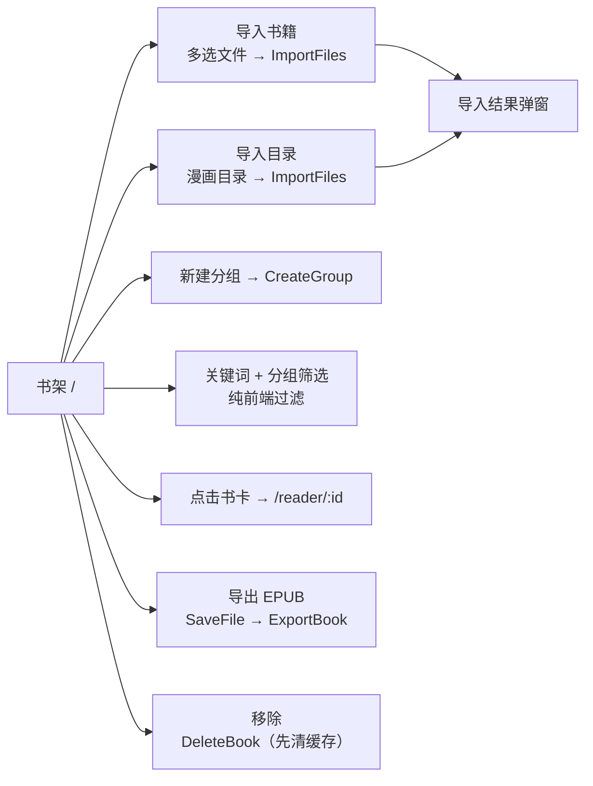

### 12.2 发现页 / 搜索页 → 详情

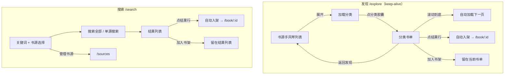

### 12.3 书籍详情页

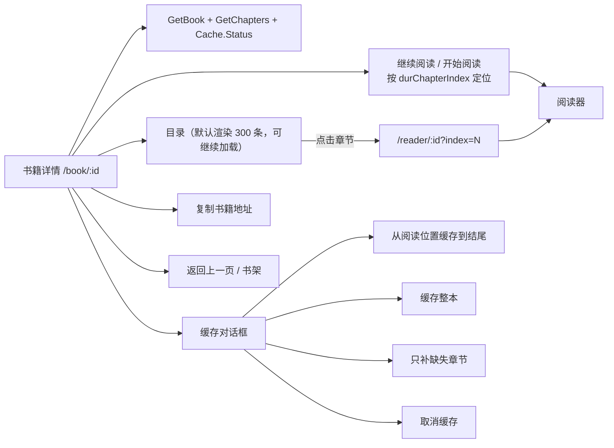

### 12.4 阅读器

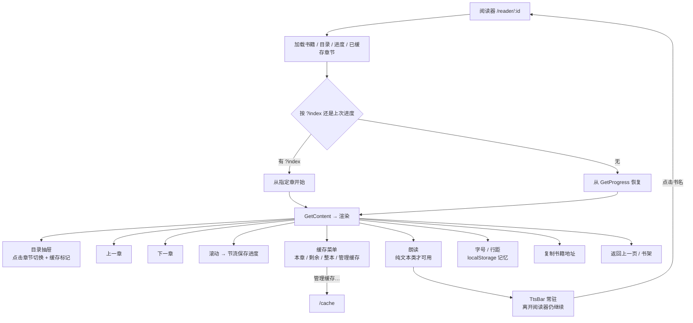

### 12.5 书源页与编辑页

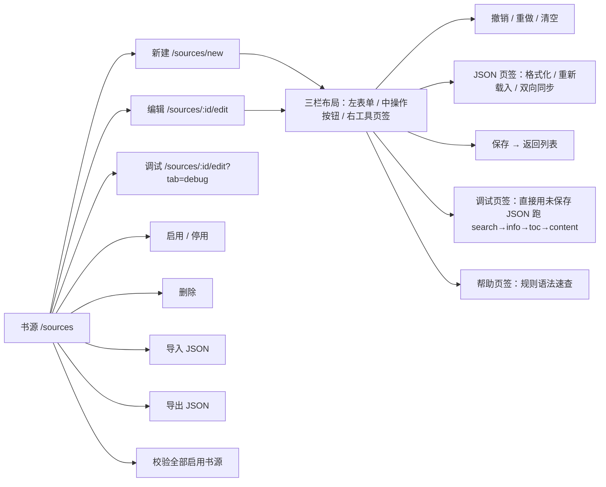

### 12.6 缓存页与 WebDAV 页

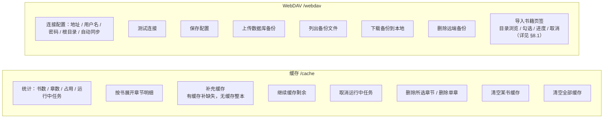

### 12.7 常驻外壳

```mermaid
flowchart TB
  SHELL["App.vue"]
  SHELL --> NAV["左侧导航<br/>书架 / 发现 / 搜索 / 缓存 / 书源 / WebDAV"]
  SHELL --> IBAR["导入进度条<br/>import:progress"]
  SHELL --> CBAR["缓存任务条<br/>cache:progress<br/>查看 → /cache，取消 → CacheAPI.Cancel"]
  SHELL --> TTS["TtsBar<br/>朗读中才显示"]
  SHELL --> KA["router-view + keep-alive<br/>仅缓存 ExploreView"]
  TTS --> T1["书名 → /reader/:bookId"]
  TTS --> T2["上一段 / 播放暂停 / 下一段"]
  TTS --> T3["语速 / 音色 / 停止"]
```

---

## 13. 关键行为速查

| 行为 | 真实路径 |
| --- | --- |
| 书架点书 | 直接进 `/reader/:id`，不进详情 |
| 搜索/发现点结果 | 先 `AddToShelf` 入架，再 `/book/:id` |
| 详情页继续阅读 | `/reader/:id?index=<durChapterIndex>` |
| 阅读正文 | `ReaderAPI.GetContent` → `ContentProvider` → 缓存优先 |
| 本地书 | 读原文件，不缓存、不联网 |
| 网络书正文 | 缓存命中直接用，否则按 `book.origin` 找书源抓取 |
| 缓存任务 | 后台协程 + 固定 worker，每书同时只允许一个 |
| 缓存图片 | 落盘 `cache/chapter/<bookId>/<index>/`，DB 只存地址 |
| 删除书籍 | 先清缓存任务与文件，再删 DB 记录 |
| 书源调试 | 全局单会话，事件逐条推送，日志最多保留 3000 行 |
| WebDAV 备份 | 上传 `legado.db` 快照；下载不自动替换运行库 |
| WebDAV 导入 | 选目录/文件 → 下载到 `<根>/webdav/...` → 逐本 `ImportLocalFiles`；单任务可取消 |
| 事件订阅 | 统一走 `src/api/events.ts`，且必须用注入的 `window.wails` |
| 发现页状态 | 唯一被 `keep-alive` 缓存的页面 |
