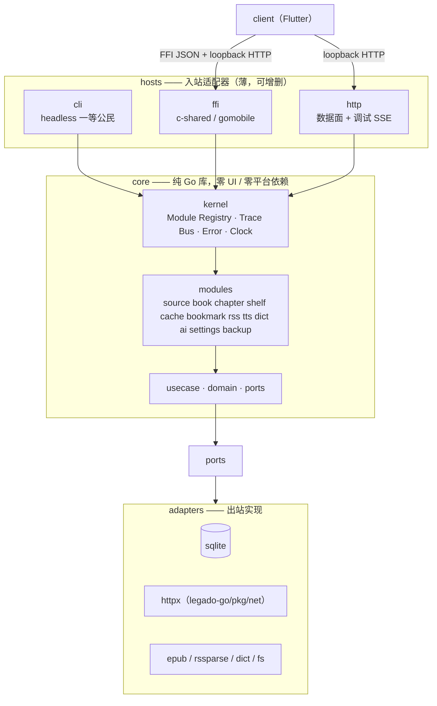

# Legado 代码架构 v2 —— 模块化 / UI 解耦 / Headless 优先

> 配套：`TECH-SELECTION.md` v4（选型与 UI 基准）、`MODULE-PLAN.md`（并行开发切分）。
> 本文解决的问题：**一份业务实现，三种驱动方式（CLI / FFI / HTTP），UI 只是消费者之一。**

---

## 0. 四条设计原则

| # | 原则 | 可检验的判据 |
|---|---|---|
| 1 | **Headless 优先** | 任何能力先能在命令行跑通并输出结构化结果，UI 才允许接入 |
| 2 | **UI 无关** | `rm -rf client/ desktop/*.go` 后，`go test ./core/...` 仍全绿、CLI 仍可完成全流程 |
| 3 | **模块自描述** | 新增一个功能域 = 新建一个目录并 `init()` 注册，**不改任何宿主代码** |
| 4 | **依赖单向** | `client → hosts → core → ports ← adapters`，反向依赖被 CI 拦死 |

> 这四条不是口号。原则 2 的验收命令会写进 Makefile（`make verify-headless`），
> 第 3 条是模块化能否成立的技术核心（§4），第 4 条用 `go list -deps` 检查（§2.2）。

---

## 1. 现状：headless 的底子已经在了

这一点必须先说清 —— 新架构不是从零发明，而是把已有优势固化。

| 已有能力 | 位置 | 状态 |
|---|---|---|
| **与宿主无关的组合根** | `desktop/internal/bootstrap/` | ✅ 注释明确：「main.go（GUI）与 cmd/ 下的命令行工具都通过它构建同一套依赖图」 |
| **规则引擎 CLI（9 个子命令）** | `legado-go/cmd/legado/` | ✅ `validate / list / search / explore / info / toc / content / download / debug` |
| **书源调试命令** | `legado-go/cmd/legado/debugcmd.go` | ✅ 4 种入口、`-stage` 分级、`-body` 响应体、`--json` JSONL、`-save-dir` 存源码 |
| **调试日志基础设施** | `legado-go/pkg/debug/`（431 行） | ✅ 已有分级与格式，但**只是打印，不是事件** |
| **业务层零 Wails 依赖** | `desktop/internal/{app,domain,port}` | ✅ 95 个文件里只有 2 个 import wails |

**所以真正的缺口只有三个**：① 调试输出没有结构化契约（UI 无法复用）；② 业务层是「胖服务」而非可独立装配的模块；③ 宿主层没有抽象（CLI 与 FFI 各写各的）。

---

## 2. 分层与依赖规则



### 2.1 目录（最终形态）

```
legado/
├── app/                    # 原版 Kotlin —— 只读，UI 基准（不参与构建）
├── legado-go/              # 规则引擎模块 —— 冻结，作为 core 的依赖
├── core/                   # ★ 唯一业务实现（Go 库）
│   ├── kernel/             #   模块注册、Trace 总线、错误码、环境（路径/时钟）
│   ├── domain/             #   实体与值对象（零外部依赖）
│   ├── ports/              #   出站端口（Repo / Net / BlobStore / EventSink）
│   ├── usecase/            #   跨模块用例编排（如「换源后重算进度」）
│   ├── modules/<域>/       #   功能模块，自注册（§4）
│   ├── adapters/           #   出站实现（sqlite / httpx / epub / rssparse / …）
│   └── engine/             #   对 legado-go 的边界封装（唯一接触点）
├── hosts/
│   ├── cli/                #   headless：probe / trace / bench / repl / serve / schema
│   ├── ffi/                #   c-shared（Win/Linux）与 gomobile（Android）入口
│   └── http/               #   /content /img /stream /events /debug/*
├── client/                 # Flutter UI（只消费 ffi + http）
└── desktop/                # 过渡期 Wails 壳（E 阶段删除）
```

### 2.2 依赖规则（CI 强制）

```bash
# 1) core 不得反向依赖宿主或 UI
go list -deps ./core/... | grep -E "legado/(hosts|client)|wailsapp" && exit 1
# 2) hosts 之间不得互相 import（防止 cli 复用 ffi 的实现细节）
go list -deps ./hosts/cli/... | grep "legado/hosts/(ffi|http)" && exit 1
# 3) client 不得直接连数据库/发业务 HTTP（见 MODULE-PLAN §1.5）
```

---

## 3. Core 内部结构

### 3.1 kernel —— 全部宿主共用的机制

| 组件 | 职责 | 为什么必须在 core |
|---|---|---|
| `Registry` | 收集模块注册的 method / CLI 命令 / HTTP 路由 / migration | 模块自描述的实现基础 |
| `Trace` | 结构化调试事件总线（§5.1） | CLI 打印与 UI 渲染必须同一份数据 |
| `Event` | 业务事件（进度、缓存完成、挑战请求） | 跨宿主推送 |
| `Err` | 统一错误码（`SOURCE_EMPTY` / `NET_TIMEOUT` / `AUTH_REQUIRED`） | UI 与 CLI 的提示逻辑一致 |
| `Env` | 数据根目录、时钟、并发度 | 替代散落的全局变量，便于测试注入假时钟 |

### 3.2 domain / ports / usecase

- `domain`：实体与值对象，**不 import 任何东西**（连 `time` 都尽量只在方法签名里用）。
- `ports`：出站接口（仓库、网络、二进制存储、事件）。测试时全部可替换为内存实现。
- `usecase`：**只放跨模块编排**（如「删书 → 清缓存 → 清书签 → 清进度」）。单模块内部的逻辑留在模块里，不要为了分层而分层。

### 3.3 模块划分（12 个）

| 模块 | 职责 | 依赖模块 |
|---|---|---|
| `source` | 书源增删改查、导入导出、校验、登录、调试 | — |
| `book` | 书架、详情、分组、搜索、发现 | `source` |
| `chapter` | 目录、正文、换源、正文缓存 | `book` |
| `shelf` | 阅读进度、排序、批量管理 | `book` |
| `cache` | 章节缓存、下载队列、任务进度 | `chapter` |
| `bookmark` | 书签、阅读记录 | `book` |
| `rss` | RSS 源、文章、收藏、阅读 | — |
| `tts` | 文本分段、TTS 规则、HTTP TTS、会话续读 | `chapter` |
| `dict` | 词典查询、规则、ECDICT 安装 | — |
| `ai` | 会话、向量索引、检索 | `book` |
| `settings` | 配置中心（Schema 驱动）、主题、备份恢复、文件管理 | — |
| `platform` | 挑战验证回调、Cookie、音频 URL 签发、图片代理 | — |

> 12 个模块 < 之前的 22 个并行单元，是因为**并行按「模块内的文件/子目录」再切**（见 `MODULE-PLAN.md`），
> 架构上的模块边界按业务域收敛，避免过度碎片化。

---

## 4. 模块自描述（模块化的技术核心）

### 4.1 契约

```go
// core/kernel/module.go
type Module interface {
    Name() string
    DependsOn() []string                        // 拓扑排序用
    Migrate(ctx context.Context, db *sql.DB) error
    Register(r *Registry)                       // 把能力交给内核
}

// Registry 是唯一注入点：注册一次，三宿主自动获得
type Registry struct{ /* ... */ }

func (r *Registry) Method(name string, h Handler, opt ...MethodOpt)  // FFI + HTTP + CLI 共用
func (r *Registry) Command(path string, run CommandFunc)             // CLI 专用
func (r *Registry) Route(method, path string, h http.HandlerFunc)    // HTTP 专用
func (r *Registry) Stream(name string, h StreamHandler)              // 流式（trace / 进度）
```

### 4.2 一个模块长什么样

```go
// core/modules/source/module.go
func init() { kernel.Register(&Module{}) }

func (m *Module) Name() string      { return "source" }
func (m *Module) DependsOn() []string { return nil }

func (m *Module) Register(r *kernel.Registry) {
    r.Method("Source.List", m.list, kernel.Query("group")).
        Describe("列出书源")
    r.Method("Source.Debug", m.debug, kernel.Streaming()).
        Describe("调试书源，推送 trace 事件")
    r.Command("source list", m.cliList)     // legado source list
    r.Command("source probe", m.cliProbe)   // legado source probe -entry "search:三体"
}
```

**注册之后自动获得**：

| 宿主 | 表现形式 |
|---|---|
| CLI | `legado source list`、`legado source probe -entry ... --json` |
| FFI | `LegadoCall({"method":"Source.List",...})` |
| HTTP | `POST /rpc/Source.List`、`GET /debug/source/{id}/trace`（SSE） |

新增模块**不需要**改 `hosts/cli`、`hosts/ffi`、`hosts/http` 任何一行 —— 这就是「功能模块化 + UI 解耦」的机制保证。

### 4.3 为什么不让模块直接写 cobra / http / ffi

因为那会把「业务模块」和「宿主框架」焊死，回到现在 `desktop/api/` 的问题：
1667 行 service 包装，换一个 UI 框架就要重写一遍。**注册表是唯一的防腐层。**

---

## 5. Headless 调试（本次重点）

### 5.1 Trace 事件模型（先定 schema，再谈功能）

现状：`pkg/debug` 只有「打印一行文本」，CLI 能看，UI 拿不到。改造为**结构化事件 + 多消费者**：

```json
{"seq":12,"kind":"http","stage":"toc","url":"https://a.com/1","status":200,"ms":180,"bytes":52341}
{"seq":13,"kind":"rule","stage":"toc","rule":"class.list@a@href","target":"$.data[*]","count":42,"ms":3}
{"seq":14,"kind":"rule","stage":"content","rule":"id.content@html","target":"","count":0,"ms":1,"hit":false}
{"seq":15,"kind":"js","level":"log","msg":"token=abc","stage":"info"}
{"seq":16,"kind":"error","stage":"content","code":"RULE_EMPTY","msg":"正文规则未命中"}
```

| 字段 | 说明 |
|---|---|
| `kind` | `http` / `rule` / `js` / `parse` / `error` / `cache` / `timer` |
| `stage` | `search` / `explore` / `info` / `toc` / `content`（与原版调试面板的 5 段一致） |
| `hit` | 规则是否命中（**最关键**：一眼看出哪条规则静默失败） |
| `seq` | 单调递增，支持断点与回放 |

消费者：

| 消费者 | 用法 |
|---|---|
| CLI | `--json` 输出 JSONL；默认彩色树形打印 |
| HTTP | `GET /debug/session/{id}/events`（SSE） |
| Flutter | 「书源调试」页订阅同一 SSE，按 stage 分组、按 hit 标红 |
| 测试 | 断言 trace 里某条规则的 `hit == true`（比断言最终文本更精确） |

> 这就是「UI 解耦」的最好例子：调试能力在 core，CLI 与 UI 各写 200 行渲染代码，**不存在两套调试逻辑**。

### 5.2 五种调试姿势

| 命令 | 用途 | 说明 |
|---|---|---|
| `legado source probe -entry "search:三体" --json` | 单链路快跑 | 已有 `debug` 命令的升级版，输出结构化 trace |
| `legado source trace -entry "toc:https://…" -break toc.list` | **断点式** | 停在指定规则，dump 当时的 document/JSON 上下文，用于定位「为什么这条没命中」 |
| `legado source bench -dir ./sources -c 8 -report bench.json` | 批量健康度 | 1988 条书源全量回归，输出通过率/耗时分布/失败原因聚类 |
| `legado repl -source 起点.json` | 交互式改规则 | `set rule.toc.list "class.toc@a"` 立刻重跑，书源作者不必改文件重启 |
| `legado serve -port 0` | 起 HTTP | UI 连它；也可给同事发链接直接调 |

### 5.3 `-break` 断点式调试的价值

书源解析失败最常见的原因不是报错，而是**某条规则静默返回 0 条**（历史上 `.[?(...)]` 那个 bug 就是这样）。
断点式调试允许：

```
$ legado source trace -entry "toc:https://book/1" -break toc.list
[break] stage=toc rule="class.toc@a@href" count=0 hit=false
  context=document(52341 bytes)
  selector="class.toc@a"  → matched 0 nodes
  hint: 页面里存在 .toc，但 a 子节点为 0；实际结构为 .toc li a
  > 修改后重试：-override "toc.list=class.toc@li@a@href"
```

`-override` 允许**不改文件、只改内存规则**重跑，形成「探测 → 假设 → 验证」闭环。

### 5.4 与现有 `legado debug` 的关系

| 现状 | 目标 |
|---|---|
| `cmd/legado/debugcmd.go` 直接调用 `pkg/debug` 打印 | 拆成「core 产生 trace」+「CLI 渲染 trace」 |
| `--json` 输出自由格式日志 | 固定 schema（§5.1），带 `seq/kind/hit` |
| 仅规则引擎可用 | 所有模块可发 trace（缓存、TTS、AI 都受益） |
| 无断点、无 override、无批量回归 | 新增（§5.2 的 trace / bench / repl） |

> 迁移策略：`pkg/debug` 保留为低层打印，新增 `kernel/trace` 作为**事件源**，
> `debugcmd.go` 改为消费 trace 的默认渲染器。**旧命令不破坏**，只是底层换了数据源。

---

## 6. 三宿主的分工

| 宿主 | 职责 | 不做什么 |
|---|---|---|
| `hosts/cli` | headless 全流程、调试、批量回归、CI | 不实现业务、不渲染 UI |
| `hosts/ffi` | c-shared / gomobile 的 `LegadoCall` + `LegadoFree` | 不解析业务 JSON 之外的格式 |
| `hosts/http` | 数据面（`/content` `/img` `/stream` `/events`）+ 调试 API + `/rpc` | 不做鉴权以外的业务判断 |

三者共用：同一份 `Registry`、同一套 `dto`、同一套错误码。

**关键收益**：未来要加 MCP（让 AI 直接调书源调试）或 gRPC（远程调试），只需新增一个 `hosts/mcp` —— core 与 client 都不用动。

---

## 7. 数据与配置

### 7.1 SQLite

- 单库 `legado.db`，由 `core/adapters/sqlite` 持有。
- Migration 按模块分段：`modules/<域>/migrations/*.sql`，由 `Migrate()` 注册，内核按 `DependsOn` 顺序执行。
- **模块不得在运行时建表**（防止并行开发各建各的表）。

### 7.2 配置中心

- 单一 `settings` 模块持有 Schema（与 `MODULE-PLAN` §7 的设置框架同源）。
- 读写走 `Settings.Get/Set/Schema`，**三个宿主都能读写**：
  - CLI：`legado settings set reader.fontSize 22`
  - UI：设置页由 Schema 渲染
  - 测试：直接注入内存配置
- 好处：headless 环境下也能改配置验证行为（如批量回归时临时改 `cache.concurrent`）。

---

## 8. 装配与启动

```go
// core/kernel/boot.go —— 唯一装配入口，三个宿主共用
func Boot(env Env, mods ...Module) (*App, error) {
    reg := NewRegistry()
    for _, m := range topoSort(mods) { m.Register(reg) }
    return reg.Build(env)
}
```

```go
// hosts/cli/main.go
app := kernel.Boot(env, source.New(), book.New(), chapter.New(), /* 按需裁剪 */)
```

| 宿主 | 装配方式 | 说明 |
|---|---|---|
| CLI | 全量模块 | 与 GUI 完全一致，保证「命令行验证过的行为 = 应用里运行的行为」 |
| FFI | 全量模块 | 同上 |
| 测试 | 内存 adapters + 全量或最小模块集 | 单模块测试只启必需模块 |

> 这套东西 `bootstrap/` 已经在做（且注释写得很清楚），v2 只是把它从「手工列出 24 个服务」
> 升级为「模块自注册 + 拓扑排序」，顺带解决新增模块要改 bootstrap 的痛点。

---

## 9. 迁移路径（5 步，每步可回滚）

| 步 | 内容 | 风险 | 回滚 |
|---|---|---|---|
| **M1** | 新建 `core/` module，先搬 `domain` / `ports` / `adapters`（纯拷贝 + import 改路径），`desktop` 通过 replace 引用 | 低（不改逻辑） | 删 `core/` |
| **M2** | 引入 `kernel`（Registry + Boot + Trace），`bootstrap` 改为调 `Boot`，先只接 `source` 一个模块 | 中 | 保留旧 bootstrap 分支 |
| **M3** | 逐模块搬迁：每搬一个，删除 `desktop/internal/app/<域>.go` 与对应 `desktop/api/<域>.go`；`desktop` 变成薄壳 | 中（模块多） | 按模块回滚 |
| **M4** | 新增 `hosts/cli`，把 `legado-go/cmd/legado` 的 9 个命令重挂到 Registry；新增 `probe/trace/bench/repl` | 低（新增，不动旧） | 旧 cmd 仍在 |
| **M5** | 新增 `hosts/ffi` + `hosts/http`，Flutter 接上去；`desktop/` 冻结到存档分支 | 中 | Wails 版仍可用 |

**顺序原则**：先搬「无逻辑改动的骨架」（M1），再换装配方式（M2），再按模块迁业务（M3），
最后才接新宿主（M4/M5）。**任何一步都不允许同时改架构和改业务逻辑。**

---

## 10. 与 `MODULE-PLAN.md` 的对应

| MODULE-PLAN 的并行单元 | v2 架构的落点 |
|---|---|
| G00 内核与桥 | `core/kernel/` + `hosts/ffi/` + `hosts/http/` |
| G01 书源 | `core/modules/source/` |
| G02 书籍与正文 | `core/modules/book/` + `core/modules/chapter/` |
| G03 缓存与下载 | `core/modules/cache/` |
| G04 书签·记录·进度 | `core/modules/bookmark/` + `core/modules/shelf/` |
| G05 RSS | `core/modules/rss/` |
| G06 TTS | `core/modules/tts/` |
| G07 词典 | `core/modules/dict/` |
| G08 AI | `core/modules/ai/` |
| G09 设置·备份·文件 | `core/modules/settings/` |
| G10 数据与网络适配 | `core/adapters/{sqlite,httpx,epub,rssparse}/` + `core/modules/platform/` |
| G11 headless CLI | `hosts/cli/` |
| U00–U09 | `client/lib/*`（不变） |

并行切分仍然有效，只是每个 Go 模块的**内部**再按文件切（模块内 `service.go` / `usecase.go` / `migrate.go` 可由不同 worktree 认领）。

---

## 11. 验收：怎么证明「UI 已解耦」

```bash
# 1) 删掉所有 UI，core 仍完整可用
mv client /tmp/client.bak && mv desktop /tmp/desktop.bak
go test ./core/... ./hosts/cli/...          # 必须全绿

# 2) 无 UI 环境下完成一次完整书源验证
./legado source probe -source 起点 -entry "search:三体" --json | jq '.stages[] | {stage,count,ms}'
./legado source trace -source 起点 -entry "toc:..." -break toc.list
./legado source bench -dir ./sources -c 8 -report /tmp/bench.json

# 3) 依赖方向没有被破坏
make verify-arch     # 跑 §2.2 的三条 go list 检查

# 4) 模块自描述成立
./legado schema -o /tmp/methods.json && jq '.methods | length' /tmp/methods.json   # 应等于注册总数
```

> 这四条就是本文档的「完成定义」。做不到第 1 条，说明还有业务逻辑漏在宿主层。

---

## 12. 待确认

1. **M3 的模块搬迁节奏**：一次搬完（快但 diff 大），还是每模块一个 PR（慢但可 review）？建议后者。
2. **`repl` 是否本期做**：对书源作者价值很高，但属新增交互，约 3 人日。
3. **`hosts/mcp` 是否预留**：若希望 AI 直接驱动书源调试，建议在 M4 就把 Registry 的 method 元数据（`Describe`）补全，后面接 MCP 几乎零成本。

---

## 13. 实施现状（2026-11-18，flutter 分支）

落地时对本文做了四处务实调整，均已验证可用，后续不要再按原计划「纠正」回去：

| 调整 | 原因 | 现状 |
|---|---|---|
| `core/` 是**独立 Go module**（`github.com/legado/core`），`hosts/` 亦然 | `desktop/internal/*` 是 Go internal 包，跨模块不可 import；M1 已把 domain/port/app/adapters 物理搬进 `core/` | 双端 `go build` 通过，core 全量测试绿，desktop 用 replace 引用 |
| 目录名是 `core/port`（单数），不是 `ports` | 包声明本来就是 `package port`，改名会在 118 个文件里制造纯噪声 | — |
| 迁移期用**反射批量注册**已有服务：`kernel.RegisterService(domain, svc)` | `desktop/api/*` 已是薄壳，重写一遍 1667 行没有收益；先让三宿主拿到 128 个方法 | `core/modules/legacy` 集中列出绑定，某个域稳定后逐条摘除 |
| 控制面参数是**位置数组** `args:[...]`，不是具名对象 | Go 反射拿不到参数名；具名需要手写 128 个解码结构 | 方法表由 `System.Methods` 导出（含 arity/paramTypes），Dart 侧据此校验 |

另外两条与本文预期不同的事实：

1. **FFI 暂缓**：本机 `CGO_ENABLED=0` 且无 gcc，`-buildmode=c-shared` 编不出来。
   `hosts/ffi/main_cgo.go` 已写好（`//go:build cgo`），当前 Flutter 走 loopback HTTP：
   启动探测 `127.0.0.1:8580`，失败则 `Process.start("legado-core serve -port 0")` 并解析 stdout。
   这反而更彻底地验证了「headless 优先」——core 是独立进程，UI 只是客户端。
2. **core 可执行文件必须叫 `legado-core`**：Flutter 产物也叫 `legado.exe`，
   同名会在同一目录互相覆盖（构建时真的踩到了）。

已实现的命令与验收路径（可直接复现）：

```bash
cd hosts
go run ./cli info                                    # 数据目录、方法数
go run ./cli methods Reader                          # 按域看签名
go run ./cli call Library.ImportLocalFiles '[["C:/path/book.txt"], 0]'
go run ./cli call Shelf.ListBooks '[0]'              # 书架（含 totalChapters/percent）
go run ./cli call Reader.GetChapters '[1]'
go run ./cli call Reader.GetContent '[1, 0]'         # 返回 dto.ChapterContent（html）
go run ./cli rss list                                # 模块自带命令，走注册表回落
go run ./cli serve -port 8580                        # /rpc /content /img /events
```

> 第 5 条 `legado rss list` 值得注意：`hosts/cli` 里没有任何 `rss` 字样，
> 命令来自 `core/modules/rss` 的 `Register()` —— 这是「模块自描述」第一次被实际验证。

### 13.1 设置中心（`core/modules/settings`）

阅读偏好原先散在桌面端的 `localStorage`（`utils/readerPrefs.ts`），安卓无从共享。
现在改为 core 持有，UI 按 Schema 渲染：

| 方法 | 作用 |
|---|---|
| `Settings.Schema` | 声明式导出：分组、控件类型（switch/slider/select/number/text）、默认值、合法区间、下拉项 |
| `Settings.Values` | 全量**有效值**（默认值 + 已落库），一律字符串 |
| `Settings.Update(patch)` | 增量保存，返回保存后的全量有效值 |
| `Settings.Reset(keys)` | 恢复默认；空数组表示全部 |
| `Settings.Reader` | 阅读器强类型配置，解析失败静默退回默认值 |

三条设计约束：

1. **校验只在 Go 侧做一次**。滑块越界不报错而是夹住并对齐 `step`（`1.85 → 1.9`），
   下拉值必须在 options 里，未知键直接 `CodeInvalid`。三个宿主（桌面/安卓/CLI）
   因此不会各自夹出三套边界。
2. **Schema 里每个键都必须有真实消费者**。原版 `pref_config_read.xml` 有 30 项、
   `ReadBookConfig.kt` 40+ 字段，照抄会做出一堆「改了没反应」的开关——
   当前只启用 11 项，全部接到阅读器的排版/翻页/主题与「退出时询问加入书架」。
   加新项时先接消费者，再加 Schema。
3. **`reader.*` 前缀刻意与旧的 `port.SettingReadTheme = "reader.theme"` 对齐**，
   桌面端旧版本已写入的主题偏好在升级后仍然生效。

阅读器里的字号/背景/翻页调整会经 `ReaderPrefs.persist()` 写回同一份配置，
不再有「菜单改了、退出就丢」的会话级缓存（`ReaderStyleStore` 已删除）。

> 已知缺口：Wails 桌面端（`desktop/api`）**没有**走内核注册表，它的阅读偏好还在
> 前端 `localStorage` 里。桌面端是待退役宿主，这一层留到 Vue 页面迁到 Flutter
> 之后自然消失，不要为它再补一套 Wails 绑定。

```bash
go run ./cli settings schema            # 设置页声明（Dart 侧据此渲染）
go run ./cli settings list              # 有效值（按 key 排序，便于 diff）
go run ./cli settings set reader.fontSize 26
go run ./cli call Settings.Reader '[]'  # 阅读器要用的强类型配置
```

### 13.2 `Tts.Segment` 的两处契约修正

- 参数从「单个对象字面量」改成**位置参数** `(text string, maxRunes int)`，
  否则 `schema` 导出 arity=0，Dart 侧无法校验参数个数。
- `Segment.Start/End` 从字节偏移改成**字符偏移**：Dart 的 `substring` 按 UTF-16
  码元计数，一个中文字在 UTF-8 里是 3 字节，按字节返回会让高亮范围错到 3 倍位置。
- 顺带实现了注释里承诺但没做的「超长单句按软断点二次切分」：没有句号的整段
  网络小说不会再变成一个几千字的片段。
