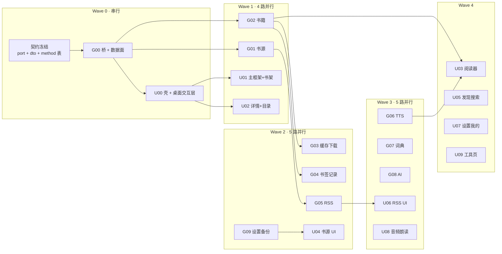

# 模块划分与并行开发规划 v1

> 配套文档：`TECH-SELECTION.md` v3（选型与 UI 基准）。本文只解决一件事：
> **非 UI 逻辑全部下沉 Go 之后，代码怎么切模块、怎么用 worktree 交给多个模型并行实现而不打架。**

---

## 0. 约束来源

| # | 约束 | 对工程形态的影响 |
|---|---|---|
| 1 | 非 UI 功能的代码**全部转 Go**，除非有性能问题 | Dart 层收缩为「渲染 + 平台 API 调用」；大量原本会写进 Dart 的业务逻辑改为 Go 模块 |
| 2 | 模块划分要支持 **worktree 多模型并行** | 目录必须**按模块隔离**，共享文件必须极少且冻结；依赖必须分层（下层先冻结契约） |
| 3 | UI 基准 = 原版 legado（`app/`） | UI 模块按原版功能域切，不按 desktop 的页面切 |
| 4 | **headless 能直接完成书源解析与调试验证** | 业务能力先经 CLI 验证再给 UI；调试数据必须是结构化事件，CLI 与 UI 消费同一份（`ARCHITECTURE-V2` §5） |

---

## 1. 硬约束：什么必须下沉 Go

### 1.1 判定规则（三问，命中任一即下沉）

1. **需要持久化吗？**（写库、写文件、写配置、算缓存键）
2. **需要跨页面/跨进程一致吗？**（阅读进度、播放队列、书源列表、当前主题）
3. **需要被引擎理解或参与规则求值吗？**（文本分段、简繁转换、过滤条件、排序键）

三问全否，才允许留在 Dart。

### 1.2 一句话版本

> **Dart 只允许持有「渲染所需的临时状态」；凡是需要落盘、需要跨页共享、需要单测的业务规则，一律 Go。**
> 现有 Vue 代码里那些「看起来像 UI 其实不是」的逻辑（见 §1.3），就是这条规则的试金石。

### 1.3 现有前端里的违约实例（迁移时必须下沉）

| 文件 | 行数 | 为什么不是 UI |
|---|---|---|
| `stores/audioPlayer.ts` | 802 | 播放队列、续读定位、进度落盘时机 —— 状态机属业务 |
| `stores/tts.ts` | 375 | 朗读分段顺序、断点续读、跨书会话 —— 需要跨页一致 + 落盘 |
| `utils/sourceList.ts` | 246 | 书源过滤/分组/模糊匹配 —— 全项目唯一一份规则，必须与 Go 侧同源 |
| `utils/readerPrefs.ts` | 140 | 偏好默认值合并与迁移 —— 配置语义 |
| `stores/sourceCheck.ts` | 105 | 书源可用性校验 —— 有单测的业务规则 |
| `tts/text.ts` | 143 | 句子切分（标点/长度/中英混排）—— 纯字符串算法 |
| `utils/chapterProgress.ts` | 46 | 百分比与章节内偏移换算 —— 需与引擎一致 |
| `tts/domSegment.ts` | 272 | 阅读器原生化后**整体作废**（依赖 DOM 坐标） |

合计约 **1,860 行**要从「Dart 重写一遍」改为「Go 新增实现」。

### 1.4 允许留在 Dart 的白名单（性能/平台例外）

| 允许 | 理由 | 边界 |
|---|---|---|
| 排版测量与分页 | `TextPainter.computeLineMetrics` 只能在 UI isolate 跑 | 只做测量与绘制，文本内容仍来自 Go |
| 手势 / 动画 / 滚动位置 | 渲染层固有 | 不产生持久化副作用 |
| 图片解码与内存缓存 | Flutter engine 的 `ImageCache` | 缓存策略（TTL/配额）在 Go |
| 系统 TTS 合成播放 | 平台 API（Android TTS / SAPI / espeak） | **分段与规则在 Go**，Dart 只喂文本并回传进度 |
| 音频播放控制 | `media_kit` / `audio_service` 是平台能力 | **队列与续读在 Go**，Dart 只执行 play/pause/seek |
| 文件选择器 / 权限 / 分享 / 剪贴板 | 平台 API | 路径与文件操作语义在 Go |
| 输入法、窗口、DPI | 平台 API | — |

### 1.5 违约检查（CI gate，可 grep）

在 CI 里对 `client/lib/**` 跑以下规则，命中即失败：

```
禁止：sqlite / sqflite / drift          （数据库只能在 Go）
禁止：dio / http 直连业务接口           （网络请求只能在 Go）
禁止：dart:io File/Directory 直接操作书库文件
禁止：Path.join(书库根目录)             （路径语义在 Go）
禁止：RegExp 解析书源规则 / HTML / RSS
禁止：shared_preferences 存业务数据     （只能存 UI 偏好，如窗口位置）
```

> 例外白名单写在 `client/analysis_options.yaml` 的注释里，新增例外需在 PR 说明理由。

### 1.6 大对象传输：别让「全下沉」撞上 JSON 拷贝

全下沉会把大块数据推过 FFI 边界，必须有明确分流：

| 数据 | 大小量级 | 通道 |
|---|---|---|
| 控制指令、列表、设置、状态 | < 64 KB | **FFI JSON**（`LegadoCall`） |
| 章节正文、EPUB 资源、备份包 | 30 KB ~ 数 MB | **loopback HTTP**（`GET /content/<bookId>/<idx>`） |
| 图片、音频流 | 50 KB ~ 数十 MB | **loopback HTTP**（`/img`、`/stream`，支持 Range/206） |
| 事件推送 | 小 | **SSE**（`/events`） |

原则：**FFI 只走控制面，数据面一律 HTTP**。这样 Android（gomobile 只能传 byte[]，有拷贝）与桌面（c-shared 可零拷贝）不必分叉，
也避免「为了不拷贝而写两套序列化」。

---

## 2. 现状盘点：谁已经下沉了

| 域 | Go 侧现状 | 结论 |
|---|---|---|
| **headless 调试链路** | `legado-go/cmd/legado` 已有 9 个子命令（含 `debug`：4 种入口 + `-stage` + `--json` JSONL + `-save-dir`） | 🟡 **能力已有，待升级为结构化 Trace**（`ARCHITECTURE-V2` §5.4） |
| 规则引擎 / JS / 网络 / 源解析 | `legado-go/pkg/*` 12.3k 行 | ✅ 已完成，冻结 |
| 书源管理 / 登录 / 调试 / 订阅 / 替换规则 | `app/source*.go`、`subscription.go`、`replacerule.go`（约 2.4k 行） | ✅ 已有，补少量方法 |
| 书架 / 正文 / 阅读器语义 | `bookshelf.go`、`library.go`、`content.go`、`reader.go` | ✅ 已有 |
| 缓存 | `cache.go` 736 行 | ✅ 已有，缺下载队列 |
| 音频 / 音频缓存 | `audio.go`、`audio_cache.go` | ✅ 已有 |
| 词典 / ECDICT | `dict*.go` 约 1.8k 行 | ✅ 已有 |
| AI 全栈 | `ai*.go` 约 2.4k 行 | ✅ 已有 |
| WebDAV | `webdav*.go` | ✅ 已有 |
| **RSS 全套** | ❌ 无 | **新增（最大缺口）** |
| **书签 / 阅读记录 / 进度同步** | ❌ 无 | 新增 |
| **TXT 目录规则 / 简繁转换 / 字体管理** | ❌ 无 | 新增 |
| **下载管理器（队列/重试/并发）** | ❌ 无 | 新增 |
| **TTS 引擎（分段/规则/HTTP TTS/缓存）** | ❌ 无（前端 1.2k 行） | 新增 |
| **备份恢复 / 文件管理 / 内置 Web 服务** | ❌ 无 | 新增 |
| **设置中心（Schema + 读写）** | ❌ 无（前端分散） | 新增 |

---

## 3. 目标目录结构

> 与 `ARCHITECTURE-V2.md` 对齐：业务实现收敛到 `core/`，宿主放 `hosts/`，UI 放 `client/`。
> 迁移按 ARCHITECTURE-V2 §9 的 5 步执行（M1 搬骨架 → M2 换装配 → M3 逐模块 → M4 CLI → M5 FFI/HTTP）。

```
legado/
├── app/                          # 原版 Kotlin —— 只读参照（UI 基准）
├── legado-go/                    # 规则引擎 —— 冻结，core 依赖它
├── core/                         # ★ 唯一业务实现
│   ├── kernel/                   # ★模块注册 · Trace 总线 · 错误码 · 环境
│   ├── domain/                   # ★领域模型（冻结）
│   ├── ports/                    # ★出站接口（冻结）
│   ├── usecase/                  # 跨模块编排
│   ├── modules/<域>/             # 各模块独占目录（service / migrate / commands）
│   ├── adapters/                 # sqlite / httpx / epub / rssparse / …
│   └── engine/                   # legado-go 边界封装
├── hosts/
│   ├── cli/                      # headless：probe / trace / bench / repl / serve / schema
│   ├── ffi/                      # c-shared / gomobile
│   └── http/                     # /content /img /stream /events /debug/*
├── client/                       # ★Flutter UI
│   ├── lib/core/                 # ★壳层：桥客户端、路由表、主题、i18n、通用组件
│   └── lib/features/<域>/        # 各 UI 模块独占目录
└── desktop/                      # 过渡期 Wails 壳（M5 后冻结）
```

★ = 冻结共享区（§6.3）。**除这些位置，任何模块只碰自己的目录。**

> 迁移期的额外冻结项：`desktop/internal/app/dto/` 在 M3 完成前仍是共享区
> （它逐模块搬去 `core/modules/<域>/dto.go`，搬完一个才解冻一个）。

---

## 4. 模块划分

### 4.1 Go 业务模块（`core/modules/`）

| ID | 模块 | 独占目录 | 依赖 | 人日 |
|---|---|---|---|---|
| **G00** | 内核与桥 | `core/kernel/`、`hosts/ffi/`、`hosts/http/` | 无 | 10 |
| **G01** | 书源域 | `core/modules/source/` | G00 | 4 |
| **G02** | 书籍与正文 | `core/modules/book/`、`core/modules/chapter/` | G00 | 6 |
| **G03** | 缓存与下载 | `core/modules/cache/` | G02 | 6 |
| **G04** | 书签·记录·进度 | `core/modules/bookmark/`、`core/modules/shelf/` | G02 | 5 |
| **G05** | RSS 域 | `core/modules/rss/`、`core/adapters/rssparse/` | G00 | 10 |
| **G06** | TTS 引擎 | `core/modules/tts/` | G00 | 6 |
| **G07** | 词典域 | `core/modules/dict/`、`core/adapters/dictsqlite/` | G00 | 3 |
| **G08** | AI 域 | `core/modules/ai/` | G00 | 4 |
| **G09** | 设置·备份·文件·Web 服务 | `core/modules/settings/` | G00 | 8 |
| **G10** | 数据与网络适配 | `core/adapters/sqlite/`、`httpx/`、`epub/`、`core/modules/platform/` | G00 | 4 |
| **G11** | **headless CLI** | `hosts/cli/` | G00 | 6 |

Go 侧合计 **72 人日**。

> G00 从 8 升到 10、并新增 G11，是因为 `ARCHITECTURE-V2` 把「模块注册表 + Trace 总线 + 命令行」提升为一等公民 ——
> 这部分投入换来的是「新增模块零改宿主」和「CLI 可直接验证书源」。

### 4.2 Flutter UI 模块（`client/lib/features/`）

| ID | 模块 | 独占目录 | 依赖 | 人日 |
|---|---|---|---|---|
| **U00** | 壳与基础设施 | `client/lib/core/`（路由、主题、i18n、桥客户端、通用组件、**桌面交互层**） | G00 | 12 |
| **U01** | 主框架 + 书架 | `client/lib/features/shelf/`、`features/shell/` | U00, G02 | 9 |
| **U02** | 详情·目录·换源 | `client/lib/features/book/` | U00, G02 | 6 |
| **U03** | 阅读器 | `client/lib/features/reader/`（分页、5 种翻页、23 项菜单、配置面板） | U00, G02, G04, G06 | 22 |
| **U04** | 书源管理·编辑·调试 | `client/lib/features/source/` | U00, G01 | 11 |
| **U05** | 发现 + 搜索 | `client/lib/features/explore/`、`features/search/` | U00, G01, G09 | 8 |
| **U06** | RSS UI | `client/lib/features/rss/` | U00, G05 | 8 |
| **U07** | 设置 + 我的 | `client/lib/features/settings/`、`features/me/` | U00, G09 | 8 |
| **U08** | 音频 + 朗读 UI | `client/lib/features/audio/`、`features/tts/` | U00, G06, G10 | 8 |
| **U09** | 工具页 | `client/lib/features/tools/`（缓存/书签/记录/文件/导入/登录/关于） | U00, G03, G04, G09 | 9 |

UI 侧合计 **101 人日**。

> U04「书源调试」页是 **Trace 总线的消费者**（`ARCHITECTURE-V2` §5.1）：
> 它订阅 `/debug/session/{id}/events`，不含任何解析逻辑。CLI 的 `source trace` 与它读同一份事件流。

### 4.3 依赖图



> 关键：**U03 阅读器（22 人日）是全项目最长关键路径**，在 W2 就用 mock 数据启动排版，不等 Go 侧全好。

---

## 5. 桥契约（Wave 0 冻结）

### 5.1 方法命名

`<Domain>.<Verb>`，Domain 与模块一一对应。**方法表不是手写的，而是各模块在 `Register()` 里声明、
由 `legado schema -o methods.json` 导出**（见 `ARCHITECTURE-V2` §4.2、§6）—— 这样契约只有一份，Dart 侧按导出结果生成常量。

```
Source.List / Source.Get / Source.Save / Source.Debug / Source.Check / Source.Import
Book.List / Book.Get / Book.Add / Book.Update / Book.Remove / Book.Progress.Set
Chapter.List / Chapter.Content / Chapter.Refresh / Chapter.Cache / Chapter.Prev / Chapter.Next
Cache.Task.Add / Cache.Task.List / Cache.Task.Cancel
Bookmark.List / Bookmark.Add / Bookmark.Remove
Record.List / Record.Append
Rss.Source.List / Rss.Article.List / Rss.Favorite.Add
Tts.Segment / Tts.Speak.Start / Tts.Speak.Stop / Tts.Session.Resume
Dict.Query / Dict.Rule.List
Ai.Chat / Ai.Index.Build / Ai.Retrieve
Settings.Get / Settings.Set / Settings.Schema
Backup.Create / Backup.Restore / Backup.WebDav.Push
File.List / File.Import / File.Delete
Account.Cookie.Get / Account.Login / Account.Challenge.Submit
```

### 5.2 统一信封

```json
// 请求
{"id": 17, "method": "Chapter.Content", "params": {"bookId": 3, "index": 12}}
// 响应
{"id": 17, "ok": true, "data": {...}, "err": null}
// 错误
{"id": 17, "ok": false, "err": {"code": "SOURCE_EMPTY", "msg": "正文规则未命中"}}
// 事件（SSE，无 id）
event: progress
data: {"taskId": "cache-3", "done": 12, "total": 88}
```

规则：**`data` 里只放 `dto` 包已定义的结构**；新增结构必须先改 `dto`（共享区，走契约变更流程）。

### 5.3 契约冻结物清单

| 文件 | 内容 | 谁可以改 |
|---|---|---|
| `core/ports/*.go` | 出站接口 | 仅契约负责人，Wave 边界串行 |
| `core/domain/*.go` | 领域模型 | 同上 |
| `core/modules/<域>/dto.go` | 该模块的传输结构 | 模块 owner；**被其他模块引用时视为契约**，需走变更流程 |
| `core/kernel/registry.go` | 注册表机制本体 | 仅 G00 |
| `client/lib/core/bridge/api.dart` | Dart 侧方法常量 | 由 `legado schema` 导出，仅 U00 更新 |
| `client/lib/core/router/routes.dart` | 28 条路由 | 仅 U00 |

---

## 6. worktree 并行方案

### 6.1 波次与占用

| 波次 | 并行数 | 内容 | 出口条件 |
|---|---|---|---|
| **W0**（3 周，串行） | 1 | `ARCHITECTURE-V2` M1+M2（建 `core/` 骨架、kernel 注册表、Boot 装配）+ 契约冻结 + G00 桥 + U00 壳 + `client/` 工程跑通一次 `getVersion` 往返 | `flutter run` 能列出真实书架；`legado source probe` 能跑通同一书源 |
| **W1**（3 周） | 4 | G01、G02、U01、U02 | 书架→详情→目录 可读通（阅读器先用纯文本占位） |
| **W2**（3 周） | 5 | G03、G04、G05、G09、U04 | 缓存可下、RSS 可拉到文章、书源可编辑保存 |
| **W3**（4 周） | 5 | G06、G07、G08、U06、U08 | 朗读出声、词典可查、RSS 可读 |
| **W4**（4 周） | 5 | U03（跨波）、U05、U07、U09 | 阅读器 5 种翻页与 23 项菜单齐活 |
| **W5**（3 周） | 2~3 | 联调、打包、性能、8 语言 | 三端可发 |

### 6.2 分支与 worktree 约定

```
分支命名：feat/G05-rss          feat/U03-reader
worktree：../wt/G05-rss          ../wt/U03-reader
合并目标：均合并到 flutter
合并顺序：同波次内按「Go 先、UI 后」，波次间严格顺序
```

每个 worktree 只允许：
1. 改自己模块的目录（§4 表里的「独占文件/目录」）
2. 新增自己模块的测试文件（同目录 `_test.go` / `_test.dart`）
3. **不得**改共享区（§5.3）、`pubspec.yaml`、`go.mod`、`Taskfile*`、根级配置

### 6.3 冲突预防（这是并行成败的关键）

| 冲突源 | 规则 |
|---|---|
| **依赖新增**（`go.mod` / `pubspec.yaml`） | W0 一次装齐；后续需要新依赖 → 提「依赖申请」，每周一次窗口串行合并（否则 `pubspec.lock` 天天冲突） |
| **dto 结构变更** | 契约变更流程：模块提出 → 契约负责人在 W 边界统一改 → 广播 → 各分支 rebase |
| **method / 路由注册** | 由各模块在自己的 `Register()` 内声明，**天然无冲突**（这是模块自描述的直接收益）；只有跨模块共享的 `dto` 需要契约变更 |
| **路由表** | U00 在 W0 就把 28 条路由页占位好（空 Widget），后续模块只替换实现 |
| **主题/通用组件** | 归 U00 所有；其他模块需要新组件 → 提给 U00，不许各自造 |
| **i18n 文案** | 按模块前缀划分 key 空间：`source.*`、`reader.*`、`rss.*`，各自只加自己的前缀 |
| **SQLite schema** | 归 G00/G02；新表一律加到统一 migration 文件，模块不能自建 `CREATE TABLE` |

### 6.4 每个模块的任务包（直接给模型用）

给每个并行单元的 prompt 必须包含以下五段，缺一不可：

```
【范围】只能改 <目录>，不得改 port/ dto/ bridge/ routes.dart/ pubspec.yaml
【输入契约】列出该模块可调的 method 与其 dto 字段（从 §5 抄）
【产出】文件清单 + 对外暴露的 widget/函数签名
【验收】go test ./internal/app/... -run <模块>  &  flutter test test/<模块>
【禁止】不得写 SQL、不得直接发 HTTP、不得引第三方状态管理库（统一用 U00 的）
```

示例（G05 RSS）：

> **G05 RSS 域**：只改 `core/modules/rss/`（`module.go` / `service.go` / `dto.go` / `migrations/`）与 `core/adapters/rssparse/`。
> 实现 `Rss.Source.List/Save`、`Rss.Article.List/Refresh`、`Rss.Favorite.*`，并在 `Register()` 里同时挂
> CLI（`rss list`）与 HTTP 路由；解析支持 RSS 2.0 / Atom，复用 `core/adapters/httpx` 与 `legado-go/pkg/rule` 的 CSS 能力。
> **不要改 `core/ports`、`core/kernel`、`hosts/*`、`client/*`**；若需新 dto，加在模块自己的 `dto.go`。
> 验收：`go test ./core/modules/rss/...` + `./legado rss list --json`（headless 必须能跑）。

### 6.5 每波合并检查（防止并行返工）

| 检查 | 命令 |
|---|---|
| Go 全量编译 + 测试 | `go build ./... && go test ./internal/... ./pkg/...` |
| Dart 静态检查 | `flutter analyze && flutter test` |
| 违约扫描（§1.5） | `grep -rE "sqflite\|dio\|dart:io" client/lib/` 应为 0 命中（白名单除外） |
| 契约未变 | `git diff flutter -- core/ports core/domain client/lib/core/bridge` 应为空 |
| **headless 可用** | `./legado source probe -entry "search:<关键词>" --json` 对该波次涉及的域必须跑通（不依赖 UI） |
| 体积回归 | 记录 exe/apk/AppImage 大小，超预算 5% 即复盘 |

---

## 7. 工期与并行收益

| 方案 | 人日 | 日历工期 | 说明 |
|---|---|---|---|
| 单人串行 | 173 | **27 周** | v3 估算 + 内核/CLI 增项 |
| 3 路并行 | 173 | ~19 周 | 受 U03 阅读器（22 人日）制约 |
| **4~5 路并行（推荐）** | 173 | **16~18 周** | W0 3 周 + 5 波 + 联调；摩擦成本约 +25% |
| 6 路以上 | 173 | 不再下降 | 契约与合并开销吃掉收益，共享区竞争加剧 |

结论：**并行 4~5 路是甜点**。全项目最长关键路径是 **U03 阅读器**，所以它必须在 W2 就启动（不等 Go 侧全好，用 mock 数据先做排版）。

> CLI 那 6 人日（G11）不要省：它既是 headless 验收手段，也是并行开发时每个 Go 模块的**自测入口**，
> 没有它，模块质量只能等 UI 接上才发现问题。

---

## 8. 风险

| 风险 | 概率 | 影响 | 对策 |
|---|---|---|---|
| 「全下沉」导致 Dart 层退化成 RPC 套壳，页面转圈变多 | 中 | 中 | 允许 UI 层缓存只读列表（内存态）；批量接口（`Book.List` 一次带进度与分组）减少往返 |
| 大正文走 JSON 卡顿 | 中 | 高 | §1.6 通道分流；正文一律 HTTP，禁止塞进 `LegadoCall` |
| 并行分支 `pubspec.lock` / 依赖冲突 | 高 | 中 | 依赖集中 W0 装齐 + 每周一次窗口 |
| 各模块自造轮子（主题、对话框、列表） | 高 | 中 | U00 先冻结通用组件库，评审时拒收自造组件 |
| Android 平台能力被误判为「非 UI 逻辑」 | 中 | 中 | §1.4 白名单写死；前台服务/通知/唤醒锁必须留原生 |
| 契约在 W2 后频繁变更导致全体 rebase | 中 | 高 | 契约变更只在波次边界处理；W0 宁可多花 2 天把 method 表定全 |
| 模型并行产出质量不一致 | 高 | 中 | 每模块强制验收命令 + 合并检查（§6.5），不达标不进主干 |

---

## 9. 下一步

1. 你确认模块切分与波次安排（尤其 **U03 提前启动**、**依赖集中 W0** 两条）。
2. 我出 W0 的施工清单：`port` 接口全表、`dto` 结构全表、`bridge` 分发骨架、`client/` 工程骨架、28 条路由占位。
3. W0 完成后，每个 worktree 直接拿 §6.4 的任务包开工。
