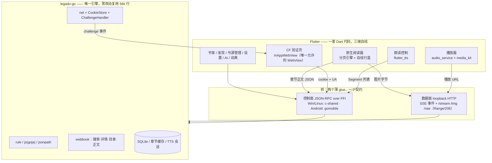
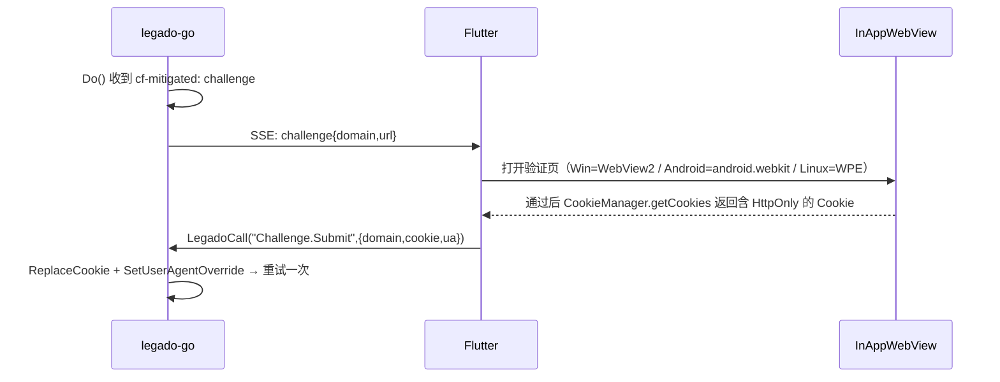

# Legado 跨端技术选型重规划 v2

> **变更记录**
> - v1（同日早些）：以「保留 Vue 阅读器」为前提，推荐 Flutter + legado-go。
> - **v2（本版）**：按新约束重排 —— ①不限 Golang 生态，任何成熟生态都可评估；②**包体与内存都要小、交互要流畅**；
>   ③**阅读器 100% 原生重写**（不得再装 WebView）；④平台 = Windows + Android + **Linux**，macOS/iOS 只要求
>   技术栈支持、本期不实现；⑤本轮**只做规划，不写代码**。
>
> 现状基线（可对比）：`legado-go` 19.6k 行 / `desktop` Go 36.3k 行 / Vue 15.2k 行 / 安卓宿主 Java 4.1k 行；
> 产物 **Windows exe 35 MB**（不含系统 WebView2）、**Android APK 45 MB**。

---

## 1. 结论（TL;DR）

1. **推荐：Flutter 做全部 UI + `legado-go` 作为 C ABI 引擎**（Windows `c-shared DLL` / Android `gomobile AAR` / Linux `c-shared .so`）。
2. **阅读器 100% 原生可行，但要认清它是一项独立工程**：分页、断行、两端对齐、标点挤压都要自己做。
   Flutter 走 SkParagraph(UAX #14)，**基础「避头尾」自动就有**，缺的是**标点挤压/悬挂 + 中文两端对齐**，
   用「测量后处理」方案可在 3~4 周做出可读版本，8 周接近现版观感（详见 §6）。
3. **Linux 是本轮最大的不确定性**：CF 验证需要真浏览器，Linux 上只能是 WebKitGTK（+约 30 MB 依赖），
   且 Flutter Linux 的**中文输入法（fcitx5/ibus）**有已知缺陷 —— 这两条必须在 PoC 里先验，不通过则 Linux 降级。
4. **包体/内存不会因此变好**：Windows 预计 35 MB → **55~70 MB**（多了 Flutter 引擎与 libmpv），
   内存大致持平（Wails 的 WebView2 也是多进程）。换来的是**流畅度、原生交互、能力完整（Cookie/TTS/后台音频/视频解码）**。
   若「体积小」是压倒性指标，唯一能显著下降的是 Rust 方案，但工期要 12 个月以上（§3）。
5. **引擎不要换语言**：56k 行 Go 是最大资产，重写等于把 1988 条书源的适配经验清零。选型自由度用在 UI/壳层即可。
6. **仍然建议先补 Wails 的 Cookie API**（1 周，独立 PR）：它既是当前唯一功能性缺陷的解，也是迁移期的功能保底。

---

## 2. 约束 → 否决条件

| 你的要求 | 转化成的硬条件 | 直接出局的方案 |
|---|---|---|
| 跨端同代码 + 原生 native | 一套 UI 代码，自绘/原生渲染，不用 WebView 当渲染层 | Wails v3、Tauri v2、Electron（均为 L1） |
| 阅读器 100% 原生 | 排版引擎必须可自绘可介入（行盒、字宽、分页可编程） | 依赖 WebView 的排版（含「阅读器留在 WebView」的所有变体） |
| 书源执行（CSS/XPath/JSONPath/**JS**） | 需要成熟 JS 引擎 + HTML 解析 + JSONPath | 无成熟 JS 嵌入的栈（如纯 Dart 自研、纯 Python 打包） |
| 朗读 TTS | 三端都要能拿到**系统** TTS | 桌面无系统 TTS 绑定的栈（JVM/CMP 桌面端） |
| 音视频源 | 需要能解 H.265/ASS 的播放内核 + 安卓后台播放 | 只靠系统 WebView 解码的方案 |
| Cloudflare 验证 | 三端都要有**能读 HttpOnly Cookie** 的真浏览器 | 无 Cookie API 的壳（Wails）、Android 恒空的（Tauri） |
| 包体/内存小 | 运行时不能太重（排除 JVM/JCEF 级） | Compose Multiplatform（JBR+JCEF）、Electron |
| Win + Android + Linux，mac/iOS 预留 | 框架必须**现在**就覆盖这 5 个平台 | 只覆盖两端的（Wails 的 Linux 是 GTK WebKit，Android 能力差） |

---

## 3. 候选池六维矩阵

| 维度 | P1 Wails3 加固 | **P2 Flutter + Go** | P3 CMP + Kotlin 引擎 | P4 Avalonia(.NET) + Go | P5 Rust + Slint |
|---|---|---|---|---|---|
| 原生渲染 | ❌ WebView | ✅ L2 | ✅ L2 | ✅ L2 | ✅ L2 |
| 阅读器可全自研 | ❌ | ✅ TextPainter 可介入 | ✅ Skia 可介入 | ✅ TextLayout 可介入 | ✅ 但排版库几乎空白 |
| 引擎复用 | ✅ Go 100% | ✅ Go 100% | ❌ 换回 Kotlin（源零适配） | ✅ Go（P/Invoke） | ❌ 全重写 |
| 三端系统 TTS | 🟡 靠桥 | ✅ `flutter_tts`（Android TTS / Win SAPI / Linux 需 espeak 或云端） | 🟡 Win/Linux 无绑定 | ✅ System.Speech(Win)+平台互操作 | 🟡 自接各平台 API |
| 音视频 | ❌ 受 WebView 解码 | ✅ `media_kit`(libmpv) + `audio_service` | ✅ Media3/VLCJ | ✅ LibVLCSharp（+80MB） | ✅ libmpv/gstreamer 绑定 |
| **CF 三端 Cookie** | 🟡 需 fork 补 API | ✅ `inappwebview`：Win=WebView2、Android=android.webkit、Linux=WPE WebKit | 🟡 JCEF（Win/Linux 重） | 🟡 依赖第三方 WebView 控件 | ❌ 无浏览器（需自带 CEF） |
| 包体（Win/Android/Linux） | 35 / 45 / — MB | 55~70 / 25~30 / 60~80 MB | 200+ / 35 / 250+ MB | 70 / 40 / 80 MB | **15 / 18 / 20 MB** |
| 内存（Win 稳态） | ~150 MB | ~110~140 MB | ~250 MB+ | ~120 MB | **~60 MB** |
| 单人可交付工期（到功能对齐） | — | **5~7 个月** | 7~9 个月 | 9~12 个月（Android 成熟度低） | 12+ 个月 |
| 结论 | 保底/过渡 | **推荐** | 工期与体积双输（JBR+JCEF） | 备选（单语言、控件最原生） | 仅当体积压倒工期 |

> 关键否决证据
> - **P3**：桌面端必须打包 JetBrains Runtime + JCEF（+150~250 MB），TTS 在 Win/Linux 无系统绑定；三项硬指标（体积、内存、TTS）同时失分。
> - **P4**：Avalonia 移动端（Android）成熟度仍是短板，WebView/媒体要靠 LibVLCSharp（+80 MB）；优点是单一语言与更强的控件感，若 P2 的排版或插件踩雷可作为退路。
> - **P5**：`cosmic-text` 只解决 shaping + 基础断行，两端对齐/标点挤压/翻页动画全部自研；单人 12 个月起，风险不可控。
> - **P1**：不满足「原生」与「阅读器 100% 原生」两条硬约束，只能当过渡。

---

## 4. 目标架构（P2）



### 4.1 桥契约（一次定死，双端同源）

```go
// bridge 只暴露一个统一入口，绕开 gomobile 的类型限制
//export LegadoCall
func LegadoCall(req *C.char) *C.char   // {"id":1,"method":"Chapter.Content","params":{...}}
//export LegadoFree
func LegadoFree(p *C.char)
```

- 出包：Windows/Linux `go build -buildmode=c-shared`；Android `gomobile bind -target=android`
  （gomobile **没有 windows/linux target**，两端 glue 必须分开，但契约同一份 JSON schema）。
- 数据面：Go 起 loopback HTTP（端口在握手时返回），SSE 推事件，`/stream` 供播放器拉流派生。
  Android 需 `network_security_config` 放行 `127.0.0.1` cleartext。
- 附带收益：`asset_url.go` 那套「参数编进路径段」的安卓 hack、`bindings/` 生成物、Wails 事件总线全部退役。

### 4.2 Cloudflare 验证链路



三条铁律（都是踩过的）：**UA 与验证窗口必须一致**；**优先复用已有 cookie 再弹窗**；**2xx 不判挑战**。

---

## 5. 什么是「100% 原生阅读器」——范围界定

| 必须原生 | 可以不做（写进范围） |
|---|---|
| 分页（按容器高度/多栏）、翻页动画（覆盖/滑动/无） | 仿真书页卷曲动画（后期可选） |
| 中文断行 + 基础避头尾（UAX #14 自带） | 竖排、注音/ルビ |
| 两端对齐、标点挤压/悬挂（自研后处理） | 中西文混排的出版级字距微调 |
| 字号/行距/字距/段距/首行缩进/背景主题 | 可重排 EPUB 的完整 CSS 子集 |
| 图片/漫画混排、PDF（`pdfrx`） | 双页对开（后期） |
| TTS 逐字高亮、点击查词、书签/进度 | — |

---

## 6. 原生阅读器排版设计（本轮新增，最关键）

### 6.1 数据流水线

```
章节文本 ──解析──▶ Paragraph[]（样式/图片/锚点）
        ──测量──▶ LineBox[]（baseline, height, x 进给, 每字 advance）
        ──分页──▶ Page[]（行区间 + 段首缩进修正）
        ──绘制──▶ CustomPainter（逐行 paint，行级缓存）
```

要点：**不自己实现断行算法**，用 `TextPainter.computeLineMetrics()` 拿到行盒（SkParagraph 已实现 UAX #14，
`、。，」』）…` 这类行首禁则字符天然被挡在行尾），再在我们自己的 `LineBox` 层做后处理。

### 6.2 两个「Flutter 不给你、必须自己做」的点

| 缺失能力 | 实现方案 | 复杂度 |
|---|---|---|
| **两端对齐**（中文单字即断点，`TextAlign.justify` 效果差） | 每行 `(版心宽 − 自然宽) / (断点数)` 分配到字间隙；混排英文按词间空格分摊，行末不做 | 中 |
| **标点挤压 / 悬挂** | 行首命中禁则集 → 把上一行末字符 advance 压到 0.5 字宽（挤压）；或把该标点画到版心外（悬挂）。二选一，配置项 | 中 |
| 分页粒度 | `computeLineMetrics` 累加高度，超页即切；段首缩进与孤行（末段仅 1 行则回退一段）单独处理 | 中 |
| 分页缓存 | key = `(fontFamily, fontSize, lineHeight, letterSpacing, 版心W/H, 缩进)` 哈希；变更后丢缓存并**在 isolate 里**全量重排 | 低 |
| TTS 高亮 | 用 LineBox 内累加 advance 取字矩形（比 `getBoxesForSelection` 更快且不依赖 TextPainter 存活） | 低 |
| 图片混排 | 段内 `ImageSpan` 先按宽高比占高 → 影响该段行盒 → 重排当页 | 中 |

### 6.3 性能预算（验收线）

| 指标 | 目标 | 做法 |
|---|---|---|
| 单章 5000 字首次分页 | ≤ 60 ms | isolate + 分块测量（每 500 字一次 `computeLineMetrics`） |
| 翻页 | ≤ 8 ms/帧 | 行级 `RepaintBoundary` + 预绘制下一页 |
| 字号切换后重排 | ≤ 150 ms（可感知但不阻塞） | 后台 isolate，先出骨架再替换 |
| 100 章目录滚动 | 稳定 60 fps | `ListView.builder` + 固定行高 |
| 内存（阅读页） | ≤ 80 MB 增量 | 只保留当前章 + 上下各一章行盒 |

### 6.4 工期与观感预期

| 阶段 | 内容 | 产出 |
|---|---|---|
| R1（1.5 周） | 分页 + 滚动/覆盖两种模式 + 主题/字号/行距 + 进度 | 「能读」 |
| R2（1.5 周） | 两端对齐 + 标点挤压 + 孤行处理 + 图片混排 | 「像正经阅读器」 |
| R3（1 周） | TTS 高亮、查词选区、书签、进度落盘 | 功能对齐 |
| R4（1 周） | 漫画（`photo_view`）/ PDF（`pdfrx`）/ 缓存与预取 | 全类型覆盖 |
| 持续 | 观感打磨（与现 Vue 版逐屏对比） | 8 周后接近现版 |

> 诚实提示：Flutter 排版在**字体 hinting、亚像素字距、标点悬挂**上不如 WebView/CSS。做到「一致」需要逐屏对比调参；
> 做不到时要接受「近似」而不是「相同」。这是选择 100% 原生必须付的账。

---

## 7. Linux 专项（本轮最大风险）

| 议题 | 现状/结论 | 处置 |
|---|---|---|
| **CF 验证用什么浏览器** | `flutter_inappwebview` Linux 走 **WPE WebKit**，依赖 `webkit2gtk`（约 +30 MB）；社区实践（enjoy_player）因该依赖在默认 Ubuntu 上需 apt 装而在 Linux 上**关闭了 WebView 功能** | 打包进 AppImage（自带 .so）；否则 Linux 端降级为「用系统浏览器打开验证页 + 手工导入 cookie」 |
| **中文输入法** | Flutter Linux 的 IM 走 GTK im module，fcitx5/ibus 有已知缺陷（候选窗位置、组合串丢失）；书源编辑页影响最大 | PoC 必测 fcitx5；不达标则书源编辑在 Linux 上退化为「导入 JSON 文件」 |
| 媒体解码 | `media_kit` 自带 `libmpv.so`；Wayland + 混合显卡需 `hwdec=auto-safe` + 关硬件加速（社区已验证） | 沿用该配置 |
| 打包分发 | AppImage（`appimagetool`）为唯一一等公民；需自带 ffmpeg 供探测 | 打 AppImage，不做 deb/rpm/flatpak |
| 系统 TTS | 无统一 TTS；`flutter_tts` Linux 支持弱 | Linux 走「云端 TTS / 预生成音频」+ 可选 `espeak-ng` 兜底 |
| 字体 | Linux 缺中文字体时排版崩塌 | 内置思源黑体子集（+3~5 MB）或运行时探测并提示 |

---

## 8. 包体 / 内存预算

| 平台 | 组成 | 估算 | 对比现状 |
|---|---|---|---|
| **Windows** | Flutter 引擎 20 + app 6 + Go 18 + libmpv 28（可选） + 图标资源 | **55~70 MB** | 35 MB ↑ |
| **Android（arm64 单 ABI）** | Flutter 10 + Go AAR 13 + 插件 5 | **25~30 MB** | 45 MB ↓ |
| **Linux AppImage** | Flutter 22 + Go 18 + libmpv 28 + webkit2gtk 30 + 字体 4 | **60~80 MB** | 新增 |
| 内存（Win 稳态，书架+阅读） | Flutter ~70 + Go heap ~40 + 图片缓存 | **110~140 MB** | ~150 MB ↓ 略 |

降体积手段：Windows/Linux 不内置 libmpv（改用系统 libmpv/ffmpeg，写清依赖）；Android 用 `abiSplit`；字体子集化。

---

## 9. 迁移路线（本轮只规划）

| 阶段 | 内容 | 验收 | 可回滚 |
|---|---|---|---|
| **A（1 周，先做）** | Wails fork 补 `WebviewWindow.GetCookies()`（内部 `edge.Chromium.GetCookieManager()` 现成），`verifywails` 降级为 fallback，去掉常开调试端口 | CF 站点验证后 3 次内通过 | 独立 PR |
| **B（3 周 PoC，可丢弃）** | ①三端 FFI 打通（同一书源：搜索→目录→正文）②三端 CookieManager 拿 `cf_clearance` ③Android 后台播放 30 min ④**Linux fcitx5 中文输入** ⑤阅读器分页原型（1 章 5000 字 ≤60 ms） | 5/5 通过才进 C；任一失败即回到 P1 或降级对应平台 | 删 `poc/` |
| **C（6 周）** | Flutter 壳：书架/详情/阅读器 R1+R2/书源列表/设置；三端同书源 diff 对照 | 日常阅读可脱离 Wails 版 | Wails 版继续发 |
| **D（6 周）** | 书源三栏编辑、发现、AI、词典、WebDAV、订阅、TTS/音视频全链路 | 功能对齐清单 100% | 同上 |
| **E** | Wails 版冻结到 `legacy/wails/`，CI 双跑对照 | — | — |

---

## 10. 风险登记册

| 风险 | 概率 | 影响 | 对策 |
|---|---|---|---|
| 原生阅读器观感达不到现版 | 中 | 高（核心体验） | R1 先做「能读」，用现版逐屏对比打分决定是否继续投入；保留「阅读器临时用 WebView」的降级开关（仅过渡，不对外宣称） |
| Linux 输入法 / WebKitGTK 依赖 | 高 | 中 | PoC B④ 先验；Linux 可先发「只读+导入」版本，编辑功能后置 |
| 两套 FFI glue 漂移 | 中 | 中 | 契约只一个 `LegadoCall(json)`，两端共用 JSON schema 测试用例 |
| Go c-shared 需 CGO+MSVC/GCC，Windows 产物 Low IL 标签 | 高（已踩） | 中 | 复用 `task fix:il` 与 `icacls /setintegritylevel M` |
| 包体超预期（mpv/webkit） | 中 | 中 | 解码器与 WebView 做成可选/按平台裁剪 |
| 单人同时维护 Dart + Go + 三个打包链 | 高 | 中 | 业务逻辑一律下沉 Go；Dart 只做 UI 与平台适配，禁止在 UI 层写业务规则 |
| Flutter 版本/插件破坏性升级 | 中 | 低 | 锁 SDK 版本 + 插件锁版本（pubspec.lock 入库） |

---

## 11. 仍需你确认的三件事（不阻塞本轮规划）

1. **Windows 包体 35 → 55~70 MB** 是否能接受？不能的话就要走「不内置 mpv / 解码器可选下载」的裁剪路线（会影响视频源开箱即用体验）。
2. **Linux 优先级**：是先发「书架+阅读+只读」的 Linux 版（编辑功能后置），还是必须与 Win/Android 功能对齐？前者能大幅降低本期风险。
3. **排版质量目标**：接受「近似现版」还是要求「逐像素一致」？后者需要引入自绘排版全链路（含字距微调），工期 +4~6 周。
