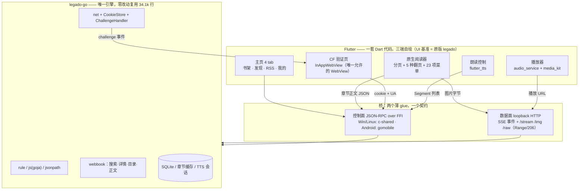
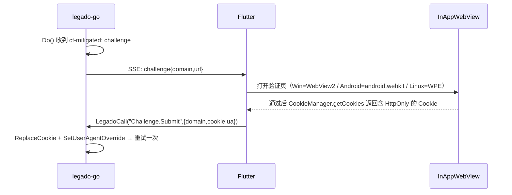

# Legado 跨端技术选型重规划 v4

> **变更记录**
> - v1（同日早些）：以「保留 Vue 阅读器」为前提，推荐 Flutter + legado-go。
> - v2：按新约束重排 —— ①不限 Golang 生态；②**包体与内存都要小、交互要流畅**；③**阅读器 100% 原生重写**
>   （不得再装 WebView）；④平台 = Windows + Android + **Linux**，macOS/iOS 只要求技术栈支持、本期不实现。
> - **v3**：**UI 基准切换为「原版 legado」**（本仓库 `app/`，Kotlin + XML + AndroidX Preference）。
>   desktop 的 Vue 界面**不再作为任何视觉或交互依据**，仅作「该功能曾跑通」的旁证。随之重算 UI 工作量与路线。
> - **v4（本版）**：新增硬约束 —— **非 UI 功能代码全部下沉 Go**，Dart 只保留渲染与平台 API 调用（详见 §2.1）；
>   并配套产出模块划分与并行开发规划 `MODULE-PLAN.md`（22 个模块 / 5 波次 / worktree 隔离规则）。
>
> 现状基线：`legado-go` 12.3k 行 / `desktop` Go 24.7k 行 / Vue 24.3k 行（均为非测试行数）；
> 产物 **Windows exe 35 MB**（不含系统 WebView2）、**Android APK 45 MB**。
> 原版 UI 规模：**47 个 UI Activity、28 个 Fragment、183 个 layout、1096 行 preference 声明、167 个矢量图标、8 种语言**。

---

## 1. 结论（TL;DR）

1. **推荐：Flutter 做全部 UI + `legado-go` 作为 C ABI 引擎**（Windows `c-shared DLL` / Android `gomobile AAR` / Linux `c-shared .so`）。
   Go 侧 34.1k 行可原样复用（复用率 92.1%），UI 层全部重写为 Dart —— 这与 v2 一致。
2. **UI 的唯一参照是原版 legado，不是 desktop。** 意味着：4 tab 主框架、5 种翻页动画（含**仿真卷曲**）、
   23 项阅读菜单、40+ 项阅读配置、11 个「我的」入口、完整 RSS 域，全部按原版还原；
   desktop 上那套 Element Plus 三栏/卡片布局**一个像素都不照搬**。
3. **原版 UI 面比 v2 估计的大**：47 个 Activity 对应约 **28 个 Flutter 路由**，加上 4 tab 与设置框架，
   UI 工期从 v2 的 12 周上调到 **22 周**；含 PoC 与打包，单人总工期 **7~9 个月**（v2 说 5~7 个月，偏乐观）。
4. **原版是纯触屏范式，桌面端必须补一层交互翻译**（滚轮/键盘/右键/无返回键），这是 v2 完全没算的活（§8）。
5. **阅读器仍可 100% 原生，但仿真翻页是硬骨头**：Flutter 无现成卷曲实现，需自绘 Bezier 折页 + 阴影，
   单列 1.5~2 周。若砍掉仿真，工期可省 2 周，但会偏离原版最核心的一个体验。
6. **额外白捡的资产**：原版 167 个 VectorDrawable 可直接转 Flutter SVG/Path；`strings.xml` 1236 行 +
   8 个语言目录可批量转 ARB；`ReadBookConfig` 的 40+ 字段就是阅读设置面板的字段表，不用重新设计。
7. **引擎不要换语言**：Go 是最大资产，重写等于把 1988 条书源的适配经验清零。
8. **非 UI 逻辑全部下沉 Go**（v4 新约束）：Dart 只剩渲染与平台 API 调用。代价是 Go 侧要**新增约 1 万行**
   （RSS、书签记录、下载管理、TTS 引擎、设置备份、文件管理 —— 这些原本会写进 Dart 的业务逻辑），
   收益是三层彻底解耦 + 可切模块并行。落到工程上是 22 个模块 / 5 个波次，见 **`MODULE-PLAN.md`**。

---

## 2. 约束 → 否决条件

| 你的要求 | 转化成的硬条件 | 直接出局的方案 |
|---|---|---|
| 跨端同代码 + 原生 native | 一套 UI 代码，自绘/原生渲染，不用 WebView 当渲染层 | Wails v3、Tauri v2、Electron（均为 L1） |
| 阅读器 100% 原生 | 排版引擎必须可自绘可介入（行盒、字宽、分页可编程） | 依赖 WebView 的排版 |
| **UI 对齐原版 legado** | 必须能还原 Material 交互（中央呼出菜单、边缘拖动、BottomSheet、长按多选）+ 仿真翻页自绘 | 组件库强耦合的栈（Element Plus/Ant 系）；纯 Web 壳 |
| 书源执行（CSS/XPath/JSONPath/**JS**） | 需要成熟 JS 引擎 + HTML 解析 + JSONPath | 无成熟 JS 嵌入的栈 |
| 朗读 TTS | 三端都要能拿到**系统** TTS | 桌面无系统 TTS 绑定的栈（JVM/CMP 桌面端） |
| 音视频源 | 需要能解 H.265/ASS 的播放内核 + 安卓后台播放 | 只靠系统 WebView 解码的方案 |
| Cloudflare 验证 | 三端都要有**能读 HttpOnly Cookie** 的真浏览器 | 无 Cookie API 的壳（Wails）、Android 恒空的（Tauri） |
| 包体/内存小 | 运行时不能太重（排除 JVM/JCEF 级） | Compose Multiplatform（JBR+JCEF）、Electron |
| Win + Android + Linux，mac/iOS 预留 | 框架必须**现在**就覆盖这 5 个平台 | 只覆盖两端的（Wails 的 Linux 是 GTK WebKit） |

### 2.1 代码归属硬约束：非 UI 逻辑全部下沉 Go

> **Dart 只允许持有「渲染所需的临时状态」；凡是需要落盘、需要跨页共享、需要被引擎理解、需要单测的业务规则，一律 Go。**

判定三问，命中任一即下沉：① 需要持久化？② 需要跨页面/跨进程一致？③ 需要参与规则求值？

| 必须下沉（现有前端实例） | 允许留 Dart（性能/平台例外） |
|---|---|
| 播放队列与续读（`audioPlayer.ts` 802 行） | 排版测量与分页（`TextPainter` 只能在 UI isolate） |
| 朗读分段与断点（`tts.ts` 375 + `text.ts` 143） | 手势 / 动画 / 滚动位置 |
| 书源过滤分组（`sourceList.ts` 246） | 图片解码与 `ImageCache` |
| 偏好合并与迁移（`readerPrefs.ts` 140） | 系统 TTS 合成播放（分段与规则在 Go） |
| 书源校验（`sourceCheck.ts` 105） | 音频播放控制（队列与续读在 Go） |
| 进度换算（`chapterProgress.ts` 46） | 文件选择 / 权限 / 分享 / 剪贴板 / 输入法 |

**通道分流**（避免大对象撞 JSON 拷贝）：控制面 < 64 KB 走 FFI `LegadoCall`；章节正文、图片、音频流走 loopback HTTP（`/content` `/img` `/stream`，Range/206），事件走 SSE。

**CI 违约扫描**：`client/lib/**` 出现 `sqflite`/`drift`、`dio`/`http` 直连业务接口、`dart:io` 直接操作书库、`RegExp` 解析书源/HTML/RSS，即判失败。

> 模块如何切、怎么用 worktree 并行 —— 见 **`MODULE-PLAN.md`**（22 个模块、5 个波次、共享区冻结清单、冲突预防规则）。

---

## 3. 候选池六维矩阵

| 维度 | P1 Wails3 加固 | **P2 Flutter + Go** | P3 CMP + Kotlin 引擎 | P4 Avalonia(.NET) + Go | P5 Rust + Slint |
|---|---|---|---|---|---|
| 原生渲染 | ❌ WebView | ✅ L2 | ✅ L2 | ✅ L2 | ✅ L2 |
| 阅读器可全自研 | ❌ | ✅ TextPainter 可介入 | ✅ Skia 可介入 | ✅ TextLayout 可介入 | ✅ 但排版库几乎空白 |
| **原版 UI 还原度** | 🟡 能画但仍是 Web 观感 | ✅ 自绘控件，触屏手势齐全 | ✅ 原生控件最像 | 🟡 控件风格偏 Windows | ❌ 控件全自绘 |
| 引擎复用 | ✅ Go 100% | ✅ Go 100% | ❌ 换回 Kotlin | ✅ Go（P/Invoke） | ❌ 全重写 |
| 三端系统 TTS | 🟡 靠桥 | ✅ `flutter_tts`（Android TTS / Win SAPI / Linux 需 espeak 或云端） | 🟡 Win/Linux 无绑定 | ✅ System.Speech(Win)+平台互操作 | 🟡 自接各平台 API |
| 音视频 | ❌ 受 WebView 解码 | ✅ `media_kit`(libmpv) + `audio_service` | ✅ Media3/VLCJ | ✅ LibVLCSharp（+80MB） | ✅ libmpv/gstreamer 绑定 |
| **CF 三端 Cookie** | 🟡 需 fork 补 API | ✅ `inappwebview`：Win=WebView2、Android=android.webkit、Linux=WPE WebKit | 🟡 JCEF（Win/Linux 重） | 🟡 依赖第三方 WebView 控件 | ❌ 无浏览器（需自带 CEF） |
| 包体（Win/Android/Linux） | 35 / 45 / — MB | 55~70 / 25~30 / 60~80 MB | 200+ / 35 / 250+ MB | 70 / 40 / 80 MB | **15 / 18 / 20 MB** |
| 内存（Win 稳态） | ~150 MB | ~110~140 MB | ~250 MB+ | ~120 MB | **~60 MB** |
| 单人可交付工期（到功能对齐） | — | **7~9 个月**（UI 面按原版重算） | 9~11 个月 | 10~13 个月（Android 成熟度低） | 13+ 个月 |
| 结论 | 保底/过渡 | **推荐** | 工期与体积双输 | 备选 | 仅当体积压倒工期 |

> 关键否决证据
> - **P3**：桌面必须打包 JBR + JCEF（+150~250 MB），Win/Linux 无系统 TTS；体积、内存、TTS 三项同时失分。
> - **P4**：Avalonia 的 Android 成熟度仍是短板，媒体靠 LibVLCSharp（+80 MB）；控件风格偏 Windows，还原原版 Material 观感要额外贴皮。
> - **P5**：`cosmic-text` 只解决 shaping + 基础断行；两端对齐、标点挤压、卷曲翻页全部自研，13 个月起。
> - **P1**：不满足「原生」与「阅读器 100% 原生」，且 Vue 界面按本次要求已不作为参照 —— 它连「先照 desktop 做再改」的过渡价值都没了。

---

## 4. 目标架构（P2）



### 4.1 桥契约（一次定死，双端同源）

```go
// bridge 只暴露一个统一入口，绕开 gomobile 的类型限制
//export LegadoCall
func LegadoCall(req *C.char) *C.char   // {"id":1,"method":"Chapter.Content","params":{...}}
//export LegadoFree
func LegadoFree(p *C.char)
```

- 出包：Windows/Linux `go build -buildmode=c-shared`；Android `gomobile bind -target=android`
  （gomobile **没有 windows/linux target**，两端 glue 必须分开，契约同一份 JSON schema）。
- 数据面：Go 起 loopback HTTP（端口握手时返回），SSE 推事件，`/stream` 供播放器拉流派生。
  Android 需 `network_security_config` 放行 `127.0.0.1` cleartext。
- 附带退役：`asset_url.go` 的「参数编进路径段」安卓 hack、`bindings/` 生成物、Wails 事件总线。

### 4.2 Cloudflare 验证链路



三条铁律（都是踩过的）：**UA 与验证窗口必须一致**；**优先复用已有 cookie 再弹窗**；**2xx 不判挑战**。

---

## 5. UI 基准：以原版 legado 为唯一参照

### 5.1 基准声明

| 项 | 取值 |
|---|---|
| **唯一视觉/交互基准** | 本仓库 `app/`（gedoor/legado，Kotlin + XML + AndroidX Preference） |
| desktop Vue 界面 | ❌ 不作视觉参照、不作交互参照、不作布局参照；仅用于查「某功能曾被验证可行」 |
| 验收方式 | **与原版安卓端逐屏对照**（真机/模拟器并排），不看 desktop |
| 不照搬的部分 | 原版的状态栏/导航栏沉浸、系统分享、通知栏样式等 Android 平台特有外壳 |

### 5.2 可直接迁移的 UI 资产（此前未盘过）

| 资产 | 原版位置 | 规模 | Flutter 处理 |
|---|---|---|---|
| 矢量图标 | `app/src/main/res/drawable/` | **167 个 XML VectorDrawable** | 转 SVG → `flutter_svg`，或用脚本转 `CustomPainter` Path；几乎零设计成本 |
| 文案与多语言 | `res/values/strings.xml` + 8 个 `values-*` 目录 | 1236 行 × 8 语言（en/zh/zh-HK/zh-TW/es/ja/pt-BR/vi） | 脚本转 ARB → `flutter gen-l10n` |
| 主题色 / 夜间色 | `values/colors.xml`、`values-night/` | 数十个语义色 | 建 `ColorScheme` + 自定义 `ThemeExtension`（含 E-Ink 主题） |
| 布局尺寸 | 183 个 `layout/*.xml` 的 dp 值 | — | 作 375dp 基准的设计规范，转 Flutter 的 8pt 栅格 |
| 阅读配置字段 | `help/config/ReadBookConfig.kt` | **40+ 字段** | 直接当阅读设置面板字段表（§6.1） |
| 设置页结构 | `res/xml/pref_*.xml` | **1096 行声明** | 转 Schema 驱动的表单（§7） |
| 阅读菜单动作 | `res/menu/book_read.xml` | **23 项** | 分主菜单 + 溢出菜单（§6.3） |

### 5.3 主页骨架（原版 `activity_main.xml`）

原版是 **ViewPager + BottomNavigationView（`labelVisibilityMode="unlabeled"`，图标无文字）**，四个 Tab 可横滑切换：

| Tab | 原版实现 | Flutter 结构 |
|---|---|---|
| 书架 bookshelf | `BookshelfFragment`（网格/列表双模式、分组、多选管理） | `BookshelfPage` + 两种 `SliverGrid`/`SliverList` |
| 发现 discovery | `ExploreFragment`（书源切换 + 分类/榜单） | `ExplorePage`（左侧源选择 BottomSheet） |
| RSS | `RssFragment`（订阅源文章流） | `RssPage` + 4 个子页 |
| 我的 my | `MyFragment` → `PreferenceFragment` | `MePage`（11 个入口，Schema 驱动） |

> 桌面端保留横向滑动手势吗？建议**保留但改用滚轮横滚 + Tab 点击**，不用鼠标拖拽（§8）。

### 5.4 页面对照表（原版 Activity → Flutter 路由 → 阶段）

**主框架与书籍**

| 原版 | Flutter 路由 | 阶段 |
|---|---|---|
| MainActivity + 4 Fragment | `/` | C |
| BookInfoActivity | `/book/:id` | C |
| BookInfoEditActivity | `/book/:id/edit` | D |
| TocActivity | `/book/:id/toc` | C |
| ReadBookActivity | `/read/:id` | C |
| ReadMangaActivity | `/read/:id`（同路由，comic 模式） | D |
| CacheActivity | `/book/:id/cache` | D |
| AllBookmarkActivity | `/bookmarks` | D |
| ReadRecordActivity | `/records` | D |
| BookshelfManageActivity | `/shelf/manage` | D |
| SearchActivity | `/search` | C |
| SearchContentActivity | `/search/content` | D |
| ExploreShowActivity | `/explore/:sourceUrl` | C |
| ImportBookActivity / RemoteBookActivity | `/import`、`/import/remote` | D |
| AudioPlayActivity | `/audio/:id` | D |

**书源与规则**

| 原版 | Flutter 路由 | 阶段 |
|---|---|---|
| BookSourceActivity | `/sources` | C |
| BookSourceEditActivity | `/sources/:url` | D |
| BookSourceDebugActivity | `/sources/:url/debug` | D |
| ReplaceRuleActivity / ReplaceEditActivity | `/replace`、`/replace/:id` | D |
| DictRuleActivity | `/dict/rules` | D |
| TxtTocRuleActivity | `/toc-rules` | D |
| RuleSubActivity（书源订阅） | `/sources/subscribe` | D |

**RSS 域（desktop 完全没有，原版有 6 Activity + 4 Fragment）**

| 原版 | Flutter 路由 | 阶段 |
|---|---|---|
| RssSourceActivity | `/rss/sources` | D |
| RssSourceEditActivity / RssSourceDebugActivity | `/rss/sources/:url[/debug]` | D |
| ReadRssActivity | `/rss/read/:id` | D |
| RssFavoritesActivity | `/rss/favorites` | D |
| RssSortActivity | `/rss/sort` | D |

**我的 / 设置 / 工具**

| 原版 | Flutter 路由 | 阶段 |
|---|---|---|
| ConfigActivity（8 个子页：其它/阅读/主题/备份/封面/欢迎/朗读/主） | `/settings[/:section]` | C（阅读+主题）、D（其余） |
| FileManageActivity / HandleFileActivity | `/files` | D |
| SourceLoginActivity | `/login/:sourceUrl` | D |
| WebViewActivity | 复用 InAppWebView 组件 | D |
| QrCodeActivity | 桌面不做；安卓接 `mobile_scanner` | E |
| AboutActivity | `/about` | C |
| WelcomeActivity | `/welcome` | C |
| 原版 WebService（内置 HTTP 阅读页） | 桌面走 loopback 数据面，**不实现**网页端 UI | — |

> 合计 **28 个 Flutter 路由**。原版 47 个 Activity 里剩下的（FileAssociation、OpenUrlConfirm、
> VerificationCode、Permission、SharedReceiver 等）属安卓平台外壳，不迁移。

### 5.5 必须还原的 6 个交互范式

| # | 原版行为 | Flutter 实现 |
|---|---|---|
| 1 | **阅读页中央点击呼出上/下菜单**，菜单任意操作后自动收起 | 手势分区：左 1/3 上一页、右 1/3 下一页、中间呼出；`AnimatedSlide` 上下抽屉 |
| 2 | **左/右边缘上下拖动**调亮度/字号（`cursor_left`/`cursor_right`） | 边缘 40dp 热区 + 垂直 DragGesture；桌面映射为 `Ctrl+滚轮` |
| 3 | 长按进入多选（书架、书源、缓存列表） | `LongPress` + 顶部批量操作栏；桌面用右键 / Ctrl+点击 |
| 4 | 底部 BottomSheet 选择器（换源、分组、字体、目录跳转） | `showModalBottomSheet`，统一封装 `AppSheet` |
| 5 | 设置页 = Preference 分组列表（开关/滑块/列表/跳转） | Schema 驱动渲染器（§7），一个组件覆盖全部设置页 |
| 6 | 顶部 Toolbar + 溢出菜单（23 项阅读菜单分流） | `SliverAppBar` + `PopupMenuButton`，溢出菜单分组带分割线 |

### 5.6 原版有、desktop 无（必须补齐）

RSS 文章域全套、阅读记录、全部书签、TXT 目录规则、文件管理、内置 Web 服务、扫码、字体管理、
自动阅读、简繁转换（`useZhLayout`）、护眼模式、仿真翻页、23 项阅读菜单、8 语言、E-Ink 主题。

### 5.7 desktop 有、原版无（本次如何处置）

| 功能 | 处置 | 理由 |
|---|---|---|
| AI 问答 / 向量索引 | **保留**，但按原版视觉语言重做（入口放「我的」，面板样式对齐原版 BottomSheet） | 引擎侧已实现（1.4k 行），删了浪费；但 desktop 的 `AIPanel` 布局不照搬 |
| ECDICT 英汉词典 | **保留**，入口合并进原版的「词典规则」，选中文字弹窗样式照原版 `DictPopover` 的结构重画 | 原版只有词典规则，无本地词典；属于能力增强 |
| WebDAV 备份 | **保留**，放进原版「备份恢复」设置页（原版支持 WebDAV 书籍但无备份） | 与原版备份页天然同构 |
| 书源订阅（Subscription） | **保留**，就是原版 `RuleSubActivity`，直接按原版做 | 同一功能 |
| **并排阅读（split）** | **默认不做**，留作桌面端可选实验特性 | 原版无此交互；按本次要求 UI 以原版为准 |
| 全屏沉浸 | 桌面做「无边框全屏」，安卓照原版隐藏状态栏/导航栏 | 平台差异，非 UI 分叉 |

---

## 6. 原生阅读器（对齐原版）

### 6.1 配置面板字段（直接取 `ReadBookConfig`）

| 分组 | 字段 | 范围/取值 |
|---|---|---|
| 翻页 | `pageAnim` | **cover 覆盖 / slide 滑动 / simulation 仿真 / scroll 滚动 / none 无动画** |
| 字体 | `textFont`、`textBold`、`textSize` | 字体选择（原版有字体管理页）、字重 0~3、字号 12~40sp |
| 间距 | `letterSpacing`、`lineSpacingExtra`、`paragraphSpacing`、`paragraphIndent` | 字距 / 行距 / 段距 / 段首缩进（支持「2em」等表达式） |
| 标题 | `titleMode`、`titleSize`、`titleTopSpacing`、`titleBottomSpacing` | 章节标题样式 |
| 版心 | `paddingTop/Bottom/Left/Right`、`headerPadding*`、`footerPadding*`、`showHeaderLine`、`showFooterLine` | 正文与页眉页脚内边距、分割线 |
| 背景 | `bgStr`、`bgStrNight`、`bgStrEInk`、`bgAlpha`、`bgType` | 白天/夜间/E-Ink 三态背景 + 透明度 + 图片背景 |
| 行为 | `autoReadSpeed`、`useZhLayout`（简繁）、`underline`、`hideStatusBar`、`hideNavigationBar`、`readBodyToLh` | 自动阅读、简繁转换、下划线、沉浸 |
| 预设 | `readStyleSelect`、`comicStyleSelect`、`shareLayout` | 排版样式预设、分享式布局 |

> 这 40+ 字段构成阅读设置面板，**字段表不用重新设计**，直接照原版 `pref_config_read.xml`（201 行）迁移。

### 6.2 五种翻页动画的实现路径

| 模式 | 实现 | 工期 |
|---|---|---|
| none 无动画 | 直接换页 | 0.2 周 |
| cover 覆盖 | 下一页 `SlideTransition` 从右侧盖上来 | 0.3 周 |
| slide 滑动 | 两页同向平移 | 0.3 周 |
| scroll 滚动 | 连续 `ScrollView`（原版是纵向长页） | 1 周（需与分页解耦） |
| **simulation 仿真** | 鼠标/手指拖拽 → 计算折角 → `CustomPainter` 画 Bezier 折页 + 背面渐变 + 阴影 | **1.5~2 周** |

> 仿真翻页是原版最受好评的体验，**不能砍**（v2 曾把它列为「后期可选」，v3 改为必做）。
> Flutter 生态的 `page_flip` 类库观感与原版差距大，建议自绘：把页面渲染成 `ui.Image` 快照，
> 再按折线做 mesh 变形（`Canvas.drawVertices`），这样性能与保真度都可控。

### 6.3 阅读菜单（原版 23 项）

| 位置 | 项 |
|---|---|
| 主菜单（6） | 目录、换源、缓存下载、书签、朗读、阅读设置 |
| 溢出菜单（17） | 刷新、设置编码、TXT 目录规则、编辑正文、倒序正文、重新分段、替换标题、去重标题、图片样式、更新目录、生效替换、日志、帮助、仿真阅读(自动)、去 ruby 注音、去 h 标签、获取进度 |

> 每一项在 Go 侧都有对应能力（`Content`、`Source`、`Cache`、`Toc`、`Replace`），
> Dart 侧只是菜单 + 调用，**不含业务逻辑**。这是「业务一律下沉 Go」的直接收益。

### 6.4 排版流水线（不变）

```
章节文本 ──解析──▶ Paragraph[]（样式/图片/锚点）
        ──测量──▶ LineBox[]（baseline, height, x 进给, 每字 advance）
        ──分页──▶ Page[]（行区间 + 段首缩进修正）
        ──绘制──▶ CustomPainter（逐行 paint，行级缓存）
```

**不自己实现断行**：用 `TextPainter.computeLineMetrics()` 拿行盒（SkParagraph 走 UAX #14，
`、。，」』）…` 这类行首禁则天然被挡在行尾），再在自己的 `LineBox` 层做后处理。

| 缺失能力 | 方案 | 复杂度 |
|---|---|---|
| **两端对齐** | 每行 `(版心宽 − 自然宽) / 断点数` 分配；混排英文按词间空格分摊 | 中 |
| **标点挤压/悬挂** | 行首命中禁则 → 压上一行末字 advance 到 0.5 字，或把标点画到版心外 | 中 |
| 分页粒度 | `computeLineMetrics` 累加高度；段首缩进与孤行单独处理 | 中 |
| 分页缓存 | key = 字体+字号+行距+字距+版心；变更后在 isolate 里全量重排 | 低 |
| TTS 高亮 | LineBox 内累加 advance 取字矩形 | 低 |
| 图片混排 | `ImageSpan` 先占高 → 影响该段行盒 → 重排当页 | 中 |

### 6.5 性能预算（验收线）

| 指标 | 目标 |
|---|---|
| 单章 5000 字首次分页 | ≤ 60 ms |
| 翻页 | ≤ 8 ms/帧（仿真模式 ≤ 12 ms/帧） |
| 字号切换后重排 | ≤ 150 ms |
| 100 章目录滚动 | 稳定 60 fps |
| 内存（阅读页增量） | ≤ 80 MB |

### 6.6 工期

| 阶段 | 内容 | 产出 |
|---|---|---|
| R1（2 周） | 分页 + none/cover/slide 三模式 + 40 项配置面板（§6.1）+ 进度 | 「能读」 |
| R2（2 周） | 两端对齐 + 标点挤压 + 孤行 + 图片混排 + scroll 模式 | 「像正经阅读器」 |
| R3（2 周） | **仿真翻页**（自绘折页）+ 23 项菜单接线 | 观感对齐原版 |
| R4（2 周） | TTS 高亮/朗读条、查词选区、书签、漫画、PDF | 全类型覆盖 |

> 诚实提示：Flutter 排版在**字体 hinting、亚像素字距**上不如 Android 原生 `StaticLayout`。
> 与原版逐屏对照时接受「近似」，不要追求像素级一致 —— 那需要自绘整条排版链路，工期 +4~6 周。

---

## 7. 设置框架：Schema 驱动（本轮新增）

原版 8 个 `pref_*.xml` 共 1096 行，本质是「分组 + 开关 + 滑块 + 列表 + 跳转」的声明。
**不要为每个设置页手写 Flutter 页面**，否则 1096 行声明会膨胀成 3000+ 行 Dart。

```dart
// 一份 Schema，一个渲染器，覆盖全部设置页
PrefSection(
  title: '阅读',
  items: [
    PrefSwitch(key: 'readBodyToLh', title: '正文底部对齐行高'),
    PrefSlider(key: 'autoReadSpeed', title: '自动阅读速度', min: 1, max: 30),
    PrefList(key: 'pageAnim', title: '翻页动画', options: ['覆盖','滑动','仿真','滚动','无']),
    PrefNav(title: '主题设置', route: '/settings/theme'),
  ],
)
```

| 收益 | 说明 |
|---|---|
| 一套渲染器 | 开关/滑块/输入/单选/跳转 5 种组件覆盖 95% 声明 |
| 与 Go 侧配置对齐 | `key` 直接用原版 `PreferKey` 字符串，配置读写走 `LegadoCall("Settings.*")` |
| 可搜索 | 原版设置项多且深，桌面端加一个设置搜索框（原版没有，属桌面增强） |
| 迁移成本低 | XML → Schema 可脚本转换初稿，再人工校对 label |

---

## 8. 桌面端交互翻译（v2 漏算，本轮补充）

原版是纯触屏应用，Windows/Linux 必须补一层输入映射，否则「照原版做」会得到一个鼠标点不动的界面。

| 场景 | 原版（触屏） | 桌面等价 |
|---|---|---|
| 翻页 | 点击左右 1/3、左右滑动 | 单键 ←/→、PageUp/PageDown、滚轮（滚动模式下滚轮=滚屏，翻页模式下滚轮=翻页） |
| 呼出菜单 | 中央点击 | 中央点击 + `Esc` 关闭 + 右键菜单（章节操作） |
| 调亮度/字号 | 左/右边缘上下拖 | `Ctrl+滚轮` 调字号；侧栏滑块调背景亮度 |
| 返回 | 系统返回键 | `Esc` / `Alt+←` / 面包屑 |
| 多选 | 长按 | 右键 → 多选模式；或 `Ctrl+点击` |
| 下拉刷新 | 下拉手势 | 工具栏刷新按钮 + `F5` |
| 列表滚动 | 触摸拖动 | 滚轮 + 滚动条（`Scrollbar` 常显） |
| 窗口缩放 | — | 书架列数随宽度自适应；阅读器版心宽度上限（如 900dp）避免超宽行 |

> 这层翻译约 **2 周**，且必须在 C 阶段就做（否则每个页面都要返工）。

---

## 9. Linux 专项（风险最高）

| 议题 | 结论 | 处置 |
|---|---|---|
| **CF 验证浏览器** | `flutter_inappwebview` Linux 走 **WPE WebKit**，依赖 `webkit2gtk`（+30 MB）；社区有因此关闭 WebView 功能的先例 | 打包进 AppImage；否则 Linux 降级为「系统浏览器验证 + 手工导入 cookie」 |
| **中文输入法** | Flutter Linux 的 IM 走 GTK im module，fcitx5/ibus 有已知缺陷（候选窗位置、组合串丢失） | PoC 必测；不达标则书源编辑在 Linux 退化为「导入 JSON」 |
| 媒体解码 | `media_kit` 自带 `libmpv.so`；Wayland + 混合显卡需 `hwdec=auto-safe` | 沿用该配置 |
| 打包 | AppImage 为唯一一等公民 | 不做 deb/rpm/flatpak |
| 系统 TTS | 无统一 TTS，`flutter_tts` Linux 支持弱 | 云端 TTS / 预生成音频 + `espeak-ng` 兜底 |
| 字体 | 缺中文字体时排版崩塌 | 内置思源黑体子集（+3~5 MB） |

---

## 10. 包体 / 内存预算

| 平台 | 组成 | 估算 | 对比现状 |
|---|---|---|---|
| **Windows** | Flutter 引擎 20 + app 7 + Go 18 + libmpv 28（可选）+ 图标/字体 3 | **56~72 MB** | 35 MB ↑ |
| **Android（arm64 单 ABI）** | Flutter 10 + Go AAR 13 + 插件 5 + 语言包 1 | **26~31 MB** | 45 MB ↓ |
| **Linux AppImage** | Flutter 22 + Go 18 + libmpv 28 + webkit2gtk 30 + 字体 4 | **60~80 MB** | 新增 |
| 内存（Win 稳态，书架+阅读） | Flutter ~70 + Go heap ~40 + 图片缓存 | **110~140 MB** | ~150 MB ↓ 略 |

> v3 比 v2 多约 2 MB：8 语言资源 + 167 个矢量图标 + 内置字体子集。

---

## 11. 迁移路线（按原版 UI 面重算）

| 阶段 | 内容 | 工期 | 验收 |
|---|---|---|---|
| **A** | Wails fork 补 `WebviewWindow.GetCookies()`，`verifywails` 降为 fallback，去掉常开调试端口 | 1 周 | CF 站点验证 3 次内通过（当前版本的功能保底） |
| **B** | ①三端 FFI 打通（搜索→目录→正文）②三端 CookieManager 拿 `cf_clearance` ③Android 后台播放 30 min ④**Linux fcitx5 输入** ⑤分页原型 ≤60 ms | 3 周 | 5/5 通过才进 C |
| **C** | 骨架：4 tab 主页、书架（双模式+分组）、详情、目录、搜索、发现、书源列表、阅读器 R1+R2、设置框架、**桌面交互层** | 8 周 | 日常阅读可脱离 Wails 版；与原版逐屏对照通过 |
| **D** | 全功能域：书源编辑/调试、替换/词典/TXT 目录规则、RSS 全套、缓存/书签/记录、导入、登录、文件管理、阅读器 R3+R4、TTS/音频全链路、AI/词典/WebDAV | 9 周 | 页面对照表 §5.4 全部点亮 |
| **E** | 打磨：仿真翻页调优、8 语言、E-Ink 主题、三端打包、性能达标 | 5 周 | 三端同书源 diff 对照无差异 |

**总计 26 周（约 6 个月）纯开发**，加缓冲与验收约 **7~9 个月**。

> 上述是**单人串行**口径。按 `MODULE-PLAN.md` 的模块切分，4~5 路 worktree 并行可压到 **14~16 周**；
> 关键路径是阅读器（U03，22 人日），必须在 W2 就启动，不能等 Go 侧全部完成。

---

## 12. 风险登记册

| 风险 | 概率 | 影响 | 对策 |
|---|---|---|---|
| **原版 UI 面比预期大**（47 Activity / 28 路由） | 高 | 高 | 严格按 §5.4 分阶段，C 阶段只做「能读能逛」，D 阶段批量铺页面；Schema 驱动消化设置页 |
| **仿真翻页做不出原版手感** | 中 | 中 | R3 单独立项，先做 2 页 demo 与原版并排对比，不达标则降级为 slide（并记录差异） |
| **触屏范式在桌面水土不服** | 中 | 高 | §8 在 C 阶段前置完成，每个页面验收时必过「纯鼠标可用」 |
| 原生排版观感不如 Android 原生 | 中 | 高 | R1 先「能读」，逐屏对比打分决定投入；接受近似 |
| Linux 输入法 / WebKitGTK 依赖 | 高 | 中 | PoC B④ 先验；Linux 可先发「只读+导入」 |
| 两套 FFI glue 漂移 | 中 | 中 | 契约只一个 `LegadoCall(json)`，双端共用 JSON schema 测试 |
| Go c-shared 需 CGO+MSVC/GCC，Windows 产物 Low IL 标签 | 高（已踩） | 中 | 复用 `task fix:il` 与 `icacls /setintegritylevel M` |
| 包体超预期（mpv/webkit/字体） | 中 | 中 | 解码器与 WebView 可选；字体子集化；语言包按需 |
| 单人同时维护 Dart + Go + 三条打包链 | 高 | 中 | 业务一律下沉 Go；Dart 只做 UI 与平台适配 |

---

## 13. 仍需你确认的三件事

1. **仿真翻页是否必做**？做 = +2 周、观感对齐原版；不做 = 省 2 周，但阅读体验明显弱于原版。
2. **并排阅读（desktop 特有）是否保留**？本文档按「默认不做」处理，若要保留需单独设计宽屏双栏，且不属于原版 UI。
3. **8 语言是否全量迁移**？全做约 +1 周（脚本转换 + 校对）；只做 zh/en 可省，但与原版对齐度下降。
