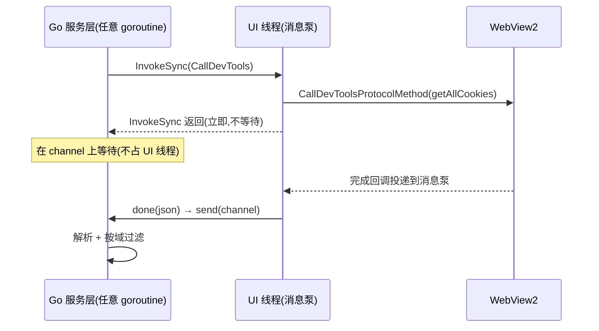
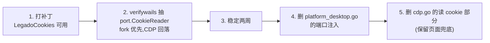

# Fork Wails v3：PC / Android 读取 HttpOnly Cookie

> 目标：绕开「WebView 只暴露一小部分能力」的限制，在**不改 Wails 本体任何现有行**的前提下，为 Windows 与 Android 增加 HttpOnly Cookie 读取；
> 同时保持随时可以跟上游 tag 同步，不向上游提 PR。
>
> 适用范围：仅 `archive/wails-v3` 维护线。Flutter 迁移完成后本补丁废弃（`flutter_inappwebview` 原生提供 CookieManager）。

---

## 1. 结论摘要

| 项 | 结果 |
|---|---|
| 补丁规模 | **新增 2 个文件，修改 0 行**（Windows 1 个、Android 1 个） |
| 自有代码改动 | `desktop/build/android/.../WailsBridge.java` +12 行（**这是我们自己的仓库，不是 Wails**） |
| Windows 技术路径 | 进程内 CDP `Network.getAllCookies`（**不需要 `--remote-debugging-port`**） |
| Android 技术路径 | `CookieManager.getInstance().getCookie(url)`，经既有 JNI 桥回传 |
| 上游同步 | 补丁以 `.patch` 数据形式维护，`git am` 重放；冲突面 ≈ 0 |
| 工作量 | 约 2.5 人日（含两端口径验收） |

关键认知：**能 0 行修改，是因为 Wails 内部已经把该暴露的都暴露了，只是没在 `pkg/application` 这层包一层。** 我们要做的是"在自己的包里加一层壳"，而不是"改它的实现"。

---

## 2. 为什么能不改现有行

三条实证（基于 `github.com/wailsapp/wails/v3@v3.0.0` 本地模块缓存）：

### 2.1 Windows：`CallDevTools` 已经是导出方法

`internal/webview2/pkg/edge/devtools.go:63`

```go
func (e *Chromium) CallDevTools(method, params string, done func(string, error)) error
```

WebView2 的 `CallDevToolsProtocolMethod` 支持 `Network.getAllCookies`，返回：

```json
{"cookies":[{"name":"cf_clearance","value":"...","domain":".uaa.com","path":"/",
 "expires":1763600000,"httpOnly":true,"secure":true,"sameSite":"Lax"}]}
```

**这条路径顺带绕开了一个坑**：同包的 `ICoreWebView2CookieManager.GetCookies(uri)`（`ICoreWebView2CookieManager.go:94`）实际是**坏的**——它把 `&list` 当成 `ICoreWebView2GetCookiesCompletedHandler*` 传给 COM，而该 API 是异步的，包里也没有任何 CompletedHandler 类型；且 `cookies_test.go` 从头到尾**没有调用过 `GetCookies`**。所以走 CDP 不仅更短，还避开了未验证代码。

### 2.2 Windows：`impl` 与 `chromium` 都是包内字段

`pkg/application/webview_window.go:170`

```go
type WebviewWindow struct {
    options WebviewWindowOptions
    impl    webviewWindowImpl   // ← 包内，可直接类型断言
    ...
}
```

`pkg/application/webview_window_windows.go:41` 的 `windowsWebviewWindow` 持有 `chromium *edge.Chromium`，也是包内字段。

**因此：在 `package application` 里新增一个 `//go:build windows` 的文件，就能 `w.impl.(*windowsWebviewWindow)` 拿到 chromium，全程不需要修改 `webviewWindowImpl` 接口。**

> 这是"少改"的关键决策点。若改成"给接口加 `getCookies()` 方法"，就必须同时改 `webview_window_windows.go`、`_android.go`、`_linux.go`、`_darwin.go`、`application_server.go` 五个实现 —— 补丁面从 0 行涨到 5 个文件，而且上游任何一个平台的实现变动都会冲突。

### 2.3 Android：已有通用的「Go 调 Java」封装

`pkg/application/application_android.go:399`

```go
func androidBridgeStringString(method string, arg string) (string, bool)
```

它是包级函数，内部走 C 层的 `callBridgeStringStringMethod`，等价于调用 Java 的 `String m(String)`。`application_android_nocgo.go` 里有非 cgo 桩，因此新文件不需要自己写 cgo。

**因此 Android 侧同样只是"加一个文件调这个方法"，不碰 Wails。**

另外确认：安卓宿主 `desktop/build/android/` 是**我们自己版本化维护的工程**（45 个文件在 git 里，含我们加的 `AudioPlayService.java`），正常构建不会从 CLI 模板重新生成（`build/android/Taskfile.yml` 只有 `overlay:gen`）。所以 Java 改动落在我们仓库，不进 Wails。

---

## 3. 补丁设计

### 3.1 Windows：`pkg/application/cookie_legado_windows.go`（新增）

```go
//go:build windows

package application

import (
	"encoding/json"
	"errors"
	"fmt"
	"net/http"
	"net/url"
	"strings"
	"time"

	"github.com/wailsapp/wails/v3/internal/webview2/pkg/edge"
)

// 编译期锁死依赖符号：上游若改 CallDevTools 签名，这里直接编译失败，
// 而不是运行时静默返回空 cookie。
var _ interface {
	CallDevTools(string, string, func(string, error)) error
} = (*edge.Chromium)(nil)

// LegadoCookies 读取 uri 对应的浏览器 cookie（含 HttpOnly）。
// 走 WebView2 进程内 CDP，不依赖 --remote-debugging-port。
// 必须在非 UI 线程调用（Go 服务层天然满足）。
func (w *WebviewWindow) LegadoCookies(uri string) ([]*http.Cookie, error) {
	ww, ok := w.impl.(*windowsWebviewWindow)
	if !ok || ww == nil || ww.chromium == nil {
		return nil, errors.New("legado: webview 未就绪")
	}

	type result struct {
		raw string
		err error
	}
	ch := make(chan result, 1)
	send := func(r result) {
		select {
		case ch <- r:
		default: // 同步失败与异步回调只会命中其一
		}
	}

	// 只在 UI 线程「发起」，绝不在 UI 线程等待回调：
	// 回调由 WebView2 的消息泵投递到 UI 线程，阻塞它必然死锁。
	InvokeSync(func() {
		if err := ww.chromium.CallDevTools("Network.getAllCookies", "{}",
			func(raw string, err error) { send(result{raw, err}) }); err != nil {
			send(result{"", err})
		}
	})

	select {
	case r := <-ch:
		if r.err != nil {
			return nil, r.err
		}
		return legadoFilterCookies(r.raw, uri)
	case <-time.After(3 * time.Second):
		return nil, errors.New("legado: 读取 cookie 超时")
	}
}

type legadoCDPCookie struct {
	Name     string  `json:"name"`
	Value    string  `json:"value"`
	Domain   string  `json:"domain"`
	Path     string  `json:"path"`
	Expires  float64 `json:"expires"`
	HTTPOnly bool    `json:"httpOnly"`
	Secure   bool    `json:"secure"`
}

// legadoFilterCookies 只保留属于该主机的 cookie。
// getAllCookies 返回的是整个 profile 的所有站点凭据，直接落库既污染 CookieStore
// 也等于把无关站点的身份带给书源。
func legadoFilterCookies(raw, uri string) ([]*http.Cookie, error) {
	var resp struct {
		Cookies []legadoCDPCookie `json:"cookies"`
	}
	if err := json.Unmarshal([]byte(raw), &resp); err != nil {
		return nil, fmt.Errorf("legado: 解析 CDP cookie: %w", err)
	}
	u, err := url.Parse(uri)
	if err != nil {
		return nil, fmt.Errorf("legado: 非法 uri %q: %w", uri, err)
	}
	host := strings.ToLower(u.Hostname())

	out := make([]*http.Cookie, 0, len(resp.Cookies))
	for _, c := range resp.Cookies {
		d := strings.TrimPrefix(strings.ToLower(c.Domain), ".")
		if d != host && !strings.HasSuffix(host, "."+d) {
			continue
		}
		ck := &http.Cookie{
			Name: c.Name, Value: c.Value, Domain: c.Domain,
			Path: c.Path, HttpOnly: c.HTTPOnly, Secure: c.Secure,
		}
		if c.Expires > 0 { // -1 表示会话 cookie
			ck.Expires = time.Unix(int64(c.Expires), 0)
		}
		out = append(out, ck)
	}
	return out, nil
}
```

### 3.2 Android：`pkg/application/cookie_legado_android.go`（新增）

```go
//go:build android

package application

import (
	"errors"
	"net/http"
	"net/url"
	"strings"
)

// 编译期锁死桥函数签名
var _ func(string, string) (string, bool) = androidBridgeStringString

// LegadoCookies 读取 uri 对应的 cookie（含 HttpOnly）。
// Java 侧：WailsBridge.getCookie(String) → CookieManager.getInstance().getCookie(url)
func (w *WebviewWindow) LegadoCookies(uri string) ([]*http.Cookie, error) {
	raw, ok := androidBridgeStringString("getCookie", uri)
	if !ok {
		return nil, errors.New("legado: android 读取 cookie 失败")
	}
	u, _ := url.Parse(uri)
	host := ""
	if u != nil {
		host = u.Hostname()
	}
	out := make([]*http.Cookie, 0, 8)
	for _, part := range strings.Split(raw, ";") {
		part = strings.TrimSpace(part)
		if part == "" {
			continue
		}
		kv := strings.SplitN(part, "=", 2)
		if len(kv) != 2 {
			continue
		}
		out = append(out, &http.Cookie{Name: kv[0], Value: kv[1], Domain: host, Path: "/"})
	}
	return out, nil
}
```

### 3.3 自有仓库：`WailsBridge.java` 追加一个方法

```java
/**
 * 读取指定 URL 的 cookie（含 HttpOnly）。供 Go 经 JNI 按方法名调用，勿改名。
 * 注意：返回 null 会被 Go 侧判为失败，这里统一返回空串。
 */
public String getCookie(String url) {
    if (url == null || url.isEmpty()) return "";
    try {
        String c = android.webkit.CookieManager.getInstance().getCookie(url);
        return c == null ? "" : c;
    } catch (Throwable t) {
        Log.w(TAG, "getCookie failed: " + url, t);
        return "";
    }
}
```

> `androidBridgeStringString` 通过 `GetMethodID(name)` 反射调用，方法名被 R8 混淆就会失效。现有桥方法都依赖这一点，说明 `proguard-rules.pro` 已保留 `com.wails.app.WailsBridge`；新增方法无需额外配置，但值得在验收时用 release 包复核一次。

---

## 4. 线程模型：为什么必须两阶段

这是整个补丁最容易写错的地方。



三个必须遵守的约束：

1. **`InvokeSync` 内部绝不能等回调**。`mainthread.go:23` 的 `InvokeSync` 是 `dispatchOnMainThread` + `wg.Wait()`，阻塞 UI 线程；而 WebView2 的完成回调要靠同一个线程的消息泵投递 → 必然 3 秒超时。
2. **`CallDevTools` 本身不保证回调只触发一次**，所以 `send` 用 `select/default`，避免同步错误路径与回调路径双写时 panic 或阻塞。
3. **窗口生命周期**：必须在 `destroy()` 之前读；`chromium` 为 nil 时直接返回错误（窗口尚未创建 / 已被 WebView2 进程故障重置）。

---

## 5. Cookie 语义映射与三个坑

| 坑 | 表现 | 处理 |
|---|---|---|
| **profile 级返回** | `getAllCookies` 返回全部站点 cookie | 按 `domain` 后缀匹配 host 过滤（已在代码里） |
| **属性丢失（Android）** | `getCookie(url)` 只返回 `k=v; k2=v2`，没有 HttpOnly/Secure/Expires | 引擎侧 `store.ReplaceCookie` 是键值对语义，`cf_clearance` 只需 name+value；**不要**用它反推属性写回 CookieStore |
| **过期语义差异** | CDP `expires:-1` 是会话 cookie；`0` 是已过期 | `>0` 才设 `Expires`，其余留零值 |
| **UA 必须一起换** | 只回填 cookie 不换 UA，CF 仍 403（`cf_clearance` 绑定 UA） | 沿用现有 `SetUserAgentOverride`，读 cookie 后一并替换 |
| **平台差异** | Linux 端 Wails 用 WebKitGTK，无 CDP | 本方案不覆盖 Linux；保留 CDP 端口方案作 fallback |

---

## 6. Fork 拓扑与上游同步

### 6.1 分支模型：补丁即数据

```
wails-fork/                      # fork 自 wailsapp/wails
├── patches/
│   ├── 0001-legado-cookie-windows.patch
│   └── 0002-legado-cookie-android.patch
├── scripts/
│   ├── sync-upstream.ps1        # 更新上游 + 重放补丁
│   └── check-anchors.ps1        # 冲突面监控
└── (源码)
```

| 分支 | 用途 |
|---|---|
| `upstream`（remote） | 只 fetch，不提交 |
| `legado` | `= upstream/<tag>` + `git am patches/*.patch`，唯一可构建分支 |
| `v3.x.y-legado.N`（tag） | 供 submodule 钉住的不可变基线 |

**为什么用 `.patch` 而不是长期 rebase 分支**：补丁是多条独立数据，能单独 review、单独禁用、单独回滚；`git am` 失败会精确指到某一条补丁，而 `git rebase` 只告诉你"这个 commit 冲突了"。日常开发仍可在 `legado` 分支上改，改完 `git format-patch upstream/<tag> --stdout > patches/000N-xxx.patch` 导出。

### 6.2 我们的仓库怎么消费 fork

```
legado/
├── third_party/wails/          # git submodule → fork 的 legado 分支
└── desktop/go.mod             # replace github.com/wailsapp/wails/v3 => ../third_party/wails
```

**一个 Go 的硬约束**：fork **必须保留 `module github.com/wailsapp/wails/v3` 不变**。

原因：`replace A => B vX.Y.Z` 要求 B 的 `go.mod` 声明 `module B`；而一旦把 fork 的 module path 改成自己的，Wails 内部所有 `github.com/wailsapp/wails/v3/...` 自引用会解析回**上游正版**，同一个包里出现两份实现。所以只能走本地目录 replace（submodule / 同级 checkout），不能 `replace` 到远端路径。

副作用：仓库 clone 需要 `--recursive`，CI 要开 `submodules: recursive`。这条要写进 README。

### 6.3 CLI 版本一致性

`wails3` CLI 内嵌模板、bindings 生成器、安卓 build_assets。**补丁只动 `pkg/application`（库），不动 CLI**，所以**不必重新构建 CLI**——只要 CLI 版本与 fork 基线 tag 相同即可。

若将来真要改 `internal/commands/`（比如改安卓模板），那就必须：

```powershell
cd third_party/wails
go build -o ../../desktop/bin/wails3.exe ./cmd/wails3
```

并把 `desktop/Taskfile.yml` 里所有 `wails3` 换成 `{{.WAILS3}}` 变量。**目前不需要这一步。**

### 6.4 更新脚本

```powershell
# scripts/sync-upstream.ps1
param([Parameter(Mandatory)][string]$Tag)
$ErrorActionPreference = 'Stop'

git fetch upstream --tags
git checkout -B legado "upstream/$Tag"

Get-ChildItem patches/*.patch | Sort-Object Name | ForEach-Object {
    git am --3way $_.FullName
    if ($LASTEXITCODE -ne 0) {
        throw "补丁冲突：$($_.Name)。git am --abort 可回滚，修正后 git format-patch 重新导出。"
    }
}

# 两端的编译闸门：windows 与 android 都不许退化
$env:GOOS = 'windows'; go build ./pkg/application/... ; if ($LASTEXITCODE) { throw 'windows 编译失败' }
$env:GOOS = 'android'; $env:GOARCH = 'arm64'; $env:CGO_ENABLED = '0'
go vet ./pkg/application/... ; if ($LASTEXITCODE) { throw 'android vet 失败' }

git tag -f "v$Tag-legado.1"
```

> 由于补丁是"纯新增文件"，`git am` 在正常情况下的冲突率接近 0。真正会冲突的只有一种情况：上游也新增了同名文件。

### 6.5 冲突面监控

三个锚点，只监控这三个文件：

| 锚点 | 我们依赖什么 | 上游改动时会怎样 |
|---|---|---|
| `pkg/application/webview_window_windows.go` | `impl` 的具体类型名 `windowsWebviewWindow`、字段 `chromium` | 类型改名 → **编译失败**（我们已用类型断言，会报错而非静默） |
| `pkg/application/application_android.go` | `androidBridgeStringString` 签名 | 签名变 → **编译失败**（已加编译期断言） |
| `internal/webview2/pkg/edge/devtools.go` | `CallDevTools` 签名 | 同上（已加编译期断言） |

```powershell
# scripts/check-anchors.ps1 —— 同步后跑一次，非空就人工确认
git log --oneline "v3.0.0..upstream/$Tag" -- `
  pkg/application/webview_window_windows.go `
  pkg/application/application_android.go `
  internal/webview2/pkg/edge/devtools.go
```

**编译期断言是这里最值钱的设计**：它把"上游悄悄改了，我们运行时静默拿到 0 条 cookie"变成"构建直接失败"。书源类的静默失败（如当年的 `.[?(...)]`）排查成本极高，宁可编译不过。

---

## 7. 与现有 CDP 端口方案的关系

现有的 `internal/adapter/verifywails/cdp.go`（250 行）用 `--remote-debugging-port` + HTTP 轮询读 cookie。新方案落地后的迁移顺序：



要点：

- **第 2 步之前不要删端口注入**。回落路径要真能用，否则现场遇到 fork 构建问题时无路可退。
- Android 则从"只打日志"（`verify_android.go`）直接变成可用，这是本方案最大的净收益。
- 端口方案在 Linux 端仍有价值（Wails v3 Linux 是 WebKitGTK，无 CDP 也无 CookieManager），这也是保留 fallback 的第二个理由。

调用侧收敛点建议：

```go
// internal/port/cookie.go（契约层，不依赖 wails）
type CookieReader interface {
    Cookies(uri string) ([]*http.Cookie, error)
}
```

`verifywails` 内按平台 build tag 提供实现：

| 平台 | 实现 |
|---|---|
| windows | `window.LegadoCookies(uri)` → 失败回落 CDP |
| android | `window.LegadoCookies(uri)` |
| linux | 仅 CDP / 不支持 |

这样业务层与 `legado-go` 的 `ChallengeHandler` 完全不知道 fork 的存在。

---

## 8. 退场策略

两条退出路径，都很轻：

1. **上游实现 cookie API**（issue #5799 挂在 `Future` 里程碑）→ 删掉 2 个补丁文件，`verifywails` 改一行调用上游方法。因为我们把方法命名为 `LegadoCookies` 而不是 `GetCookies`，**不会与上游未来 API 撞名**。
2. **Flutter 迁移完成** → `flutter_inappwebview` 的 `CookieManager` 原生支持读 HttpOnly（Windows/Android 都是），整个补丁连同 `verifywails` 一起废弃。

---

## 9. 验收清单

### Windows

| 用例 | 做法 | 通过标准 |
|---|---|---|
| 读普通 cookie | 本地假站 `Set-Cookie: a=1` | 返回 `a=1` |
| 读 HttpOnly | `Set-Cookie: cf_clearance=xxx; HttpOnly; Path=/` | 返回且 `HttpOnly=true` |
| 不越域 | 同 profile 下其他域写 cookie | 结果里**不含**它们 |
| 全链路 | 现有假挑战页 → 弹窗 → 人工点过 | 重试后 200，且响应里带新 cookie |
| 无端口 | 移除 `--remote-debugging-port` 后跑上述用例 | 全通过（证明不依赖调试端口） |

### Android（真机）

| 用例 | 通过标准 |
|---|---|
| `getCookie` 返回非空 | 挑战页完成后能读到 `cf_clearance` |
| release 包 | R8 不破坏方法名（反射调用仍成功） |
| 后台恢复 | 切后台再回来，cookie 仍可读 |

### 回归

跑 `tmp-mcptest/run_all.py` 全量，确认未影响既有链路。

---

## 10. 工作量与风险

| 项 | 人日 |
|---|---|
| 两个补丁文件（含注释与断言） | 0.5 |
| `verifywails` 适配 + CDP 回落 | 0.5 |
| Windows 验收（含假挑战页） | 0.5 |
| Android Java + 真机验收 | 0.5 |
| fork 仓库 + 脚本 + CI | 0.5 |
| **合计** | **2.5** |

| 风险 | 概率 | 缓解 |
|---|---|---|
| `Network.getAllCookies` 在个别 WebView2 Runtime 上不返回 | 低 | 备用路径：自写 `ICoreWebView2GetCookiesCompletedHandler`（+120 行，仍在 `edge` 包里新增文件，不改现有行） |
| 上游重命名 `windowsWebviewWindow` / 改 `chromium` 字段 | 低 | 编译期失败 → 同步时立刻发现 |
| Android 个别 ROM 的 `getCookie` 不含 HttpOnly | 中 | 真机验收前置；不可用时退化为"从响应头 `Set-Cookie` 解析"（现有 `store.ReplaceCookie` 已支持） |
| submodule 让 clone 变复杂 | 确定 | README + CI `submodules: recursive`；也可改 `go.work` 同级 checkout |
| 许可合规 | 低 | Wails 为 MIT，fork 保留 LICENSE，README 注明改动范围 |

---

## 11. 一句话总结

**不改 Wails 一行代码，只加两个文件**：Windows 用包内类型断言 + 已导出的 `CallDevTools` 发 `Network.getAllCookies`，Android 用既有的 `androidBridgeStringString` 调 `CookieManager.getCookie`；补丁以 `.patch` 数据维护、配编译期断言把上游漂移变成构建失败，因此"随时更新上游"的成本接近于零。
