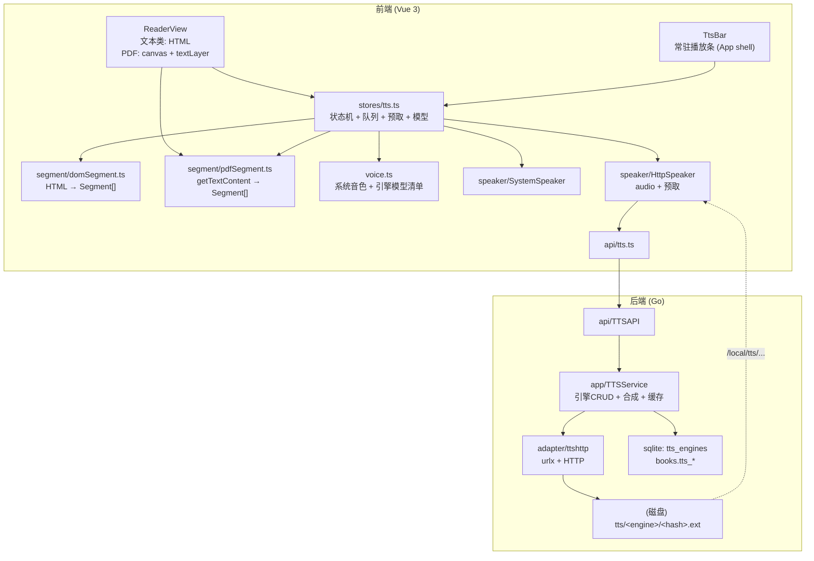
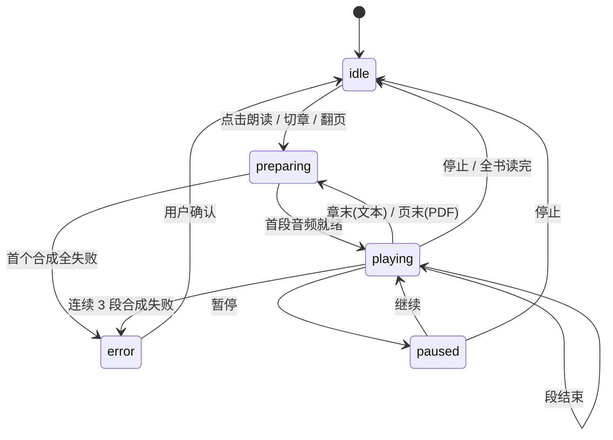
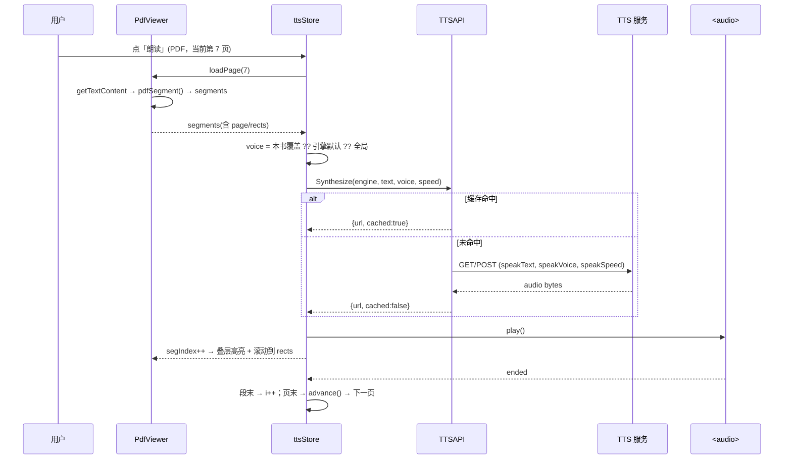

# 桌面端 TTS 朗读功能设计方案（v2：含 PDF + 多发音模型）

> 范围：`desktop/`（Wails v3 + Vue 3）为**网络小说（书源）**、**EPUB**、**TXT**、**PDF** 提供朗读能力，
> 并支持在**多个发音模型**之间切换（系统音色 / 自建 HTTP TTS 服务的模型）。
> 状态：**M1 已实现并验收（2026-10-30，见 §17）**；M2（PDF）、M3（HTTP 引擎+多模型）、M4/M5 未开始。
> 带 ✅ 的是已在本仓库实测/核对过的事实，带 ⚠️ 的是需要注意的实现陷阱。

## v2 相对 v1 的变化

| 项 | v1 | v2 |
|---|---|---|
| PDF | 明确不做 | **必做**，且必须把 PDF 渲染从内置 iframe 换成 pdf.js（唯一能拿到文本层的路径） |
| 发音模型 | 只有"选一个系统音色" | **一等公民**：`Voice` 抽象、每引擎模型清单、规则变量 `{{speakVoice}}`、本书级覆盖、试听、缓存按模型隔离 |
| 里程碑 | M1–M4 | M1–M5（PDF 单列一个里程碑，因为它是唯一"可能做不成"的风险项） |

---

## 0. 结论速览

| 决策 | 内容 |
|---|---|
| **双引擎** | ① **系统朗读**（WebView `speechSynthesis`）：零配置、离线 → P0；② **HTTP TTS**（对齐 Legado `HttpTTS` 语义 + 扩展模型参数）：音质可用 → P0 |
| **PDF 必须换渲染器** | 内置 PDF 查看器是浏览器插件，**DOM 不可访问、取不到文本**。改用 `pdfjs-dist`（canvas + textLayer）：文本层用于朗读/高亮/点句跳读，顺带拿到大纲、页码、缩放 ✅ 前置条件 |
| **分段在前端** | 文本类从渲染后 DOM 切段；PDF 从 `getTextContent()` 重建段落。两条路径产出**同一个 `Segment` 抽象**，下游播放器/高亮/进度只认一个模型 |
| **多发音模型** | `Voice{id,name,lang}` 统一抽象；系统引擎来自 `getVoices()`，HTTP 引擎来自配置里的模型清单或 `/voices` 探测；生效层级：**本书覆盖 > 引擎默认 > 全局默认** |
| **音频经 `/local/` 直出** | 落盘 `<数据目录>/tts/<engine>/<hash>.<ext>`，`<audio src="/local/tts/...">` 播放（`http.FileServer` 天然支持 Range ✅） |
| **规则引擎零新造** | `legado-go` 的 `js.Bindings` **已内置** `SpeakText`/`SpeakSpeed` ✅，只需给 `urlx.Options` 透传，并补一个 `SpeakVoice` |

**已实测（决定 P0 可行性）**

| # | 结论 | 证据/影响 |
|---|---|---|
| 1 | Windows WebView2 的 `speechSynthesis` **可用** | `getVoices()` 6 个声音，含 3 个中文（Huihui / Kangkang / Yaoyao）；`speak()` 的 `start`/`end` 正常触发 |
| 2 | ⚠️ **首帧 `getVoices()` 返回空数组** | 必须等 `voiceschanged`，否则音色设置静默失效（`voice.ts` 首条规则） |
| 3 | `navigator.mediaSession` 存在 | 媒体键 P2 可用 |
| 4 | `/raw/`、`/local/` 都支持 Range | `http.ServeFile` / `http.FileServer` ✅ → pdf.js 分块读取、`<audio>` 拖动都可行 |
| 5 | **pdf.js 能正确取出中文文本** | 用本机 57 页中文 PDF 实测：p2 483 字、p5 363 字，无乱码、无替换符 |
| 6 | **cMaps 不是必需，但要有** | 同一 PDF 加不加 cMaps 结果完全一致（该文件字体带 ToUnicode）。缺 ToUnicode 的 CID 字体才依赖 cMap → 仍随包分发作保险，**不把它当"必挂"** |
| 7 | **段落重建算法可用** | 原型跑通「y 聚行 → 间距+句末标点聚段」：p2 出 5 段（28/101/168/103/83 字）、p5 出 8 段，边界合理 |
| 8 | 🔴 **扫描版 PDF 是常态，不是边角案例** | 本机另一份 221 页的政府公告 PDF：**逐页抽样 0 个文本 item**（纯图片）。TTS 对它无字可读 |

> 第 8 条直接决定产品口径：**"PDF 能朗读"必须限定为"有文本层的 PDF"**。
> 检测与提示是硬需求；是否做 OCR 兜底见 §6.7 与 §15。
>
> 预研脚本与完整数据：`desktop/tmp-pdfspike/`（`scan.mjs` / `group.mjs` / `RESULTS.md`），可随时复跑。

---

## 1. 目标与非目标

### 目标

1. **四种格式都能读**：书源小说、EPUB、TXT、**PDF（限定"有文本层"的 PDF）**。
   扫描版 PDF 明确提示不可读，OCR 作为可选项（见 §6.7）。
2. 点「朗读」从**当前段落/当前页的首段**开始，自动续读：文本类自动翻章，PDF 自动翻页。
3. 朗读时当前段落**高亮并滚入视野**（PDF 是在页面上叠半透明矩形）；点任意段落/任意位置可从那里读。
4. **多发音模型**：可切换系统音色，也可切换 HTTP 引擎提供的模型（如 `zh-CN-XiaoxiaoNeural`、
   `kokoro:zf_xiaobei`、GPT-SoVITS 的 speakers），并支持"这本书专用某模型"。
5. 暂停/继续、上一段/下一段、语速、定时停止。
6. 离开阅读器（回书架/去设置）继续朗读，底部常驻播放条可控制。
7. 进度并入现有 `reading_progress`（文本类按章 + 滚动百分比；PDF 按页 + 页内位置）。

### 非目标

| 不做 | 原因 |
|---|---|
| **扫描版 PDF 的 OCR（默认不做）** | 无文本层，识别质量不可控且体积大（+35MB）。M2 只做**检测 + 明确告知**；OCR 为 M5 可选项（`tesseract.js` 按页惰性，见 §6.7） |
| 漫画朗读 | 无文本 |
| Go 侧系统 TTS（SAPI / NSSpeechSynthesizer / speech-dispatcher） | 需 cgo 或平台绑定，违反 `ARCHITECTURE.md` §8/§9 |
| 音频导出 / 整本离线合成 | 存储与版权问题 |
| PDF 的完整 viewer 能力（连续滚动、批注、搜索） | 本方案只保证"单页 + 翻页 + 缩放 fit-width"够朗读用，其余见 §6.6 |

---

## 2. 现状盘点（代码事实）

### 2.1 阅读链路

| 环节 | 现状 | 位置 |
|---|---|---|
| 正文获取 | `ReaderAPI.GetContent(bookID, index)` → `ChapterContent{HTML, Images}` | `desktop/api/reader.go`、`internal/app/dto/reader.go` |
| 内容分派 | 本地书走解析器，网络书走书源抓取 | `internal/app/content.go` |
| 文本类渲染 | `v-html` 注入 `.content` | `ReaderView.vue:236-249` |
| **PDF 渲染** | `<iframe src="/raw/?p=...">` 交给 WebView 内置查看器 | `ReaderView.vue:224` |
| **PDF 后端** | 只有一个占位章节「全文」，`Content()` 返回空 HTML | `internal/adapter/bookparser/pdf.go` |
| PDF 大纲 | `SyncOutline` API 已存在但**前端从未调用** | `api/reader.go:55`、`api/reader.ts:35` |
| 进度字段 | `chapterIndex` + `chapterPos` + `scrollPercent`，**`chapterPos` 已全链路落库但恒为 0** | `migrations/001_init.sql`、`sqlite/chapter.go:136` |
| 净化 | `replace_rules` 尚未生效 | 无引用 |

> **两个"已经躺在那里没人用"的东西正好被本方案用上**：`chapterPos` 作为 PDF 页码、`SyncOutline` 作为 PDF 大纲落库（P2）。

### 2.2 已有可复用资产

| 资产 | 说明 |
|---|---|
| `/local/` 静态路由 | `main.go:149`，`<audio>` 可直接播放并拖动 ✅ |
| `/raw/` 任意文件路由 | `main.go:serveRawFile`，`http.ServeFile` ✅ → pdf.js 可直接按 URL 加载本地 PDF |
| `settings` 键值表 | `port.SettingsStore` |
| `legado-go` JS 变量 | `js.Bindings.SpeakText/SpeakSpeed` 已存在并注入 `speakText`/`speakSpeed` ✅ |
| `urlx.AnalyzeUrl` | 支持 `{{expr}}`、`@js:`、`<1,2,3>`、`,{method:"POST",body:...}` ✅（缺 SpeakText 透传） |
| 迁移机制 | `migrations/NNN_*.sql` + `schema_version` 表 ✅，加列很便宜 |

### 2.3 缺口清单

| 缺口 | 影响 |
|---|---|
| 无音频能力（前端/后端） | 从 0 开始 |
| **PDF 无文本层访问** | 朗读、高亮、页码进度全部无从谈起 |
| 无「当前播放段落」概念 | 进度粒度只到章 + 滚动百分比 |
| 无发音模型概念 | 引擎=一个固定音色，用户无法选模型 |
| `HttpTTS` 表与配置 UI 不存在 | 需新建表 + 设置页 |
| 无正文净化 | 朗读会念出"请收藏本站" |
| 侧栏无设置入口 | 引擎/模型配置无处安放 |

---

## 3. 技术路线选型

### 3.1 朗读引擎

| 方案 | 音质 | 离线 | 成本 | 风险 | 结论 |
|---|---|---|---|---|---|
| **A. 系统朗读**（`speechSynthesis`） | 中（中文偏机械） | ✅ | 极小：纯前端 | Chromium `pause()` 长文本有缺陷；Linux 可能无声音；机器间音色差异大 | **P0**（兜底：装完就能读） |
| **B. HTTP TTS**（URL 规则 + 模型参数） | 好（取决于服务） | ❌ | 中 | 需用户自备服务 | **P0**（唯一"音质能长期听"的通用路径） |
| C. 内置 Edge 在线引擎 | 很好 | ❌ | 中高 | **ToS + 接口失效风险** | P2，默认关闭，启用须弹说明 |
| D. Go 侧系统 TTS | 中 | ✅ | 高 | 破坏 `CGO_ENABLED=0` | ❌ 否决 |

### 3.2 PDF 文本层

| 方案 | 中文支持 | 成本 | 结论 |
|---|---|---|---|
| **`pdfjs-dist`（前端）** | 浏览器级，配 cMaps 后可靠 | 中：换渲染器 + 文本重建 | ✅ **采用**。唯一能同时拿到"渲染 + 文本 + 坐标 + 大纲"的路径 |
| Go `klippa-app/go-pdfium`（wazero WASM） | 好 | 高：约 8MB WASM + 结构化文本 API | 备选。仅当"必须后端出文本"时才考虑 |
| Go `ledongthuc/pdf` | **CID 中文字体常乱码** | 低 | ❌ |
| 保留内置查看器 + 外部取文本 | — | — | ❌ 取不到，且页码无法同步 |

> 结论：**PDF 的渲染与文本层都交给 pdf.js**。这不是"顺手多做一个功能"，而是 PDF 朗读的唯一可行路径；
> 代价是阅读器的 PDF 分支从"一行 iframe"变成"一个精简 viewer"（见 §6）。

### 3.3 发音模型来源

| 来源 | 发现方式 | 覆盖场景 |
|---|---|---|
| 系统音色 | `speechSynthesis.getVoices()`（等 `voiceschanged`） | Windows/macOS 自带中英文音色 |
| HTTP 引擎静态清单 | 引擎配置里逐行填 `id=显示名\|lang` | 任何服务，最稳，**默认** |
| HTTP 引擎动态探测 | 可选 `voicesUrl`（GET 返回 JSON，按 `itemsKey/idKey/nameKey/langKey` 取） | Kokoro / IndexTTS / GPT-SoVITS / CosyVoice 这类本地模型服务的 `/voices`、`/speakers` |

---

## 4. 总体架构



**分层落点（严格按 `ARCHITECTURE.md`）**

| 层 | 新增文件 | 职责 |
|---|---|---|
| `internal/domain` | `tts.go` | `TTSEngine`、`Voice`、`AudioClip`、领域错误 |
| `internal/port` | `tts.go` | `TTSEngineRepository`、`TTSSynthesizer` |
| `internal/app` | `tts.go`、`dto/tts.go` | 引擎 CRUD、模型清单解析、合成编排、缓存、本书覆盖 |
| `internal/adapter/ttshttp` | `synth.go`、`voices.go` | 拼接规则请求、拉音频、`voicesUrl` 探测 |
| `internal/adapter/persistence/sqlite` | `tts_repo.go`、`migrations/003_tts.sql` | 建表 + 加列 |
| `api` | `tts.go` | `TTSAPI` |
| `frontend/src` | `stores/tts.ts`、`components/TtsBar.vue`、`components/pdf/PdfViewer.vue`、`segment/*.ts`、`speaker/*.ts`、`voice.ts`、`api/tts.ts`、`views/SettingsView.vue` | 见 §6/§7 |

---

## 5. 统一的段落模型

```ts
// 位置：前端 segment/types.ts
export interface Segment {
  text: string;        // 已做朗读前净化
  chapter: number;     // 章序号（PDF 为 0，页码另存）
  page?: number;       // 仅 PDF
  rects?: Rect[];      // 仅 PDF：每行一个矩形（用于高亮/命中测试，pdf 坐标）
  long: boolean;       // 超长，需再切句
}
```

- 文本类：`rects` 为空，靠 `el` 关联（见 §6.2），实际实现用 `SegmentEl extends Segment { el: Element }`；
- PDF：靠 `page + rects` 定位，`el` 为空。

下游（播放、高亮、进度）只认 `Segment`，不关心来源。

### 5.1 朗读前净化（两条路径共用 `ttsText.ts`）

1. 去零宽字符、`\u00ad`（软连字符）、`\u00a0`，连续空白归一；
2. 去常见站点噪音：`请收藏本站.*`、`本章未完.*继续阅读`、`最新网址.*`、`手机用户请浏览.*`、纯 URL 行、`[本章由.*]`；
3. 去纯符号/页码行（`***`、`12/240`、`第 3 页`）；
4. **CJK 粘连修复**：两个汉字之间夹一个空格 → 去掉（PDF 抽取常见，见 §6.3）；
5. 符号朗读友好化：`……`→`，`、`——`→`，`、连续标点归一。

> `replace_rules` 落地后，站点噪音应前移到 Go 侧统一处理，本文件退化为"归一 + 符号"。

---

## 6. PDF 朗读（本版重点）

### 6.1 为什么必须换渲染器

内置 PDF 查看器是浏览器扩展，不是普通 DOM：拿不到文本、拿不到当前页、拿不到选中内容。
`<iframe>` 里唯一的可控手段是 URL 片段 `#page=N`，但**改了 hash 是否跳页、是否重载都不保证**，
且用户手动滚动后的页码完全不可知 → 高亮、点读、进度、续读全部无法实现。

所以 `PdfViewer.vue` 用 pdf.js 重画：

```
pdfjsLib.getDocument({ url: rawFileURL(book.bookUrl),
                       cMapUrl: "/pdfjs/cmaps/", cMapPacked: true,
                       standardFontDataUrl: "/pdfjs/standard_fonts/" })
```

### 6.2 渲染结构

```
<div class="pdf-stage">            ← 滚动容器
  <div class="pdf-page">           ← 当前页
    <canvas class="pdf-canvas" />  ← 位图（devicePixelRatio 缩放）
    <div class="pdf-text-layer" /> ← textLayer（可选中、可用 Range）
    <div class="pdf-tts-hl" />     ← 朗读高亮叠层（绝对定位，按 rects 画）
  </div>
</div>
```

- 缩放：MVP 只做 **fit-width**（容器宽 / page.view 宽），`Ctrl+滚轮` 或按钮调 `scale`（P1）。
- 翻页：单页模式，`page` 状态驱动；`←/→` 与阅读器现有键位复用（PDF 下改为翻页）。
- 页缓存：`Map<number, PDFPageProxy>`，只保留当前页 ±2。
- **textLayer 用 pdf.js 自带的 `TextLayer` 类**（v4 API：`new TextLayer({textContentSource, container, viewport})`），
  不要自己拼 span——版本升级时它跟着变，自己写会错位。

**cMaps 与 standard_fonts：随包分发，但别当"救世主"**

实测结论（见 §0 第 6 条）：**带 `ToUnicode` 表的中文 PDF 不需要 cMap 也能正确取字**——本机 57 页样本加与不加 cMaps，
文本逐字一致。只有**缺 `ToUnicode` 的 CID 字体**才依赖 cMap（这类文件在老版方正/华文排版、部分扫描 OCR 导出的 PDF 里出现）。

因此：
- `pdfjs-dist/cmaps`（约 1.5MB）与 `standard_fonts` 仍复制到 `frontend/dist/pdfjs/`（`postbuild`，见 §10.1），
  成本极低、能救回一部分文件；
- **构建期校验只检查目录存在并 warn**，不做"缺了就 fail"——把它当致命条件会误导排查方向（真正的空文本大多来自扫描版，见 §6.7）。

### 6.3 文本重建算法（`segment/pdfSegment.ts`）

```ts
const tc = await page.getTextContent();
// 1) 按 y 聚行：|dy| < height*0.5 视为同一行
// 2) 行内按 x 排序拼串；相邻 item 间距 > height*0.35 → 补一个空格
// 3) 行 → 段：垂直间距 > 行高*1.7 且 上一行以 。！？：；”"） 结尾 → 断段
// 4) 过滤页眉页脚：正则 + 跨页重复行黑名单（见下）
// 5) 后处理：CJK 间空格删除、软连字符去除、连续空白归一（同 §5.1）
```

**实测产出**（本机 57 页中文 PDF，原型 `tmp-pdfspike/group.mjs`）：

| 页 | 行数 | 段数 | 段长分布 | 备注 |
|---|---|---|---|---|
| p2 | 22 | 5 | 28 / 101 / 168 / 103 / 83 | 边界恰好落在自然段 |
| p5 | 20 | 8 | 120 / 40 / 34 / 34 / 34 / 30 / 68 / **3** | 最后一段是页脚 `－1－`，必须过滤 |

页脚实测样本：`－1－`、`－24－`、`－I－`、`－53－`。过滤规则：

```
^\s*[－—–\-]\s*[0-9IVXLCa-z]*\s*[－—–\-]\s*$      // －24－ / －I－
^\s*(第\s*)?\d+\s*(页|/\s*\d+)\s*$                 // 12 / 第 12 页 / 12/57
```
再加一条兜底：预扫前 20 页，**同一短行（<30 字）出现在 >50% 的页面上** → 加入黑名单（抓页眉书名、章名）。

每段保留 `rects`（每行的 pdf 坐标矩形），高亮与点读都靠它：
- 高亮：`rects` × `viewport` → 叠层 `<div>` 的半透明背景；
- 点读：点击坐标反算成 pdf 坐标，找**包含该点的第一个 rect** 所属段落 → 从该段读。

**超长段**（单段 > 180 字）在句末标点处二次切句，`long=true`，只影响合成粒度不影响高亮粒度。

### 6.4 进度与续读

| 项 | 决策 |
|---|---|
| 页码 | `chapterPos = pageIndex`（0-based）。`chapterPos` 字段已全链路落库 ✅，**无需改表** |
| 章 | PDF 仍是单章「全文」（后端 `PDFParser` 不变）；跨"章"= 跨"页" |
| 页内位置 | `scrollPercent` 复用为"当前段在本页的进度"（不用于滚动，仅给书架显示百分比） |
| 朗读续读 | 页末最后一段结束 → 下一页第 0 段；到最后一页 → `idle` |
| 手翻页 | 更新 `page` + 保存进度；朗读中翻页 → 从新页首段继续（与文本类翻章一致） |
| 重开 | `GetProgress().chapterPos` → 直接跳该页 |

### 6.5 与文本类的差异点（实现时别写错）

| 维度 | 文本类 | PDF |
|---|---|---|
| 段落来源 | 渲染后 DOM | `getTextContent()` |
| 高亮 | 给元素加类 | 叠层矩形 |
| 翻页单位 | 章（异步拉 HTML） | 页（本地，同步） |
| `chapterPos` | 恒 0 | 页码 |
| 章节数 | 真实目录 | 1（「全文」） |
| 底栏 | `N / 总数` | `第 N / M 页` |

### 6.6 PDF viewer 的能力边界（明确写清，避免验收争议）

MVP（M2）只做：**单页渲染 + 翻页 + fit-width + 文本层选择 + 朗读高亮 + 页码进度**。

不做（或后续）：连续滚动、双页、旋转、搜索、批注、缩略图侧栏、大纲落库。
大纲（`getOutline()`）在 M2 里**只用于目录抽屉跳页**，不写数据库——避免一次性插入上百行 `book_chapters`
（`SyncOutline` 已具备该能力，列为 P2，等 PDF 章节语义真正需要时再启用）。

### 6.7 扫描版 PDF：先"诚实告知"，OCR 作为可选兜底

**这是本方案最容易被低估的一块**：本机抽样的 221 页政府公告 PDF，逐页 0 个文本 item——**整本都是图片**。
中文世界大量 PDF（公文、扫描书、拍照转 PDF）都是这样，"PDF 能朗读"如果不加限定，首次使用就可能翻车。

**检测（M2 必做）**

| 层级 | 规则 | 行为 |
|---|---|---|
| 页 | 该页 `items` 拼接长度 < 20 字 | 该页标记 `scanned`，朗读时提示「本页是图片，无文本」并跳到下一个有文本的页 |
| 文档 | 打开后前 5 页全部 `scanned`（或抽样 10 页里 ≥8 页空） | **打开即提示**：「这本 PDF 是扫描版，没有文本层，暂不支持朗读」，并给「了解 OCR 方案」入口 |
| 书架 | 已标记 `doc.scanned` 的书 | 卡片上显示"图片版"角标，避免用户反复点朗读 |

> 原则：**宁可明确说"读不了"，也不要让用户点了播放键后一片安静。** 静默失败是这类功能口碑崩塌的最快方式。

**OCR 兜底（P2，默认关闭，需决策）**

| 方案 | 体积 | 质量（中文） | 依赖 | 判断 |
|---|---|---|---|---|
| **`tesseract.js`**（WASM，跑在 Worker） | +15MB wasm、+20MB `chi_sim` | 中（印刷体可用，竖排/复杂版式差） | 无（纯前端） | ✅ **若做就选它**：不破坏纯 Go 构建、可**按页惰性**处理 |
| 外挂 `tesseract` CLI（Go `exec`） | 0（要求用户自装） | 好 | 用户环境 | 备选：检测 `PATH` 里有就用，否则降级提示 |
| Windows WinRT OCR | 0 | 中 | 平台绑定（COM） | ❌ 与"跨平台 + 无 cgo"冲突 |
| 云 OCR（百度/腾讯） | 0 | 好 | 需密钥、按次计费、隐私 | 后续可选：作为 HTTP 引擎的"同类"，走同一套配置 |

若做，设计要点：**按页惰性 + 结果落盘缓存**（`<数据目录>/ocr/<bookHash>/<page>.txt`），只识别用户正在听/已翻到的页，
首次提示"本页正在识别，约 2–5 秒"；识别结果与文本层段落走同一个 `Segment` 抽象，后续流程零改动。
代价：首次使用要下载 20MB 语言包（离线打包则安装包变大），且 221 页全书识别耗时以小时计 —— 所以**只做按页**，不做整本。

---

## 7. 多发音模型

### 7.1 模型抽象

```ts
export interface Voice {
  id: string;        // 传给引擎的值：系统音色名 / zh-CN-XiaoxiaoNeural / zf_xiaobei
  name: string;      // 展示名
  lang?: string;     // zh-CN / en-US
  engineId: string;  // "system" | "http:<id>"
}
```

### 7.2 生效层级（从高到低）

1. **本书覆盖**：`books.tts_engine_id` + `books.tts_voice`（"这本用小说音色，那本用新闻音色"）
2. **引擎默认模型**：`tts_engines.default_voice`（每个引擎各自记住上次选的模型）
3. **全局默认**：`tts.engine` + `tts.voice`

阅读器/播放条上的模型下拉改的是"本书覆盖"；设置页里改的是"引擎默认/全局默认"。

### 7.3 HTTP 引擎如何把模型传出去

规则变量新增 **`{{speakVoice}}`**（对齐 `speakText`/`speakSpeed` 的做法）：

```
https://tts.example.com/api?t={{speakText}}&v={{speakVoice}}&s={{speakSpeed}}
@js: `https://tts.example.com/tts?text=${encodeURIComponent(speakText)}&voice=${speakVoice}`
,{method:"POST", body:"text="+encodeURIComponent(speakText)+"&voice="+speakVoice}
```

需要两处小改动（我们自己 fork 的 `legado-go`，改动可控）：

| 文件 | 改动 |
|---|---|
| `pkg/js/engine.go` | `Bindings` 增加 `SpeakVoice string`；`inject()` 里 `g.Set("speakVoice", ...)`（`speakText`/`speakSpeed` 已有 ✅） |
| `pkg/urlx/analyze_url.go` | `Options` 增加 `SpeakText`/`SpeakSpeed`/`SpeakVoice`，`evalJS` 时透传给 `js.Bindings` |

各引擎按需取用：不支持语速的服务，URL 里不写 `{{speakSpeed}}` 即可；不做"语速参数名配置"这种过度设计。

### 7.4 模型清单的来源与 UI

| 来源 | 交互 |
|---|---|
| 系统音色 | 设置页下拉，按 `lang` 分组，标"本机"；空列表时显示"本机无可用语音，请改用 HTTP 引擎" |
| 引擎静态清单 | 编辑框逐行 `id=显示名\|lang`，保存时校验非空 id 唯一 |
| 引擎动态探测 | 「拉取模型」按钮 → `ProbeVoices(engineID)` → 展示返回的模型数；失败不阻塞（静态清单仍可用） |

**试听**：`TestEngine(engineID, voiceID)` 用固定样句合成并播放（不计入缓存，或计入但标记 `probe`）。
样句建议「这是一段试听，人生若只如初见，何事秋风悲画扇。」——含标点与文言节奏，能听出音色差异。

### 7.5 缓存与模型的相互影响

| 项 | 决策 |
|---|---|
| 缓存键 | `sha1(engineID | **voice** | speed | text)[:16]` — 换模型必须重新合成 |
| 目录 | `<数据目录>/tts/<engineID>/<hash>.<ext>` |
| 膨胀风险 | 每个模型一份缓存 → 设置页展示"按模型统计占用"，一键清空某模型（P1） |

---

## 8. 后端设计

### 8.1 数据表与迁移

```sql
-- migrations/003_tts.sql
CREATE TABLE IF NOT EXISTS tts_engines (
  id            INTEGER PRIMARY KEY AUTOINCREMENT,
  name          TEXT    NOT NULL,
  url           TEXT    NOT NULL,              -- 规则模板：{{speakText}} {{speakVoice}} {{speakSpeed}} @js:
  content_type  TEXT    NOT NULL DEFAULT '',   -- 期望响应 Content-Type 的正则，空=不校验
  header        TEXT    NOT NULL DEFAULT '',   -- JSON 对象串
  voices        TEXT    NOT NULL DEFAULT '',   -- 静态模型清单：每行 id=名称|lang
  default_voice TEXT    NOT NULL DEFAULT '',
  voices_url    TEXT    NOT NULL DEFAULT '',   -- 动态探测（可选）
  enabled       INTEGER NOT NULL DEFAULT 1,
  sort_order    INTEGER NOT NULL DEFAULT 0,
  created_at    INTEGER NOT NULL,
  updated_at    INTEGER NOT NULL
);

-- 本书级覆盖：不同书用不同模型/引擎
ALTER TABLE books ADD COLUMN tts_engine_id INTEGER NOT NULL DEFAULT 0;
ALTER TABLE books ADD COLUMN tts_voice     TEXT    NOT NULL DEFAULT '';
```

**设置键**（`port/settings.go` 追加）

| 键 | 值 |
|---|---|
| `tts.engine` | `"system"` 或 `"http:<id>"` |
| `tts.voice` | 全局默认模型 |
| `tts.rate` | 语速百分比，默认 `100`（50–200） |
| `tts.autoNext` | 自动翻章/翻页，默认 `1` |
| `tts.readChapterTitle` | 先读章节标题，默认 `1`（PDF 读「第 N 页」？默认关） |
| `tts.cacheLimitMB` | 默认 `256` |
| `tts.prefetch` | 预取段数，默认 `2` |

### 8.2 端口

```go
type TTSEngineRepository interface {
    List(ctx context.Context) ([]*domain.TTSEngine, error)
    Get(ctx context.Context, id int64) (*domain.TTSEngine, error)
    Save(ctx context.Context, e *domain.TTSEngine) error
    Delete(ctx context.Context, id int64) error
}

// TTSSynthesizer 把一段文本合成成音频文件，返回可被 /local/ 直接访问的结果。
type TTSSynthesizer interface {
    Synthesize(ctx context.Context, e *domain.TTSEngine, text, voice string, speed int) (*domain.AudioClip, error)
    ProbeVoices(ctx context.Context, e *domain.TTSEngine) ([]domain.Voice, error)
}

type AudioClip struct {
    Path string // 磁盘绝对路径
    MIME string
    Size int64
}
```

### 8.3 适配器（`adapter/ttshttp`）

请求：

```go
au := urlx.New(urlx.Options{
    Url: e.URL, SpeakText: text, SpeakVoice: voice, SpeakSpeed: speed,
    Headers: e.HeaderMap,
})
```

校验（对齐 Kotlin `HttpReadAloudService` 的行为）：

1. 超时 **20s**，失败重试 1 次；
2. 状态码 2xx；`Content-Type` 命中 `audio/*` → 成功；
   命中 `application/json` / `text/*` → 视为错误页，读 ≤4KB 作为错误消息；
   配了 `content_type` 正则则额外校验；
3. 音频 ≤ 8MB、> 256B（过小视为错误页）；
4. 扩展名由 Content-Type 决定：`mpeg→.mp3`、`wav|x-wav→.wav`、`ogg→.ogg`、`aac→.aac`，未知 `.mp3`。

`ProbeVoices`：GET `voices_url`，JSON 数组 → 若带 `itemsKey` 先取该字段；每条取 `idKey`/`nameKey`/`langKey`
（默认 `id`/`name`/`lang`，缺 `id` 用 `name`）。

### 8.4 缓存

| 项 | 决策 |
|---|---|
| 键 | `sha1(engineID|voice|speed|text)[:16]` |
| 路径 | `<数据目录>/tts/<engineID>/<hash>.<ext>` |
| 并发 | 全局串行 + 每引擎 ≤2；前端预取只领先 `tts.prefetch` 段 |
| 淘汰 | 启动时 + 每 50 次写入，按 `mtime` 删到 ≤ `tts.cacheLimitMB` |
| 失败缓存 | `<hash>.err`，TTL 10 分钟，避免反复打挂服务 |

### 8.5 API（`api/tts.go`）

| 方法 | 说明 |
|---|---|
| `ListEngines()` | 引擎列表 + 当前选中 + 全局默认模型 |
| `SaveEngine(cfg)` / `DeleteEngine(id)` | 名称/URL 非空校验；删被选中项回退 `system` |
| `TestEngine(cfg, voice)` | 合成固定样句，返回耗时/字节/错误（供试听与"测试连接"） |
| `ProbeVoices(cfg)` | 从 `voices_url` 拉模型清单 |
| `Synthesize(engineID, text, voice, speed)` | 返回 `{url, bytes, cached}`，**不返回 base64** |
| `GetPrefs()` / `SavePrefs(p)` | 全局偏好 |
| `SetBookOverride(bookID, engineID, voice)` | 本书级覆盖；`engineID=0` 表示清除 |
| `CacheStats()` / `ClearCache(engineID?)` | 占用与清理 |

---

## 9. 播放状态机与跨章/跨页



store 状态：

```ts
{
  status, bookId, bookName, format,
  chapter, page, segIndex, segCount,
  engineId, voice, rate,
  segments: Segment[],
  sleepAt, errorMsg, generation
}
```

**Source 适配（关键解耦）**：store 不关心是章还是页，只请求"下一批段落"：

```ts
interface TtsSource {
  load(bookId, chapter, page): Promise<Segment[]>;   // 文本: 拉 HTML→domSegment；PDF: pdfSegment
  advance(): Promise<{chapter, page} | null>;        // 文本: next chapter；PDF: next page
}
```

- 文本类 `advance()` → `readerApi.getContent(bookId, next)`（异步、可能失败 → 错误态）
- PDF `advance()` → `page+1`（本地、同步；`pageCount` 来自已加载的 PDFDocumentProxy）
- **PDF 的 source 需要 pdf.js 文档代理**，因此由 `PdfViewer` 在挂载时把 `loadPage(page)` 回调注册进 store；
  用户离开阅读器后 PDF 朗读**无法续读**（文档代理随组件卸载）。这一点必须明说：
  **PDF 朗读在前台会话内有效，离开阅读器即暂停**（文本类可后台继续）。

---

## 10. 前端设计

### 10.1 构建与依赖

| 项 | 决策 |
|---|---|
| 依赖 | `pdfjs-dist@4.x`（**锁版本**：TextLayer / worker API 在小版本间变过） |
| worker | `new Worker(new URL("pdfjs-dist/build/pdf.worker.min.mjs", import.meta.url), {type:"module"})` |
| cMaps | `postbuild` 把 `node_modules/pdfjs-dist/cmaps` + `standard_fonts` 复制到 `frontend/dist/pdfjs/` |
| 校验 | 构建脚本检查 `dist/pdfjs/cmaps/Adobe-GB1-UCS2.bcmap` 存在，否则 **fail**（缺了就中文乱码） |

### 10.2 组件与职责

| 文件 | 职责 |
|---|---|
| `views/ReaderView.vue` | 按格式分派：pdf → `PdfViewer`；comic → 图片流；其它 → 文本 |
| `components/pdf/PdfViewer.vue` | pdf.js 加载、单页渲染、textLayer、翻页、缩放、大纲抽屉、点读命中 |
| `components/TtsBar.vue` | 常驻播放条：书名·章/页、上/下段、播放/暂停、语速、**模型下拉**、定时、关闭 |
| `stores/tts.ts` | 状态机、队列、预取、模型解析、进度回写 |
| `segment/domSegment.ts` / `segment/pdfSegment.ts` | 两条切段路径，共用 `Segment` |
| `speaker/SystemSpeaker.ts` / `speaker/HttpSpeaker.ts` | 播放实现 |
| `voice.ts` | 系统音色枚举（等 `voiceschanged`）、引擎清单解析、默认挑选 |
| `utils/ttsPrefs.ts` | localStorage 缓存 UI 偏好（语速/上次模型），与服务端设置双写 |
| `views/SettingsView.vue` | 引擎列表 + 模型管理 + 试听 + 全局偏好 + 缓存 |

### 10.3 交互细节

| 场景 | 行为 |
|---|---|
| 阅读器顶栏「朗读 ▶」 | `start(book, chapter/page, segIndex)`；已在读则变「暂停」 |
| 正文/页面点击 | 文本类：点段落 → 从该段读（仅朗读中生效，避免和翻页冲突）；PDF：点位置 → 命中的段 |
| 文本类翻章 / PDF 翻页 | 朗读中自动跟随；未朗读时只翻页 |
| 模型切换 | 播完当前段后换（不打断半句）；切换即写入"本书覆盖" |
| 语速切换 | 立即生效（HTTP：下一段参数变；系统：`rate` 重设） |
| 快捷键 | 阅读器内 `Alt+Space` 播放/暂停；`Alt+←/→` 上/下一段（P1） |
| 关窗 | 停止 + 落盘进度 |
| Linux/无声卡 | 探测 `getVoices().length===0` → 引导到 HTTP 引擎 |

---

## 11. 关键流程



**异常路径**

| 情况 | 处理 |
|---|---|
| 单段合成失败 | 跳下一段，记告警；连续 3 段 → `error` + 提示"引擎不可用：检查 URL/模型/额度" |
| PDF 页无文本层 | 该页提示"本页无文本（扫描页）"，自动跳到下一个有文本的页；全书无文本 → 直接提示不支持 |
| 系统引擎无中文模型 | 提示切 HTTP 引擎，并给「去设置」按钮 |
| 切页竞态 | `generation` 计数，过期回调丢弃 |
| 用户离开阅读器（PDF） | 暂停（文档代理销毁），播放条保留"继续阅读"入口 |
| 用户离开阅读器（文本） | 后台继续，播放条可用 |

---

## 12. 里程碑

| 里程碑 | 内容 | 验收标准 | 规模 |
|---|---|---|---|
| **M1 骨架 + 文本类** ✅ 已实现 | `Segment` 抽象、`domSegment`、`ttsStore`、`SystemSpeaker`、`TtsBar`、段落高亮/滚动、自动翻章、进度联动 | 系统音色下连续读 3 章；离开阅读器继续；进度正确落库；0 控制台异常 | M |
| **M2 PDF 朗读** | `PdfViewer`（pdf.js 单页 + textLayer + fit-width）、`pdfSegment`、矩形高亮、点读命中、页码进度（`chapterPos`）、**扫描版检测与提示**、cMaps 打包 | ① 有文本层的中文 PDF（用本机 57 页样本）：页码/翻页正确、高亮随段移动、点页内任意段落能从那里读、重开回到原页；② 扫描版 PDF（用本机 221 页样本）：打开即提示"无文本层"，不出现"点了没反应" | **L（最高风险）** |
| **M3 HTTP 引擎 + 多模型** | `tts_engines` 表 + 迁移 + 仓储 + `ttshttp`（含 `ProbeVoices`）+ 缓存（键含 voice）+ `TTSAPI` + `SettingsView`（引擎/模型/试听）+ `HttpSpeaker` + 本书覆盖 | 配一个真实服务（如本地 Kokoro/IndexTTS）：能拉取模型、试听、朗读；换模型后重新合成（缓存不串）；本书覆盖生效 | L |
| **M4 打磨** | 预取窗口、语速热切、睡眠定时、`Alt` 快捷键、缓存统计与按模型清理、封面/详情页"朗读设置"入口 | 预取命中时段间无静默；睡眠到点淡出停止 | M |
| **M5 可选** | Edge 内置引擎（默认关）、**扫描版按页 OCR（`tesseract.js`）**、句级 `CSS.highlights`、`mediaSession` 媒体键、PDF 大纲落库（`SyncOutline`）、PDF 连续滚动 | 各自独立验收 | M |

**建议顺序：M1 → M2 → M3。**
理由：M2 是唯一"可能做不成"的风险项（pdf.js 集成 + 段落重建 + 扫描版占比），越早撞墙越好；
M3 只是 `Speaker` 的第二个实现 + 一套配置 UI，确定性高。
若时间紧，M3 可先只做"单模型 HTTP 引擎"，模型清单留到 M4。

---

## 13. 测试计划

### 13.1 Go 单测

| 用例 | 断言 |
|---|---|
| `urlx` 变量透传 | `{{speakText}}` / `{{speakVoice}}` / `{{speakSpeed}}` 与 `@js:` 都能取到值 |
| 合成客户端 | `audio/mpeg` → 落盘 `.mp3`；`application/json` → 错误含响应片段；`content_type` 不匹配 → 报错；超时 → 明确超时错误；<256B → 判失败 |
| `ProbeVoices` | 数组/包裹 `items`/缺 `id` 用 `name` 三种形态都能解析；非法 JSON → 可读错误 |
| 缓存 | 同 voice 命中；换 voice 不命中；换 speed 不命中；超限淘汰最旧；`.err` TTL |
| 仓储 | CRUD、删除后回退、`books.tts_*` 更新 |

### 13.2 前端单测

| 用例 | 断言 |
|---|---|
| `domSegment` | `<p>` 逐行、`<br><br>` 分段、`div>p` 嵌套、混合图片/裸文本 → 段数与文本符合预期 |
| 索引不变量 | 同一 HTML parse 到离线 document 与挂到 body 的容器，结果逐项相等 |
| `pdfSegment` | 用 2 个 fixture（中文小说 1 页、英文论文 1 页）：行/段数、页眉页脚被过滤、CJK 空格被修掉、`rects` 非空 |
| 扫描版判定 | 空 textContent → 返回 `[]` 且标记 `scanned` |
| `voice.ts` | 系统音色未就绪时返回空且订阅 `voiceschanged`；默认挑 `zh-CN` |

### 13.3 MCP UI 自动化（沿用 `desktop/tmp-mcptest`）

新增 `s6_tts_text.py` / `s7_tts_pdf.py` / `s8_tts_voice.py`：

**文本类**：点朗读 → `playing`；3 段后 `segIndex` 递增、`.tts-active` 唯一且在视口；点第 5 段 → `segIndex===4`；
暂停/继续；语速持久化；章末自动翻章；末章末段 → `idle`。

**PDF**：导入 50 页中文 PDF → `.pdf-canvas` 有非空 `width`；`text-layer` 子节点 > 0；
点朗读 → `.pdf-tts-hl` 出现且 `getBoundingClientRect` 在 canvas 内；翻页 → 高亮跟随新页；
重开书 → `第 N 页` 与关闭前一致；扫描版 → 出现提示文案。

**多模型**：设置页新建引擎（空名/空 URL 校验）→ 填本地 mock → 「拉取模型」得到 N 个 → 试听（收到一次合成请求）
→ 播放条切模型 → 断言后端收到的 `voice` 变化（mock 记录请求）→ 同文本同模型第二次 `cached:true`、换模型 `cached:false`。

> **本仓库踩过的坑**：MCP 的 `js_eval` 遇语法错误不报错而是**静默超时**，脚本 JS 先过 `node --check`；
> Element Plus 的 `v-loading` 遮罩会吞掉真实点击，点击前等遮罩消失。

### 13.4 人工验收（含已确定的样本）

预研阶段已在本机找到两类现成样本，直接作为验收基准：

| 样本 | 用途 | 期望 |
|---|---|---|
| `Downloads/2026版事业单位公开招聘分类考试公共科目笔试考试大纲.pdf`（57 页，有文本层） | 正例 | 每页 360–1900 字，读出完整句子，页脚 `－24－` 不被朗读 |
| `Downloads/2026年专业调整相关文件及资料/1.…（粤考委〔2023〕5号）.pdf`（221 页，纯扫描） | 反例 | 打开即提示"无文本层"，不出现"点了没反应" |

- Windows 三个中文音色实际发声；HTTP 引擎两个不同模型的差异可感知；
- PDF：另找日文/英文各一本，抽查 3 页文本完整性（漏字、乱码、错序、多栏错行）；
- 长段落（>2000 字）不吞尾；PDF 大页（>2000 字符）不卡 UI；
- 低配机器上预取是否导致掉帧；后台播放是否被节流。

---

## 14. 风险与对策

| 风险 | 影响 | 对策 |
|---|---|---|
| **PDF 换渲染器引入回归** | 原本能看的 PDF 看不了了 | MVP 只做单页+fit-width，把面缩小；保留 `LEGADO_PDF_NATIVE=1` 环境变量回退到 iframe（不朗读）做兜底 |
| **中文 PDF 缺 cMap 取不到字** | 朗读为空/乱码 | cMaps 随包分发 + 构建期校验文件存在；首次朗读时若文本 < 20 字直接报"无文本层"而不是静默 |
| **扫描版 PDF** | 用户以为坏了 | 页级 + 文档级检测（§6.7），**明确提示**而非静默；OCR 是 P2 可选项（`tesseract.js` 按页惰性） |
| pdf.js worker 在 Wails 下加载失败 | PDF 白屏 | 用 `new URL(..., import.meta.url)` 走 Vite 打包；启动时 `getDocument` 失败给出可读错误（含路径） |
| pdf.js 体积（~1MB + 1.5MB cmaps） | 安装包变大 | 可接受；cmaps 只在打开 PDF 时按需加载 |
| 系统音色机器间差异 / Linux 无声音 | 体验不一致 | 启动探测 + 引导 HTTP 引擎；文档明确"系统朗读是兜底" |
| Chromium `speechSynthesis.pause()` 缺陷 | 暂停后无声 | 暂停 = `cancel()` + 记录段；继续 = 从该段重读 |
| HTTP 合成慢（1–3s） | 首句空等、段间静默 | `preparing` loading + 预取 2 段 + 缓存 |
| 模型 ID 不稳定 / 服务接口不统一 | 拉取失败 | 静态清单为默认，动态探测 optional |
| 多模型导致缓存膨胀 | 占盘 | 键含 voice + LRU + 按模型统计清理 |
| `url` 可指向任意地址（SSRF） | 可访问内网 | 配置由用户显式填写（等同书源现状）；限制响应 ≤8MB；不自动跟随跨私网重定向 |
| PDF 朗读无法后台续读 | 离开阅读器即停 | 明说限制；播放条给"回到阅读继续"；文本类不受影响 |
| 朗读与阅读进度互相打断 | 进度跳变 | 单一写入源：朗读推进也走 `persistProgress`（PDF 写 `chapterPos=page`） |

---

## 15. 待确认决策点

1. **扫描版 PDF 要不要 OCR**（最影响"PDF 能不能读"的一条）：实测本机 221 页政府公告 PDF **整本 0 文本**，
   这类文件在中文世界很常见。若你的目标 PDF 里有相当比例是扫描件，M2 做完只会得到"能读的仍读不了"的结论。
   可选：M2 只做检测提示（推荐先这样）／M5 上 `tesseract.js` 按页惰性 OCR（+35MB 体积、2–5s/页）。
2. **PDF 兜底开关**：是否保留 `LEGADO_PDF_NATIVE=1` 回退到内置 iframe（可看不可读）？建议保留，成本极低。
3. **PDF 大纲是否落库**：M2 只做前端抽屉跳页（不写库，推荐）；还是要一次落 `SyncOutline` 让目录持久化？
4. **本书级覆盖的入口**：放书详情页（推荐，"这本书用什么声音"语义最自然），还是只在播放条里改？
5. **设置页形态**：新增独立 `/settings`（推荐，本方案按此写），还是把 TTS 塞进「书源」页做 tab / 与 WebDAV 合并？
6. **Edge 内置引擎**是否要做（M5，默认关、有 ToS 风险）。
7. **句级高亮**是否近期就要（决定是否现在就引入 `CSS.highlights` + Range 映射；PDF 的矩形高亮已在 M2 覆盖段落级）。

---

## 16. 与安卓端语义对照

| 安卓 | 桌面端 | 备注 |
|---|---|---|
| `HttpTTS.url`（`speakText`/`speakSpeed`） | `tts_engines.url`（+ `speakVoice`） | 语法同源，多一个模型变量 |
| `HttpTTS.contentType` | `content_type` | 同语义 |
| `BaseReadAloudService.contentList` | `ttsStore.segments` | 分段来源不同（DOM / pdf.js / `TextChapter`） |
| `nowSpeak` / `paragraphStartPos` | `segIndex` | 暂不做段内字符偏移续读 |
| `nextChapter()` | `TtsSource.advance()` | 文本翻章 / PDF 翻页 |
| `setTimer(minute)` | `sleepAt` + 定时器 | 到点淡出后停 |
| 通知栏 / MediaSession | `TtsBar` + `mediaSession`（M5） | 桌面无常驻通知 |
| `getTtsEngine()` 按书记住引擎 | `books.tts_engine_id` + `books.tts_voice` | 多一层模型 |
| PDF 不支持朗读 | **支持**（超出安卓端） | 靠 pdf.js 文本层；扫描版除外 |

---

### 附：一句话总结

**文本类照旧用 DOM 切段；PDF 必须先用 pdf.js 接管渲染拿到文本层与坐标；两条路径统一成
`Segment{text, rects}`，播放器只认它。发音模型做成 `Voice` 一等公民，按「本书 > 引擎 > 全局」
三级生效，HTTP 侧用 `{{speakVoice}}` 传出去，缓存键把模型算进去。**

---

## 17. M1 实施记录（2026-10-30）

### 17.1 落地清单

| 文件 | 内容 |
|---|---|
| `frontend/src/tts/types.ts` | `Segment` / `SegmentEl` / `Voice` / `TtsStatus` |
| `frontend/src/tts/text.ts` | 净化（零宽符、CJK 粘连、省略号/破折号、重复标点、站点噪音、页码/分隔线）＋超长二次切句 |
| `frontend/src/tts/domSegment.ts` | HTML → `SegmentEl[]`，不依赖布局；`<br>` 分行时包 `<span class="tts-seg">` 以便精确高亮 |
| `frontend/src/tts/offlineSegment.ts` | 离线切段（离开阅读器后继续读） |
| `frontend/src/tts/voice.ts` | 系统音色枚举（等 `voiceschanged`）、按语言挑默认 |
| `frontend/src/tts/SystemSpeaker.ts` | `speak/cancel` + 启动失败检测 + `onend` 看门狗 |
| `frontend/src/tts/prefs.ts` | 语速/音色/自动续读的 localStorage |
| `frontend/src/stores/tts.ts` | 状态机、段队列、`generation` 竞态守卫、章末续读、进度节流回写 |
| `frontend/src/components/TtsBar.vue` | 常驻播放条（书名·章·段计数、上/下段、播放暂停、语速、音色、停止） |
| `frontend/src/tts/*.test.ts`、`utils/plainText.test.ts` | 53 条单测 |

改动：`App.vue`（右侧列布局 + 挂 `TtsBar`）、`ReaderView.vue`（朗读入口、会话、高亮跟随、点段跳读、稳定 bookId）。

### 17.2 实施中发现、方案里没写的 5 件事

1. **网络小说正文常常是纯文本**（无 `<p>`、只有换行）。原先 `v-html` 渲染在 `white-space: normal` 下把换行全折叠——读者看到一整面墙，切段也只能切出一整块。
   新增 `utils/plainText.ts`：**只有整段 HTML 一个标签都没有时**才按行补 `<p>`，其余原样通过。渲染与切段共用，显示和朗读一起修好。
2. **离开阅读器要继续读，就得能不依赖 DOM 切段**。`offlineSegment.ts` 把同一份 HTML 塞进游离 document 切段——
   这正依赖 §5 那条不变量（同一 HTML + 同一算法 ⇒ 同一段落数组），所以单测把它锁死了。会话因此不该在卸载时丢弃。
3. **`bookId` 来自路由参数，离开阅读器后变成 0**，导致朗读续读打出 `参数不合法: 缺少书籍 ID`（MCP 用例抓到的真实 bug）。改为进入时记一个 `boundBookId` 给所有「离开后仍会执行」的调用使用。
4. **高亮跟随用即时滚动**。`behavior:"smooth"` 在连续朗读（段间几秒）下会一直排不上队，观感是"高亮在跑、页面在追"，且滚动过程中点击会点歪。
5. **空章节要防死循环**。跳过空章的重试必须限量（连续 3 个就报错停），否则阅读器卸载后拿不到 HTML 会无限递归。

### 17.3 验收结果

| 层 | 结果 |
|---|---|
| 单测（vitest + jsdom） | **53 通过 / 0 失败**：净化、切句、切段（含嵌套/`<br>`/裸文本/噪音）、索引不变量（离线 vs 在线 × 重复切段幂等）、离线切段、音色挑选、纯文本段落化 |
| MCP UI 全流程 | **103 通过 / 0 失败**（原 82 项无回归 + 新增 21 项 TTS） |
| TTS 用例覆盖 | 段落化渲染、进入播放、自动推进、高亮唯一且在视口、暂停不再发声、点段跳读、上/下段、语速落盘、音色下拉与落盘、章末自动翻章、离开阅读器继续、书架页控制、回阅读器恢复高亮、停止清理、进度落库、0 JS 异常、数据还原 |

### 17.4 M1 的已知限制（都写在用例里，不是漏测）

- 「连续读 3 章」用「单章内跨段推进 + 章末自动翻章」证明机制；真实连读 3 章要按每分钟约 300 字的真实语速跑一小时以上，不适合放进自动化。
- 系统语音的**音质差异无法断言**，只验证音色可枚举、可选择、选择被持久化。
- 暂停即 `cancel` + 重读当前段：Chromium 的 `pause()` 长文本恢复不可靠，这条沿用方案 §14 的决定。
- 朗读中的手动滚动不会改变播放位置（进度以段为准）；滚轮滚动期间朗读器仍会按段回写进度。
