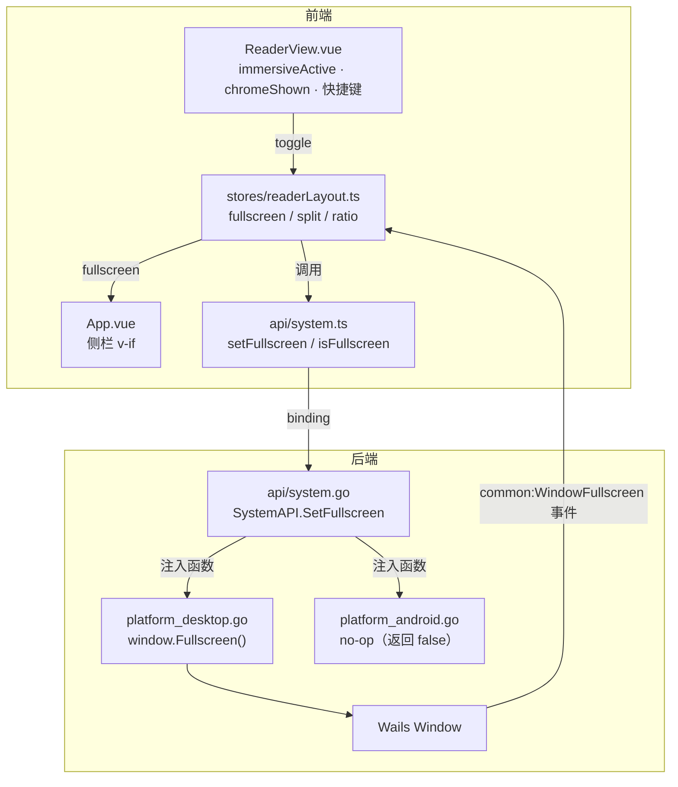
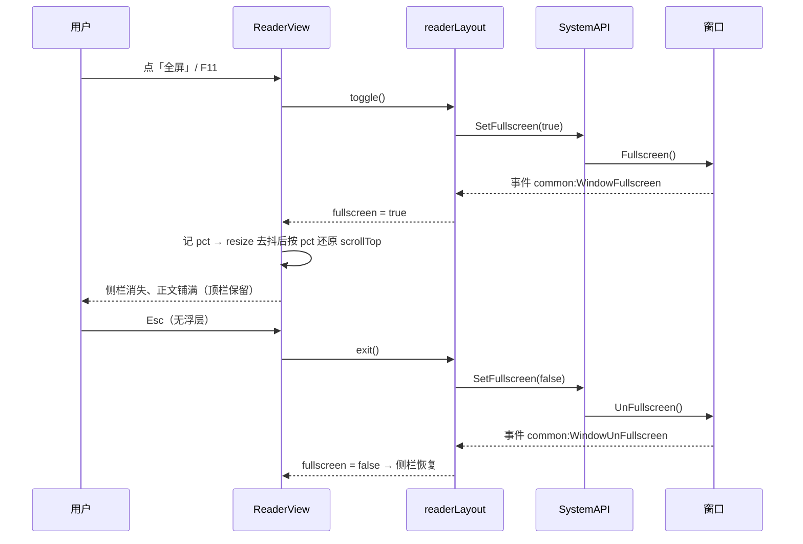
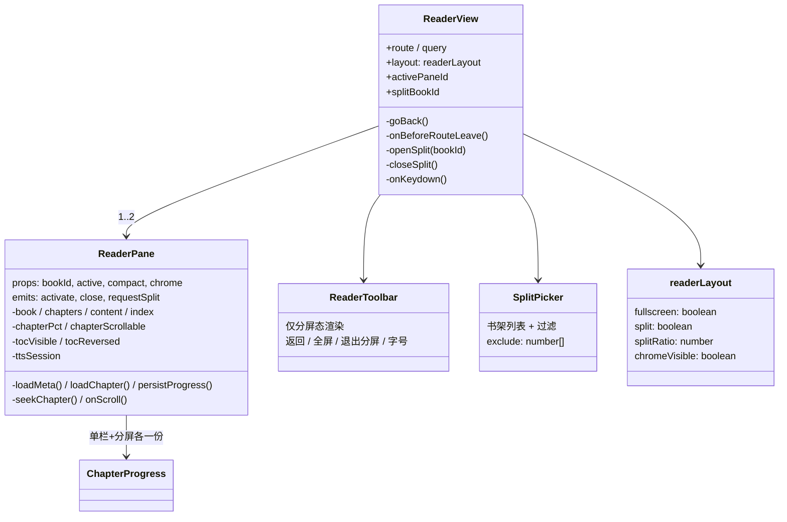
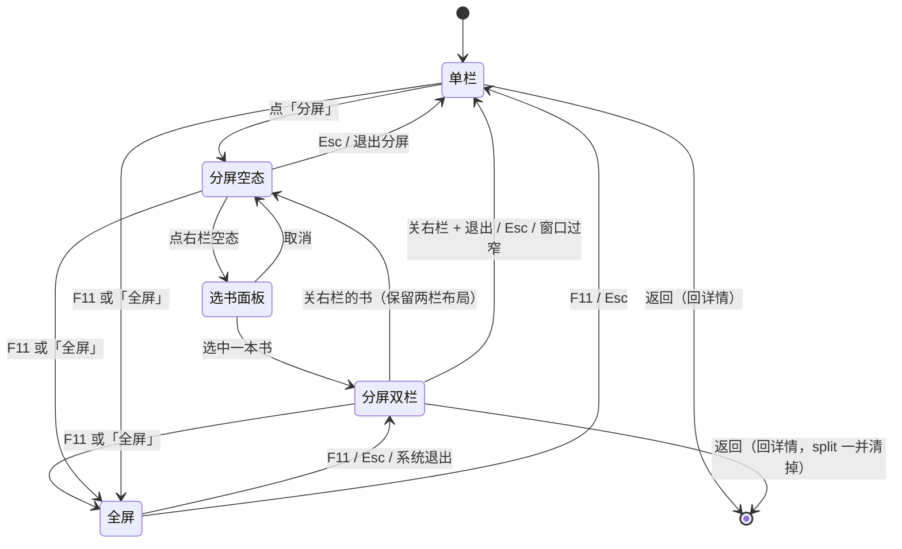
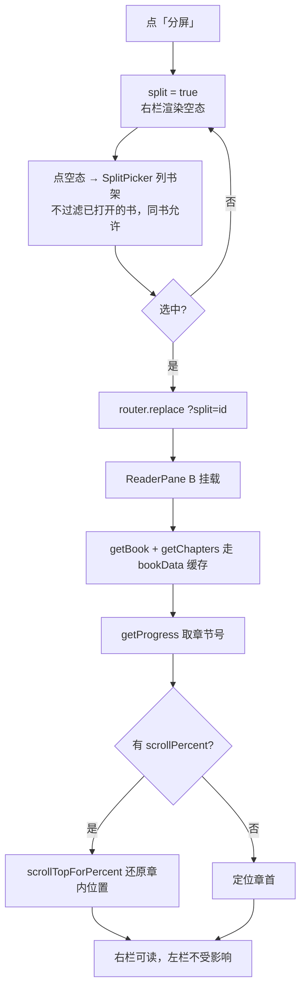

# PC 全屏阅读 + 多书并排阅读 设计方案

> 状态：**M1 / M2 / M3 已实现并回归通过**（2026-11-11）；M4 边界打磨待做
> 涉及模块：`desktop/api/system.go`、`desktop/platform_*.go`、`desktop/frontend/src/views/ReaderView.vue`、`desktop/frontend/src/App.vue`
> 回归基线：`s3` / `s6` / `s13` / `s22` / `s23`，新增 `s24` / `s25`

---

## 0. 一句话结论

1. **全屏阅读**：新增一个后端窗口开关 + 一个前端 `readerLayout` store，把「沉浸」从"只对安卓生效"推广成"两端共用、桌面由全屏态驱动"。安卓端 UI 零改动。
2. **多书并排**：把现 `ReaderView.vue`（1337 行，混着"外壳"和"一本书"）拆成 `ReaderView`（外壳/布局）+ `ReaderPane`（一本书），然后在外壳里用 flex 摆两个 pane + 一根可拖分隔条。拆分必须先做、且必须是一次**行为等价**的纯重构。

---

## 1. 目标与约束

| 项 | 内容 |
|---|---|
| 目标 A | 桌面端阅读页可进入/退出全屏，正文获得整屏空间 |
| 目标 B | 桌面端可同屏并排读两本书，各自独立翻章、滚动、记进度 |
| 硬约束 1 | **安卓端代码尽量少 diff**：阅读器仍是同一份组件，不出现"两端各写一套阅读器" |
| 硬约束 2 | 现有单栏阅读行为不得回归（s3/s6/s13/s22/s23 必须全绿） |
| 硬约束 3 | 进度、朗读、缓存、词典都按 `bookId` 驱动，不引入"隐式当前书"的全局状态 |
| 非目标 | 安卓端不做分屏（412px 放不下两栏正文）；不做三栏以上 |

---

## 2. 需求一：PC 全屏阅读

### 2.1 交互定义

| 动作 | 结果 |
|---|---|
| 顶栏「全屏」按钮 / `F11` | 窗口进入全屏 + 左侧栏隐藏 + 阅读器顶栏底栏**保留** |
| 点正文中间 1/3 | 收起顶栏/底栏/进度条，只剩正文（与安卓端同一套逻辑） |
| 再点中间 / `Esc`（无浮层时） | 先恢复栏位，再按一次退出全屏 |
| 点「退出全屏」/ `F11` / 系统级退出（Win+↓、mac 绿灯） | 恢复窗口与左侧栏，阅读状态不丢 |
| 离开阅读页（返回/路由跳转） | 自动退出全屏，避免"回到书架还占满屏" |
| 跨会话 | **不记忆**，下次进阅读器默认非全屏 |

`Esc` 优先级定为：**词典浮层 > 取词模式 > 全屏 > 分屏（M3）**。理由：浮层是"临时遮挡物"，必须最先关；全屏/分屏是"视图状态"，逐层退。

### 2.2 现状差距

- 前端只有 `chromeVisible`（移动端沉浸），`chromeShown = !platform.isMobile || chromeVisible`——桌面端恒为 true，栏位永远收不起来。
- 左侧栏在 `App.vue` 里 `v-if="!platform.isMobile"`，没有"阅读全屏"这一维。
- 后端 `SystemAPI` 没有任何窗口级能力（只有文件对话框、平台、安全区）。
- Wails `Window` 接口已有 `Fullscreen()` / `UnFullscreen()` / `IsFullscreen()` / `ToggleFullscreen()`，并有 `common:WindowFullscreen` / `common:WindowUnFullscreen` 事件。

### 2.3 分层方案



**为什么把窗口操作注入成函数而不是在 `SystemAPI` 里判平台**：`SafeArea` 已经是这个套路（`safeAreaFunc` 由 main 注入），照抄即可，`api/` 层继续保持零 `GOOS` 分支，安卓端只需要在 `platform_android.go` 里加一个 5 行 no-op。

```go
// api/system.go
type fullscreenFunc func(on bool) bool   // 返回操作后的实际全屏态

func (a *SystemAPI) SetFullscreen(on bool) bool
func (a *SystemAPI) IsFullscreen() bool
```

```go
// platform_desktop.go
func setFullscreen(on bool) bool {
    w := application.Get().Window.Current()
    if w == nil { return false }
    if on { w.Fullscreen() } else { w.UnFullscreen() }
    return w.IsFullscreen()
}

// platform_android.go
func setFullscreen(bool) bool { return false }  // 安卓无窗口层，沉浸由栏位开关负责
```

### 2.4 关键决策

**D1｜沉浸判定统一成一个表达式，移动端行为完全不变**

```ts
// 移动端恒为 true（栏位可点按切换）；桌面端由全屏态驱动
const immersiveActive = computed(() => platform.isMobile || layout.fullscreen);
const chromeShown = computed(() => !immersiveActive.value || chromeVisible.value);
```

对照现有公式：移动端 `immersiveActive` 恒 true → 退化成 `chromeVisible`，**与今天逐字等价**；桌面端非全屏 → 恒 true，栏位常显。一行改动换来两端的沉浸语义统一。

**D2｜`chromeVisible` 上提到外壳，由 pane 接收 prop**
分屏后两个 pane 必须同时收起/同时展开（否则一半有栏一半没有），状态只能有一份。单栏时对外表现不变。

**D3｜全屏切换后按「章内百分比」还原阅读位置**

进全屏时窗口变宽、侧栏消失、正文高度变化。若只保留 `scrollTop`，用户会觉得"跳了一段"。已有 `percentFromScroll` / `scrollTopForPercent`（`utils/chapterProgress.ts`）正好拿来用：

1. 切换前记 `pct`；
2. `resize` 稳定后（去抖 120ms，全屏切换会连发多次 resize）按 `pct` 写回 `scrollTop`；
3. 走的是 `seekChapter` 同一条路径，不做第二套换算。

**D4｜状态对账：事件优先，resize 兜底**
系统级退出（Win+↓、mac 绿灯按钮）不会走我们的按钮，必须把状态捞回来。订阅 `common:WindowFullscreen` / `common:WindowUnFullscreen`（走 `window.wails.Events`，不要用打包副本，见 `api/events.ts` 顶部的踩坑说明）；订阅失败时退化为 `resize` 后查一次 `IsFullscreen()`。两条路都收敛到同一个 `syncFromBackend()`。

**D5｜不记忆全屏状态**
启动即全屏会让人以为侧栏丢了。需要常驻全屏的用户用 F11——这个键不跨会话也不跨书，是"临场姿态"而非"偏好"，与 `readerPrefs`（字号/行距）的性质不同。

### 2.5 时序



### 2.6 改动清单

| 文件 | 改动 |
|---|---|
| `api/system.go` | 新增 `fullscreen` 字段、`SetFullscreen` / `IsFullscreen`、构造函数多一个注入参数 |
| `platform_desktop.go` | 新增 `setFullscreen`（4 行） |
| `platform_android.go` | 新增 `setFullscreen` no-op（1 行 + 注释） |
| `main.go` | `NewSystemAPI(platformName, safeAreaJSON, setFullscreen)` |
| `frontend/src/api/system.ts` | `setFullscreen` / `isFullscreen` 封装 |
| `frontend/src/stores/readerLayout.ts` | **新增**：`fullscreen` + `toggle/exit/syncFromBackend`（M3 再加 split 字段） |
| `frontend/src/views/ReaderView.vue` | `immersiveActive` / `chromeShown`、顶栏「全屏」按钮、`F11`、`Esc` 分支、`onStageClick` 中间区、卸载退出全屏、切换时按 pct 还原 |
| `frontend/src/App.vue` | 侧栏 `v-if="!platform.isMobile && !readerLayout.fullscreen"` |
| `tmp-mcptest/s24_reader_fullscreen.py` | **新增** UI 用例 |
| `desktop/ARCHITECTURE.md` | §11 补一节「全屏阅读」 |

**安卓端 diff 预算：`platform_android.go` 一个 no-op 函数（1 个有效语句）+ 无 UI 改动。**

---

## 3. 需求二：多书并排（分屏）

### 3.1 交互定义

```
┌──────────────────────────────────────────────────────────────┐
│ ← 返回     全屏   退出分屏                       字号 ──●──  │ 外壳工具条（仅分屏态，36px）
├───────────────────────────────┬──────────────────────────────┤
│ 书名A · 章节        目录  ⋮   │ 书名B · 章节       目录  ⋮  │ 每栏自己的精简头
├───────────────────────────────┼──────────────────────────────┤
│                               ┊                              │
│          正 文 A              ┊          正 文 B             │ 各自滚动
│                               ┊                              │
├───────────────────────────────┼──────────────────────────────┤
│ 本章 42% ▬▬▬▬▬▬●▬▬▬▬▬▬       ┊ 本章 8% ▬●▬▬▬▬▬▬▬▬▬▬▬▬       │
│ [上一章] 12/340 [下一章]      ┊ [上一章] 3/88 [下一章]       │
└───────────────────────────────┴──────────────────────────────┘
                                  ↑ 6px 可拖分隔条
```

| 动作 | 结果 |
|---|---|
| 单栏顶栏「分屏」 | 立即切成两栏，**右栏是空态**（「选择一本书」+ 一行说明），不弹面板 |
| 点右栏空态 | 打开选书面板（书架列表 + 过滤框），选中后右栏加载 |
| 点/滚某一栏 | 该栏成为 `active`（左缘 2px 强调线 + 标题加粗），键盘 ←/→ 只作用于它 |
| 拖分隔条 | 两栏宽度实时变化，比例存 `localStorage`，夹在 25%~75% |
| 右栏 `⋮` → 关闭 | 回到单栏，左栏阅读位置与进度不受影响 |
| `Esc`（无浮层/非全屏） | 退出分屏（右栏关闭） |
| 窗口 < 900px | 「分屏」按钮禁用；已分屏则自动收成单栏并提示一次 |
| 刷新页面 | `?split=<bookId>` 参与恢复，右栏直接回来 |
| 安卓端 | 不出现任何分屏入口（`v-if="!platform.isMobile"`） |

**选书来源只限书架内**。理由：分屏后两本书都可能"不在书架"，离开时的试读询问会退化成两次弹窗；限定书架内即可让这条老逻辑保持"最多问一次"。从搜索/发现点开的试读书想并排，先入架。

**允许两栏是同一本书**（已确认）。适用场景是同书不同章对照（前文查设定、后文接着读）。这带来一个必须定死的规则：两栏写的是**同一条进度记录**，谁后写谁覆盖。规则定为——

> **同书两栏时，只有 `active` 栏落盘进度。** 非活动栏照样能滚、能翻章（不限制操作），但不写 `saveProgress`；切换 active 时先把原栏的当前位置落盘一次，再交接。

这样"进度=你最后操作的那一栏"，不会被后台那栏的滚动悄悄篡改。实现上 pane 里对 `persistProgress` 加一个 `if (isSameBook && !active) return` 的短路即可，其余逻辑不动。

### 3.2 为什么必须先拆 `ReaderPane`

现 `ReaderView.vue` 把三件事揉在一起：

1. **路由与离开守卫**（`bookId`、`goBack`、试读入架询问）——属于外壳；
2. **一本书的加载与渲染**（`book/chapters/content/index/pct/scroll/toc`）——属于 pane；
3. **全局能力接线**（tts 会话、词典、缓存任务、快捷键）——一半外壳一半 pane。

不拆就直接渲染两份 `ReaderView`，`boundBookId`、`chapterPct`、`index` 会互相覆盖（它们都是组件内的单例 ref）。所以 **M2 是一次纯重构：把 2 搬到新组件，1 和 3 留在外壳，DOM 结构与类名保持不变**，跑完全部回归再进 M3。

### 3.3 组件架构



单栏时 `ReaderPane` 渲染**与今天完全相同的**顶栏 / 正文 / 进度条 / 底栏（类名 `.bar` / `.stage` / `.text` / `.comic` / `.pdf` / `.nav` 全部保留），这样 `s3/s6/s13/s22/s23` 的选择器一条都不用改。

### 3.4 状态归属表

| 状态 | 归属 | 说明 |
|---|---|---|
| `book / chapters / content / index` | pane | 每栏独立；`boundBookId` 变成 props（天然稳定） |
| `chapterPct / chapterScrollable / 滚动位置` | pane | 各自一份 `ChapterProgress`，各写各的 `saveProgress(bookId)` |
| `tocVisible / tocReversed` | pane | 两栏各有目录，互不影响 |
| `loading / fileMissing` | pane | 一栏出错不影响另一栏 |
| 字号 / 行距 | 全局 `readerPrefs` | 两栏必须一致，否则观感割裂 |
| `fullscreen / chromeVisible` | `readerLayout` | 两栏同时收起/展开 |
| `split / activePaneId / splitRatio` | `readerLayout` + query | 路由只记"右栏是哪本"，布局状态在 store |
| 朗读 | 全局 `tts` 单会话 | 同一时刻只能读一本；正在读的那栏标题旁标 🔊 |
| 词典 / 取词 | 全局 `dict` | 只有 active pane 能取词；切栏先 `dict.close()` + 关取词模式 |
| 缓存任务 | 全局 `cache`（按 bookId） | 各自栏内显示自己的进度 |
| 快捷键 | 外壳监听 → 转给 active pane | 避免两个 pane 都抢方向键 |

### 3.5 路由与返回键

- `/reader/:id` 仍然表示**左栏 / 单栏**那本书，深链与书签语义不变。
- 右栏用 `?split=<bookId>` 记账，**一律 `router.replace`**：分屏开关不该产生历史项，否则返回键要按两次才回详情页（`smartBack` 依赖 `history.state.back`，`replace` 不改它，安全）。
- 关闭分屏 → `replace('/reader/:id')` 去掉 query。
- **防环**：`watch` `route.query.split` 时只在"与当前右栏不一致"时加载，避免自己 `replace` 触发自己。
- `Esc` 顺序：浮层 > 取词 > 全屏 > 分屏。返回按钮=直接离开阅读器（回到详情页），不做"先退分屏"的二次确认——那是 Esc 的语义。



### 3.6 打开第二本书的流程



### 3.7 冲突与边界

| 场景 | 处理 |
|---|---|
| 两栏同一本书 | **允许**（同书不同章对照）。只有 active 栏写 `saveProgress`，切 active 时先落盘原栏；其余逻辑不特殊处理 |
| 一栏朗读中，另一栏点「朗读」 | 直接接管（`tts.start` 会重置会话），`TtsBar` 立刻显示新书；不做打断式弹窗——朗读随时可恢复 |
| 关闭正在朗读的那一栏 | 朗读继续（现有 `detach` 语义"解绑不停播"），走 `offlineSegment` 续读 |
| 一栏是 PDF、一栏是文本 | 允许；PDF 的滚动归 iframe，不进 `ChapterProgress` |
| 一栏文件丢失 | 该栏显示 `.file-missing` 状态页，另一栏正常 |
| 右栏书被移出书架 | 分屏时监听 `bookshelf` 变化，右栏自动关闭并提示 |
| 窗口缩到 < 900px | 自动收单栏，保留左栏；`ElMessage` 提示一次 |
| 分屏 + 试读询问 | 选书限定书架内，离开时最多问一次 |
| 内存 | 两栏正文 DOM 没问题；分屏时不触发额外缓存任务 |
| 移动端 | `v-if="!platform.isMobile"` 屏蔽全部入口；`?split` 参数不解析 |

### 3.8 改动清单

| 文件 | 改动 |
|---|---|
| `views/ReaderView.vue` | 瘦身为外壳：路由、布局、快捷键、离开守卫、分屏编排（约 250 行） |
| `components/reader/ReaderPane.vue` | **新增**：从现阅读器搬来的单书逻辑（1399 行，逻辑逐行平移，`boundBookId` 仍留在窗格内，`bookId` 改走 props） |
| `components/reader/SplitPicker.vue` | **新增**：右栏空态 + 选第二本书（限书架内，允许同书） |
| `views/ReaderView.vue` | 外壳：`?split` 解析、两栏布局、分隔条 + 拖拽遮罩、`activePane`、窄窗自动收 |
| `stores/readerLayout.ts` | 保持只存全屏（`split / ratio / activePane` 都留在 `ReaderView`，分屏态由 query 唯一表达，不重复存一份） |
| `router/index.ts` | 不变（`?split` 是 query，不需要新路由） |
| `tmp-mcptest/s25_reader_pane.py` | **新增** UI 用例：拆分后核心路径 |
| `tmp-mcptest/s26_reader_split.py` | **新增** UI 用例：分屏 |
| `desktop/ARCHITECTURE.md` | §11.7.6 / §11.7.7 补「外壳+窗格」与「并排阅读」 |

> 与初稿的差异：原计划有 `ReaderToolbar.vue`（外壳工具条）与 `SplitDivider.vue`
> （独立分隔条组件）。实际实现里，单栏工具栏本来就在窗格里，分屏时每栏用
> `compact` 精简头即可，外壳不需要自己的工具条；分隔条只有 6px 宽 + 一个遮罩，
> 放外壳里比单开一个组件更短。少两个文件，行为一致。

---

## 4. 里程碑与验收


| 里程碑 | 内容 | 验收 |
|---|---|---|
| **M1** 全屏（需求 1） ✅ | 后端 3 文件 + `readerLayout` + `ReaderView`/`App.vue` | `s24` **16 项通过**；`s22` 14/14；`s23` 13/13；安卓端无 UI 变化 |
| **M2** 拆 pane（纯重构） ✅ | `ReaderPane` 抽出，单栏 DOM 不变 | `s25` **10 项通过**（目录跳章/问AI/缓存/字号/朗读/返回）＋ `s13` 13/13、`s22` 14/14、`s23` 13/13、`s24` 16/16 |
| **M3** 分屏 ✅ | pane B + picker + 分隔条 + `?split` | `s26` **15 项通过**：空态/两栏独立翻章/只有活动栏吃键盘/拖分隔条/Esc/窄窗自动收/移动端无入口 |
| **M4** 打磨 ⬜ | 朗读冲突提示、文件丢失、右栏书被移除 | 手工 + 补充用例 |

**为什么 M2 单独一期**：它没有任何用户可见变化，却是唯一可能把现有阅读器改坏的一步。把它和 M3 混在一起，一旦回归挂了就分不清是"搬家搬错了"还是"分屏逻辑有 bug"。

---

## 5. 测试计划

**新增 `s24_reader_fullscreen.py`**（复用 `uilab.py`，书目按本地 EPUB 动态挑）
1. 进入阅读器 → `SystemAPI.IsFullscreen()==false`、`.sidebar` 存在
2. 点「全屏」→ `IsFullscreen()==true`、`.sidebar` 消失、`.reader` 占满视口
3. 顶栏仍在（`chromeShown` 为真），进度条数值不变
4. 点正文中间 → 顶栏/底栏/进度条全部隐藏；再点 → 恢复
5. `Esc` → 退出全屏、`.sidebar` 回来、`IsFullscreen()==false`
6. `F11` 进入 + `F11` 退出
7. 全屏态下返回书架 → 全屏自动关闭（不残留）
8. `?ui=mobile` 412px 下不出现「全屏」按钮（安卓不受影响）

**新增 `s26_reader_split.py`**（实际落地 15 项）
1. 单栏只有一个窗格、没有选书面板
2. 点「分屏」→ 右栏是空态选书面板（不猜书），URL 记 `?split=0`
3. 选书 → 两栏各一份 `.stage`/`.text`，URL 记 `?split=<id>`
4. 右栏点「下一章」→ 右栏章节变、左栏不动
5. 点左栏后按 `→` → 只有左栏翻章（active 生效）
6. 真实鼠标拖分隔条 → 左栏变窄、右栏变宽（500/500 → 301/699）
7. `Esc` → 关右栏回单栏，URL 上的 `split` 一并清掉
8. 窗口缩到 760px → 自动回单栏
9. 移动端布局无「分屏」入口、无横向溢出
10. 结束时两本书的阅读进度都还原

**回归**：`run_all.py` 全量（`s3 / s6 / s13 / s22 / s23` 必须与本次改动前一致）。

---

## 6. 风险

| 风险 | 影响 | 对策 |
|---|---|---|
| `ReaderPane` 抽取时漏掉某个 `boundBookId` | 离开阅读器后朗读/进度写到 0 号书 | props 化后 `bookId` 只来自 props；用 `s6` + 手工"离开后继续朗读"验 |
| 两栏共用 `window` 级键盘监听 | 一次方向键翻两栏 | 监听留外壳，按 `activePaneId` 派发 |
| `?split` 与 `watch` 互相触发 | 无限 `replace` | 只在"目标 bookId ≠ 当前右栏"时加载 |
| 全屏切换连续 resize | 进度条百分比抖动、阅读位置跳 | 120ms 去抖后按 pct 还原一次 |
| 安卓端被牵连 | 阅读器行为变化 | 全屏按钮/分屏入口全部 `v-if="!platform.isMobile"`；M2 后跑 s13/s22 |
| 试读询问在分屏下重复弹 | 离开时被拦两次 | 选书限定书架内 |

---

## 7. 已确认的三个决策（2026-11-11）

| 决策点 | 结论 |
|---|---|
| 分屏入口形态 | **纯文字按钮**「分屏」，与现有「目录」「问 AI」同一视觉权重，不加图标 |
| 右栏初始内容 | **默认为空**：点「分屏」先出两栏布局，右栏是「选择一本书」空态，点它才弹选书面板（少一次"没选就取消"的无效弹窗） |
| 两栏是否可同书 | **允许**。进度规则见 §3.1：只有 active 栏落盘，切 active 时先落盘原栏 |

M1（全屏）不依赖以上任何一条，可独立交付。
