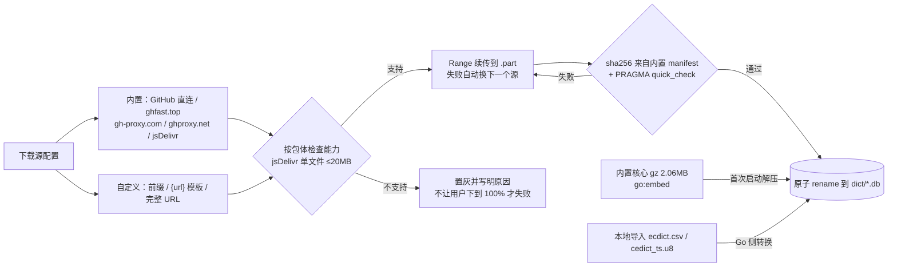
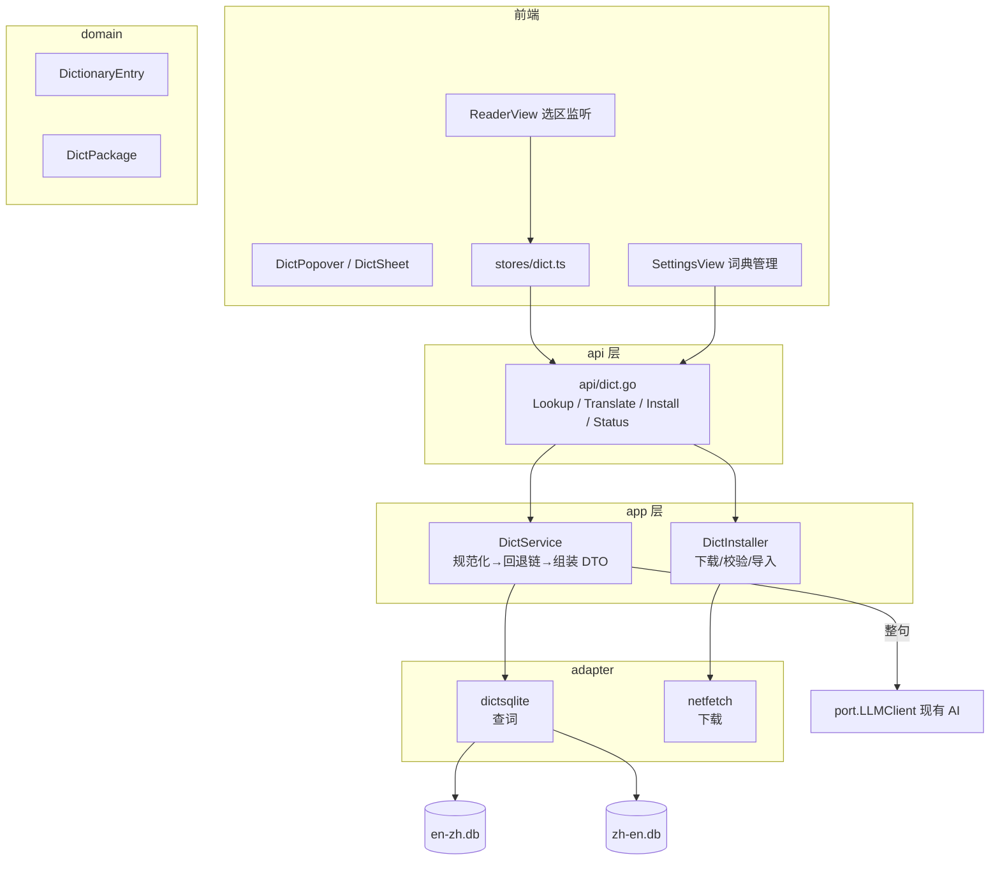
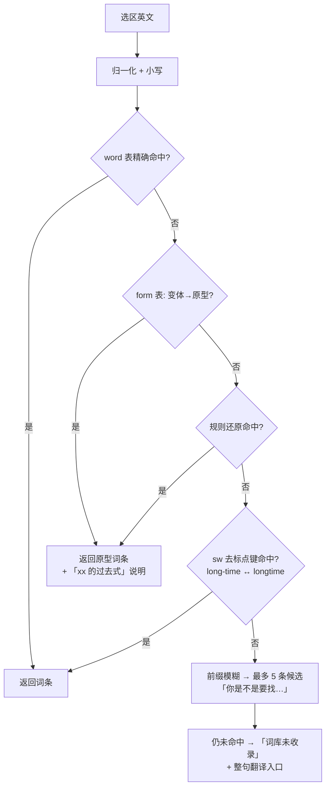
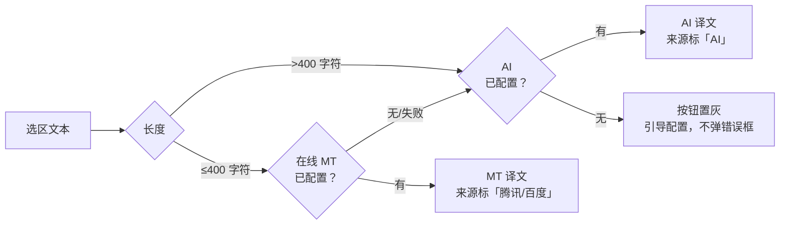

# 桌面端英汉互译（阅读器取词 / 划句翻译）设计方案 · v2

> 状态：**决策已定（§13），M1 实施中**。本文所有体积、查得率、延迟、镜像吞吐均为本机实测值
> （2026-11-08），实测脚本与产出留在 `%TEMP%\dict-eval\`，复现方法见 §3.6 与文末附录。
> 配套设计：`ARCHITECTURE.md` §12（AI）、`desktopTTS朗读功能设计方案.md`（朗读）。

---

## 0. 结论速览

**三件事分开做，不引入任何在线词典 API：**

| 能力 | 数据来源 | 许可 | 体积（实测） | 联网 |
| --- | --- | --- | --- | --- |
| 英 → 中（取词） | **ECDICT**（`ecdict.csv` 76 万词条） | MIT | 核心档 4.48 MB / 全量 46.69 MB | 不需要 |
| 中 → 英（取词） | **CC-CEDICT**（12.5 万词条） | CC BY-SA 4.0 | 13.91 MB | 不需要 |
| 整句 / 整段翻译 | **在线 MT 优先**（腾讯云 TMT 500 万字符/月免费）＋ AI 兜底提质 | 用户自备密钥 | 0 | 需要 |

**三个必须先知道的实测结论：**

1. **按词频裁剪词条时，词形表必须独立保留。** ECDICT 把 `had / were / been / did` 这类
   「自动生成的变化形式」也收成了独立词条，但它们没有 BNC/当代词频标注。只按词频裁剪会把这批词
   整批删掉——实测 `had / were / been` 全部查不到，损失 **3.74% 的词次**，而且丢掉的是最常用的词。
   正确做法：主体词条按词频裁剪，**词形映射表（58,152 条）全量保留**，查不到时回退到原型。
2. **3.8 万词条就够用了。** 用《傲慢与偏见》全本（124,544 词次 / 6,999 词种）实测，
   3.8 万词条 + 全量词形表已经覆盖 **98.74% 的词次 / 89.60% 的词种**；加到 77 万词条也只到
   99.35% / 94.58%，多出的 42 MB 换 0.6 个百分点，剩下的是专名（Darcy、Bennet）和连字复合词。
3. **查询成本可以忽略。** SQLite 精确查询 **0.02 ms**，冷打开 10 ms。瓶颈完全不在查询侧，
   而在「第一次把词库装到机器上」。

**推荐落法：内置 4.48 MB 核心词库（gzip 2.14 MB，随二进制分发）＋ 可选下载两档扩展包。**
这样「不联网、不下载、开箱即用」和「可选离线缓存」两件事同时成立——详见 §4。

**扩展包怎么下：下载地址不写死，做成「内置镜像下拉 + 自定义输入」两段式。** 实测 GitHub 直连
27 KB/s 而镜像 283 KB/s（10 倍差），且 `ghp.ci`、`moeyy`、`kkgithub` 三个常见镜像当测已全部 502，
`ghps.cc` 404——地址一旦固化进代码，功能可用性就交给运气了。落地见 §4.2（源清单 / 三种自定义写法 /
能力过滤 / 自动换源续传），接口见 §8.1，界面见 §9.4。

---

## 1. 目标与非目标

### 目标

1. 阅读器里**选中英文单词/短语** → 就地弹出释义：音标、词性、中文释义、词形变化、词频与考试标签。
2. **选中中文词** → 给出英文对应词（汉英方向，满足「互译」）。
3. **选中整句** → 给出译文（走 AI），明确标注来源与联网状态。
4. 词典**离线可用**；扩展词库可选下载、可从本地文件导入、可删除回收空间。
5. 桌面端与安卓端行为一致（同一套 Go 业务层与 Vue 组件）。

### 非目标（本期不做）

- 生词本 / 复习卡片（数据模型预留，不实现 UI）；
- 整章自动翻译、双语对照排版（属于 EPUB 翻译，另一件事）；
- 漫画、PDF 的 OCR 取词（PDF 无文本层时无从选词；有文本层时走同一套选区逻辑，M2 之后再验）；
- 专业领域词库市场 / 用户自定义词典包格式（StarDict 兼容留作 v2，见 §12-R7）。

---

## 2. 现状盘点（代码事实）

### 2.1 阅读器渲染链路（`frontend/src/views/ReaderView.vue`，1029 行）

| 事实 | 对本功能的影响 |
| --- | --- |
| 文本类走 `<div class="content" v-html="displayHTML">`，正文是真实 DOM 文本节点 | ✅ 可以直接用浏览器原生选区，不需要自己算字符偏移 |
| `onStageClick` 按左右 1/3 翻章，**已有一行 `if (window.getSelection()?.toString()) return`** | ✅ 选词时不会误翻页，这个保护已经在了 |
| 朗读中点击正文会 `tts.jumpTo(segIndex)` | ⚠️ 取词优先级必须排在朗读跳转之前，否则朗读时选词会变成「从这段开始读」 |
| 滚动容器是 `.text`（`overflow:auto`），不是 window | ⚠️ 浮层用 `position: fixed` + 视口坐标，不能用容器内绝对定位 |
| 偏好存 `localStorage`（`utils/readerPrefs.ts`，增量写入） | ✅ 取词开关、浮层位置偏好走同一套 |

### 2.2 可复用的既有资产

| 资产 | 位置 | 复用方式 |
| --- | --- | --- |
| 系统朗读 | `frontend/src/tts/SystemSpeaker.ts` | 单词发音按钮直接调 `speak()`，零新增依赖；需注意它「cancel 与 speak 同 tick 会丢句子」，改为独立实例 + 60 ms 间隔 |
| LLM 通道 | `internal/port/ai.go` `LLMClient.Chat` | 整句翻译复用，不用新建 HTTP 客户端 |
| SQLite 只读访问 | `modernc.org/sqlite`（§8 零 cgo） | 词典库用同一驱动，`mode=ro` 打开 |
| 二进制内嵌 | `main.go` 的 `//go:embed all:frontend/dist` | 核心词库用同一手法内嵌 |
| 事件总线 | `port.EventBus.Emit`（`cache.go` / `ai_index.go` 已有范式） | 词库下载/导入进度 |
| 设置持久化 | `app_settings` 单键（对齐 WebDAV/AI 先例） | 若需要服务端保存安装偏好 |

### 2.3 缺口

全仓（排除 `node_modules`）grep `词典 / 翻译 / dict / translate` **零命中**——这是全新模块，
没有历史包袱，也没有历史约束可抄。需要新建：domain / port / adapter / app / api / 前端组件各一份。

---

## 3. 词典来源选型

### 3.1 候选全景

| 候选 | 方向 | 词条数 | 许可 | 可随应用分发 | 词形/词频 | 结论 |
| --- | --- | --- | --- | --- | --- | --- |
| **ECDICT** | 英→中 | 76 万（v28 发布版 340 万） | **MIT** | ✅ | ✅ exchange + lemma + BNC/当代词频 + 考试标签 | **选它** |
| **CC-CEDICT** | 中→英 | 12.5 万 | **CC BY-SA 4.0** | ✅（需署名+同协议） | 有拼音，无词频 | **选它** |
| StarDict 流通词库（朗道、21 世纪、牛津高阶等） | 双向 | 各异 | ❌ 绝大多数有版权 | ❌ | 好 | 不用（可作 v2 用户自导入） |
| 汉典 / 有道 / 百度 / 谷歌翻译 API | 双向 | — | 商业 API | — | — | 不用（要 key、限流、不可离线） |
| Wiktionary dump | 双向 | 巨大 | CC BY-SA | 体积不可接受 | 一般 | 不用 |
| LibreTranslate / Argos Translate（离线 NMT） | 双向 | — | MIT/CC | ✅ | 模型 100 MB+，中英质量一般，CPU 推理慢 | 不用（整句交给 AI 更好） |
| FreeDict eng-zho | 英→中 | 很少（千级） | GPL/CC | ✅ | 无 | 不用 |

### 3.2 英→中 为什么是 ECDICT

1. **许可最干净**：MIT，作者在 issue 里明确答复「可以，MIT 协议」，商用与再分发都没有障碍。
2. **它本来就是为「看书软件内嵌字典」做的**（README 第一段自述），字段设计正好对上阅读场景：
   - `exchange`：`perceive` → `p:perceived/d:perceived/i:perceiving/3:perceives`，动词/名词/形容词全变体；
   - `lemma.en.txt`：扫 BNC 一亿词次生成的词干库，`gave→give`、`teeth→tooth`；
   - `bnc` / `frq`：两套词频（历史语料 vs 近 20 年），正好用来判断「这词要不要认识」；
   - `tag` / `collins` / `oxford`：中考/高考/四六级/雅思/托福/GRE + 柯林斯星级 + 牛津 3000。
3. **收词量级压得住**：76 万词条 → 46 MB，裁剪后 4 MB 级。相比朗道之类的专有词库，没有法务风险。
4. **社区验证充分**：8.5k star、1.4k fork，T.vim / Trans.nvim / pot-app 等插件都在用。

**注意区分三个版本**（选错体积差 10 倍）：

| 来源 | 词条 | 形态 | 说明 |
| --- | --- | --- | --- |
| repo `ecdict.csv`（master） | 76 万 | CSV 62.95 MB | **本方案采用**，字段全、可直接解析 |
| Release `ecdict-sqlite-28.zip` | 340 万 | SQLite 207 MB 压缩 | 太大，且带音标图文，不适合移动端 |
| `ECDICT-ultimate` | 更大 | — | 无必要 |

### 3.3 中→英 为什么只有 CC-CEDICT

「互译」的反方向在开放数据里几乎没有第二个选择：

- 它是 1997 年 CEDICT 的延续，**MDBG 维护、按月发布**（最新 2026-11-07，125,379 条）；
- 每条带 `繁体 简体 [拼音] /英文释义 1/释义 2/`，正好给出「这个词英文怎么说」+ 拼音；
- 许可 CC BY-SA 4.0，允许商用与再分发（义务见 §3.5）。

实测抽样（官方 125,394 条）：`苹果 → apple; CL:個|个[ge4]`、`芯片 → computer chip; microchip`、
`不客气 → you're welcome; don't mention it`、`东西 → 两条（east and west / thing; stuff）`。

**它不是翻译器，是词典**：给的是词义枚举，不是通顺译文；虚词组合（如「他的」）没有词条，
必须回退到单字（`他`、`的` 都有）。这一点必须在 UI 上讲清楚（§9.2），否则用户会拿它跟整句翻译比。

### 3.4 整句为什么复用现有 AI 而不是内置离线翻译

- 词典数据**给不出译文**，这是结构性问题（词义枚举 ≠ 句意）。用户划一整句时，唯一能给出通顺结果的
  就是大模型。
- 项目已有完整 AI 通道（`ARCHITECTURE.md` §12），含配置、密钥掩码、超时、事件流；新功能只需
  加一个非流式的 `Translate` 用例，**不引入新依赖、不新增密钥**。
- 离线 NMT（LibreTranslate/Argos）中英方向质量明显不如小参数 LLM，却要多背 100 MB+ 模型和
  CPU 推理开销，在阅读器里点一下要等 1-3 秒，体验倒挂。
- 未配置 AI 时的降级路径必须明确：**只给词典结果 + 一句「配置 AI 后可整句翻译」**，不要静默失败。

### 3.5 许可与合规（实施时必须落地）

| 数据 | 义务 | 落地动作 |
| --- | --- | --- |
| ECDICT（MIT） | 保留版权声明与许可全文 | `dict/NOTICE-ECDICT.txt`；设置页「词典来源」列出项目主页与 MIT 全文 |
| CC-CEDICT（CC BY-SA 4.0） | ①署名 ②标明是否修改 ③衍生数据同协议共享 | 汉英包**独立成文件**（`zh-en.db`），不与 ECDICT 数据混表；随包附 `NOTICE-CC-CEDICT.txt`（含来源 URL、发布版本日期、我们的转换说明）；设置页可查看 |

把汉英包单独成文件的另一个理由：CC BY-SA 的 ShareAlike 只约束「CC-CEDICT 的衍生作品」，
分开放就不会牵连 ECDICT 那部分的许可声明。

### 3.6 实测数据与方法

**方法**：`ecdict.csv` + `cedict_ts.u8` 下载到 `%TEMP%\dict-eval\`，用 `measure2.py` 转 SQLite
（`WITHOUT ROWID` 主键表），`coverage2.py` 用《傲慢与偏见》全文统计查得率，`sqlite3` 计时。
本机：Windows 11 / Python 3.12 / 本机 SSD。

**体积与词条**：

| 档位 | 主体词条 | 词形映射 | SQLite | gzip -9 |
| --- | --- | --- | --- | --- |
| 英文 核心 top30k | 38,243 | 58,152 | **4.48 MB** | 2.14 MB |
| 英文 标准 top60k | 59,137 | 58,152 | 5.79 MB | 2.82 MB |
| 英文 全量 | 770,238 | 58,152 | 46.69 MB | 20.54 MB |
| 汉英 CC-CEDICT | 125,394 | — | 13.91 MB | 7.08 MB（官方 `.txt.gz` 原件仅 3.98 MB） |

**查得率**（《傲慢与偏见》124,544 词次 / 6,999 词种）：

| 档位 | 词次查得 | 词种查得 | 其中「靠词形表救回」 | 未命中的典型 |
| --- | --- | --- | --- | --- |
| top30k | **98.74%** | 89.60% | 7.14% | longbourn / netherfield / meryton（专名） |
| top60k | 99.02% | 91.80% | 6.46% | 同上 + drawing-room / to-morrow |
| 全量 | 99.35% | 94.58% | 0.00% | gutenberg-tm / pglaf（文件头噪声） |

**性能**：`word` 表查询 0.022 ms、`form` 表 0.020 ms（2000 次均值），只读库冷打开 8.8-10.1 ms。
**构建耗时**：62.95 MB CSV → 全量 SQLite 8.5 s（桌面 Python）。Go 实现预计同量级或更快；
安卓 arm64 预估 30-60 s，因此**构建只发生在「导入本地 csv」这一条路径**，正常安装是直接下载成品 db。

---

## 4. 词库分层与分发

### 4.1 分层

| 层 | 内容 | 体积 | 来源 | 何时存在 |
| --- | --- | --- | --- | --- |
| **内置核心** | 英文 top30k + 全量词形表 | 4.48 MB（gz 2.14 MB） | `go:embed`，首次启动解压 | **永远**（不可删除） |
| **英文标准包** | top60k + 词形表 | 5.79 MB | 可选下载 | 用户安装 |
| **英文全量包** | 77 万词条 + 词形表 | 46.69 MB | 可选下载 / 本地 csv 导入 | 用户安装 |
| **汉英包** | CC-CEDICT 12.5 万 | 13.91 MB | 可选下载 | 用户安装 |

> **已定（2026-11-08）**：核心库**内置**（随二进制分发，不可删除）；**汉英方向做进首版**（M3），
> 即四项全做，不砍范围。

**为什么内置 4 MB 而不是「一律按需下载」**：下载链路是本功能唯一的高失败环节（实测
`raw.githubusercontent.com` 到本机只有 27 KB/s，63 MB 要一小时以上；即使用镜像也只有约 280 KB/s）。
把「查个常用词」这件事绑在一条可能失败的下载上，等于给核心阅读体验加了一个单点故障。
4 MB 换「永不失败」，划算；46 MB 的全量包再另说。

**为什么不做「内置 mini 8k 词」三档**：实测 2 万词条档已经 97.6% 词次覆盖，再往下压收益递减，
维护三档数据的复杂度不值当。

### 4.2 四条供给通道与下载源配置

**下载地址不写死在后端**，做成「内置源列表 + 自定义输入」两段式。原因很直接：GitHub 原始链接
在国内实测 **27 KB/s**，同一时刻镜像 **283 KB/s**（10 倍差），而镜像的可用性按天变化——
2026-11-08 实测 `ghp.ci`、`github.moeyy.xyz`、`raw.kkgithub.com` 三个曾经流行的镜像**全部 502**，
`ghps.cc` 返回 **404**。把地址固化进代码，等于把功能可用性交给运气。



四条通道：

1. **内置**：`dict/core.gz` 内嵌，解压到 `<data>/dict/en-zh.core.db`（版本化文件名，升级时替换）。
   不联网、不校验（内容就在二进制里）。
2. **下载**：按配置的源列表 `Range` 续传**上游源文件**到 `.part`，`sha256` 校验后
   **在本机转换**成词库，再原子 `rename`。任一环节失败都不动已有文件（细节见 §4.2.3）。

   > **实施时改了这一条**：原计划由我们自建仓库发布预构建的 `.db`，实际改成直接用上游
   > 的固定提交（ECDICT 的 `ecdict.csv`、CC-CEDICT 的 `cedict_ts.u8`）在本机转换。
   > 理由：自建仓库没人维护就会烂掉，第一次下载失败时用户拿到的是 404 而不是词库；
   > 上游固定提交只要 GitHub 还在就能下。代价是 63 MB 的 CSV 要用户自己下（镜像约 4 分钟），
   > 因此保留了「导入本地文件」这条等价路径，并在源选择器上做测速。
   > 转换器与 `cmd/dictbuild` 共用 `internal/adapter/dictbuild`，不会出现两套 schema。
3. **本地导入**：用户自备 `ecdict.csv`（62.95 MB）或 `cedict_ts.u8`，后台转换并推进度事件。
   这条路径让「所有镜像同时挂掉」不构成功能不可用，也是唯一的纯离线扩展方式。
4. **自定义源**：用户完全可以把包下到自己的服务器/局域网，填一个完整 URL 让应用拉。

#### 4.2.1 内置源清单（2026-11-08 本机实测）

| 源 | ID | 形态 | 实测吞吐 | Range | 单文件上限 | 定位 |
| --- | --- | --- | --- | --- | --- | --- |
| GitHub 直连 | `github` | 原样 | 27 KB/s | ✅ 206 | 无 | 官方，慢但不易失效，**兜底** |
| ghfast.top | `ghfast` | 前缀 | **283 KB/s** | ✅ 206 | 无 | **默认首选** |
| gh-proxy.com | `ghproxy` | 前缀 | **276 KB/s** | ✅ 206 | 无 | **默认第二** |
| ghproxy.net | `ghnet` | 前缀 | 24 KB/s | ✅ 206 | 无 | 能通但慢，排直连之前 |
| jsDelivr | `jsdelivr` | 改写 | 258 KB/s | ✅ 206 | **20 MB** | 仅适用小包，见下 |
| 自定义 | `custom` | 前缀 / 模板 / 完整 URL | 探测 | 探测 | 无 | §4.2.2 |

**jsDelivr 的 20 MB 是硬限制，不是推测。** 对 63 MB 的 `ecdict.csv` 实测返回
`403 File size exceeded the configured limit of 20 MB.`。对照我们的包：
核心 4.48 MB / 标准 5.79 MB / 汉英 13.91 MB 都能走 jsDelivr，**全量包 46.69 MB 不行**。
因此源选择器必须按「当前要下的包」检查能力，不满足的直接置灰并写原因（例如
「jsDelivr 单文件上限 20 MB，全量包 46.69 MB 无法使用」），**而不是让用户下到 100% 才 403**。

同理，前缀型镜像是否能代理 GitHub Release 资产（`/releases/download/...`）与 raw 文件不同，
manifest 里每个包声明自己的**托管形态**（`raw` 或 `release`），源声明支持哪些形态，
两者取交集才出现在可选列表里（§4.2.4）。

#### 4.2.2 自定义源的三种写法

用户粘什么就认什么，前端不做拒绝式校验，后端按下列**顺序**判定：

| 写法 | 例 | 判定 | 典型用途 |
| --- | --- | --- | --- |
| 含 `{url}` 占位符 | `https://my.proxy/?u={url}` | 模板替换 | 自建反代 / Cloudflare Worker |
| `http(s)://` 开头、无占位符 | `https://ghfast.top/` | **前缀拼接** | 绝大多数镜像的用法 |
| 指向具体文件 | `https://nas.local/packs/en-zh.full.db` | 直接使用 | 内网分发 / 已自行下载 |

细节：
- 前缀形态**自动补尾部 `/`**，用户写不写都行；
- `{url}` 替换**不做 URL 编码**——镜像要求原样嵌套，编码后反而 404；
- 完整文件 URL 形态跳过 manifest 里的路径拼接，但**仍然校验 sha256 与体积**，
  体积对不上直接报「所选文件与该版本不符」。

安全约束（三条必须落）：
- 只接受 `http` / `https`，其他 scheme 一律拒绝（防 `file://` 读本地任意文件、防 `javascript:`）；
- `http`（非加密）给黄色提示「连接未加密」，**不阻止**——内网自建是真实场景；
- **源不可信也不会污染词库**：sha256 与体积来自内置 manifest（§4.2.4），镜像只能做字节转发，
  改一个字节就校验不过并立刻换源。但这不代表能防「镜像知道你下什么」，提示语不承诺隐私。

#### 4.2.3 回退与换源

| 模式 | 行为 |
| --- | --- |
| **自动**（默认） | 按用户排序依次尝试。任一环节失败（连接 15 s 超时 / 非 2xx / 大小不符 / sha256 不符 / `quick_check` 失败）立即换下一个 |
| **手动** | 只试选中源，失败即停，弹「换个源重试」，不偷偷切走 |

- 换源时 emit `dict:install:progress` 带 `sourceId` 与 `switchedFrom`，界面明示
  「ghfast.top 不可用，已切换到 GitHub 直连」，**不能静默**——用户需要知道速度为何变了。
- **跨源续传是安全的**：所有源转发同一份字节，`.part` 的已下载前缀换源后继续
  `Range: bytes=<n>-`，不重下。实测四个可用源都正确响应 206（请求 1000-1999 精确回 1000 字节）。
- **全失败**：保留旧库不动，给出两条出路——换源重试 / 本地导入（§4.2「通道 3」）。

#### 4.2.4 为什么 manifest 必须内置

如果 sha256 也从网络拉，恶意镜像可以**同时**替换包和哈希，校验等于没做。所以：

```go
//go:embed dict/manifest.json
var dictManifest []byte
```

manifest 只随应用版本更新（走应用更新渠道，不走下载源）。里面**只有**包 ID、体积、sha256、
版本日期，以及与源无关的仓内坐标：

```json
{"id": "en-zh-full", "name": "英文完整词库", "fileName": "en-zh.full.db",
 "kind": "ecdict", "tier": "full",
 "source": {"repo": "skywind3000/ECDICT",
            "ref": "39cfb9672c0906b63569e0453c2e6abfb9ab182a",
            "path": "ecdict.csv", "form": "raw",
            "size": 66009548, "sha256": "d1ecbdf9…"},
 "entries": 770238, "builtAt": "2026-11-02"}
```

注意 `ref` 是**提交号而不是 `master`**：上游 tag/分支会移动，哈希就对不上了。
换版本必须发版更新清单——这是有意为之，可复现优先于自动跟随。

**manifest 里不存任何镜像地址**，地址全部由「源配置 + 模板 + 仓内坐标」现场拼出来。好处：
- 加一个新镜像**不需要发版**，改配置即可；
- 镜像永远拿不到哈希，投毒无门；
- 各源 URL 形态差异（raw 直取 / Release 资产 / jsDelivr 改写）由模板吸收，
  业务代码只认「包 ID + 源 ID」。

三种形态的拼法（以 `repo=bingxl/legado-dict-packs`、`ref=v1`、`path=en-zh.full.db` 为例）：

| 形态 | URL |
| --- | --- |
| `raw` + 直连 | `https://raw.githubusercontent.com/bingxl/legado-dict-packs/v1/en-zh.full.db` |
| `release` + 直连 | `https://github.com/bingxl/legado-dict-packs/releases/download/v1/en-zh.full.db` |
| 前缀源（ghfast / ghproxy / ghnet） | 上述任一 URL **原样拼在前缀后** |
| jsDelivr（仅 `raw` 形态且 ≤20 MB） | `https://cdn.jsdelivr.net/gh/bingxl/legado-dict-packs@v1/en-zh.full.db` |

> 46.69 MB 的全量包不适合提交进 git 仓库（raw 形态），放 Release 资产更合理；
> 但它也就**失去了 jsDelivr 这条快路**。所以全量包默认走 `ghfast` → `ghproxy` → 直连，
> 三个源合计实测吞吐足够在 3 分钟内下完（283 KB/s ≈ 2.8 分钟）。

#### 4.2.5 持久化与设置页

设置项落 `settings` 表（键值对，与现有偏好同一套机制，不需要迁移）：

| 键 | 值 | 说明 |
| --- | --- | --- |
| `dict.source.mode` | `auto` / `manual` | 默认 `auto` |
| `dict.source.selected` | 源 ID | 手动模式用；自动模式作为「首选」 |
| `dict.source.custom` | 字符串 | 自定义源，空表示未设置 |
| `dict.source.order` | JSON 数组 | 自动模式的尝试顺序，用户可拖拽调整 |

设置页形态见 §9.4。**测速按钮**对每个源发一次 64 KB `Range` 请求，显示实测 KB/s 与
「不支持 Range」标记；结果**不缓存跨会话**（镜像速度按小时变化，缓存会误导）。

> 不做的：不内置「订阅式」源列表（远端下发源配置）——那等于把地址控制权又交回网络，
> 与本节出发点矛盾。新增官方源靠应用版本更新，第三方源靠用户自己填。

### 4.3 版本与校验

`<data>/dict/manifest.json`：

```json
{
  "packages": [
    {"id": "en-zh-core", "version": "ecd-1.0", "entries": 38243, "builtAt": "2026-11-08"},
    {"id": "en-zh-full", "version": "ecd-1.0", "entries": 770238, "sha256": "...", "size": 48963584},
    {"id": "zh-en", "version": "cedict-2026-11-07", "entries": 125394, "sha256": "..."}
  ]
}
```

- 版本号里带**数据源日期**，便于回答「我的词库是不是太旧」；
- 升级内置核心时用文件名带版本（`en-zh.core.v2.db`），老的启动时清理，避免「升级后仍读旧库」；
- 词典库**不进主库迁移**：它跟 `legado.db` 完全独立，坏了删掉重装即可，不该牵连阅读数据（§6 持久化策略）。

---

## 5. 总体架构



**分层铁律对照（`ARCHITECTURE.md` §4）**：`api/` 只做参数校验与转发（R1）；`app/` 不 import Wails（R2）；
`DictionaryEntry` 经 `dto` 转换后才下发（R3）；前端只有 `src/api/dict.ts` 引用 bindings（R4）；
查词走 `port.DictionaryRepository` 接口，SQLite 只是其中一种实现（R5）。

---

## 6. 查词算法（核心）

### 6.1 归一化（前端与后端各做一半）

| 步骤 | 位置 | 理由 |
| --- | --- | --- |
| 取选区 `toString()`、压缩连续空白 | 前端 | 减少传输与日志噪音 |
| 去首尾标点、弯引号归一（`’`→`'`、`“”`→`"`） | 后端 | 词典键不含标点；弯引号在 EPUB 里极常见 |
| 小写化（仅英文） | 后端 | ECDICT 键为小写 |
| 长度上限 200 字符 | 后端 | 防御误选整章 |

### 6.2 英 → 中：五级回退



**规则还原**只作为词形表的最后兜底（实测贡献 < 1% 词次，但能把 `-s/-es/-ed/-ing/-er/-est/-ly`
的漏网之鱼捞回来）：`'s` 所有格剥离 → `ies→y` → `es/s` → `ied/ed→y/e/∅` → `ing→e/∅` → `er/est` → `ly`。

**这一节是整个方案的关键**：实测「只做精确匹配」在 top30k 档只有 91.99% 词次，加上词形表到 98.74%。
不做回退，用户查 `was`、`had`、`went` 都会得到「未收录」——这是阅读场景最常见的三个词。

### 6.3 中 → 英：最长子串匹配

中文没有空格，用户可能连选几个词。策略：

1. **精确命中**优先（选区 1-8 字，直接查）；
2. 未命中则**按选区长度从长到短**切子串，取第一个命中的（最长匹配）；
3. 仍未命中的**单字兜底**（`他的` → 展示 `他` 与 `的` 两条，标注「按单字给出」）；
4. 命中多条时全部返回（`东西` 有两条：east and west / thing; stuff），按拼音去重后并列显示。

**界限**：≥ 10 个汉字视为整句，走 AI，不做词典查询（词典给不出句意，硬查只会显示一堆单字释义）。

### 6.4 整句 → 翻译引擎链（在线 MT 优先，AI 兜底/提质）

> 决策已定（2026-11-08）：**要在线翻译兜底**，不是「只走 AI」。

链路是**串行降级**，不是二选一：



**为什么短句给 MT、长段给 AI**：MT 按字符计费（腾讯 500 万/月免费，超出 58 元/百万字符），
短句走 MT 几乎零成本且延迟 200-400 ms；长段（>400 字符）MT 的分句策略容易把定语从句拆散，
AI 有上下文优势。阈值 `400` 放进设置项可调，不写死。AI 未配置时长段仍回落 MT（能用比不能用好）。

#### 6.4.1 引擎适配器

统一 `port.Translator`，各家差异全部收在 adapter 里：

```go
type Translator interface {
    Name() string                     // "tencent" / "baidu" / "custom"
    Limit() int                       // 单次字符上限
    Translate(ctx context.Context, text, from, to string) (string, error)
}
```

| 引擎 | 鉴权 | 免费额度（2026-11 官方文档） | 单次上限 | QPS | 适配成本 |
| --- | --- | --- | --- | --- | --- |
| **腾讯云 TMT**（首选） | SecretId + SecretKey，**TC3-HMAC-SHA256 签名** | **500 万字符/月** | 2000 字符 | 5 | 中，签名约 80 行 |
| 百度翻译 标准版 | appid + key，`MD5(appid+q+salt+secret)` | 5 万字符/月 | 1000 字符 | 1 | 低，但额度太小 |
| 百度翻译 高级版 | 同上 + 个人认证 | 100 万字符/月 | 6000 字符 | 10 | 低 |
| 自定义 | OpenAI 兼容 `/chat/completions` | 取决于用户 | 取决于模型 | — | 低（复用 §12 的 LLMClient） |
| 自建 LibreTranslate | 无（或 token） | 无限（自己的机器） | 不限 | 本机 | 中，要用户自己部署 |

**选腾讯 TMT 作默认推荐的三个理由**：免费额度是百度的 100 倍（500 万 vs 5 万）；
QPS 5 够划句用（百度标准版 QPS 1，连点两句就会 429）；语种识别不计费，不用先判方向。

**但实现上必须允许"一个都不配"**：不配 MT 不配 AI 时，整句翻译按钮置灰并写清缺什么——
这是默认状态，不能让新用户一进来就看到一个报错的按钮。

#### 6.4.2 三条约束（都是踩过才写的）

1. **密钥只存本地，不回显原文**：`settings` 表存 `dict.mt.tencent.secretId/secretKey`，
   界面显示掩码（`AKID****9f2c`），与 §13 书源登录同一套掩码规则。
2. **字符数要预扣**：超过引擎单次上限**必须分段**（按句号/换行切，不许硬切在词中间），
   分段后逐段请求、逐段拼接；任一段失败则整体报错并把已成功的段标记出来，
   不能拼出半句译文。
3. **LRU 缓存按 `sha256(engine + text)`**：同一句换引擎要重新翻，不能拿 MT 的缓存冒充 AI 的。
   上限 200 条（§12.5 同思路），命中时不产生任何网络请求。

#### 6.4.3 手动重译

译文浮层底部两个入口：**[用 AI 重译]** / **[用在线翻译重译]**，仅在对应引擎已配置时可见。
用户对自动选择不满意时能一键换路，不需要先去设置页改偏好——
「自动选择」是默认值，不是强制。

### 6.5 边界情况处理表

| 情况 | 行为 |
| --- | --- |
| 选中的是数字 / 纯符号 | 不弹浮层 |
| 选中内容跨了 TTS 高亮段落 | 正常查词，不清除高亮 |
| 单词内含连字符（`half-an-hour`） | `sw` 键去标点后匹配；仍未命中给候选 |
| 大小写专名（`Darcy`） | 小写后查；未收录 → 「疑似专名」提示 + 整句翻译入口 |
| 词库未安装（用户删了汉英包） | 中文方向直接提示「未安装汉英词典」+ 一键安装，不做静默降级 |

---

## 7. 数据模型与文件布局

### 7.1 SQLite 结构（只读库，无迁移）

```sql
-- 英文库 en-zh*.db
CREATE TABLE word(
  w TEXT PRIMARY KEY,        -- 小写规范词
  ph TEXT,                   -- 音标
  tr TEXT,                   -- 中文释义，换行分隔
  pos TEXT, collins INT, oxford INT, tag TEXT, bnc INT, frq INT
) WITHOUT ROWID;
CREATE TABLE form(
  v TEXT PRIMARY KEY,        -- 变体（过去式/复数…）
  l TEXT,                    -- 原型
  t TEXT                     -- 关系码，如 p,d（过去式+过去分词）
) WITHOUT ROWID;

-- 汉英库 zh-en.db
CREATE TABLE zh(z TEXT, py TEXT, en TEXT, trad TEXT);           -- 简体/拼音/英文/繁体
CREATE INDEX idx_z ON zh(z);
CREATE INDEX idx_t ON zh(trad);
```

`WITHOUT ROWID` 是省体积的关键（实测 top30k 档比默认表省约 30%）；`tr` 直接用 ECDICT 的
`translation` 原文（换行即分条），不做二次切分，避免丢信息。

**`form.t` 是实施时补上的，原方案没有。** 原计划靠后缀猜「过去式/过去分词」，
但 `had / were / been` 与原型（have / be）没有共同前缀，猜出来只剩一句「变形」——
而这是阅读里最高频的三个词。ECDICT 的 `exchange` 本来就有关系标记：
`p` 过去式、`d` 过去分词、`i` -ing、`3` 三单、`s` 复数、`r` 比较级、`t` 最高级。
构建时把「正向关系」（原型的 `p:/d:/i:`）与「反向关系」（`0:lemma`）**合并**成一条，
同一变体从多条记录汇合（`had` 同时是 have 的过去式与过去分词），存成 `p,d`。
体积代价 0.17 MB，词形条数从 56,409 涨到 58,152（多出来的是正向关系带来的变形）。

原方案里的 `sw`（去标点键 → 词）表**没有实现**：`long-time ↔ long time` 用一个
运行时的去连字符回退就能覆盖，不值得为它多一张索引表、多 1 MB 体积。

### 7.2 目录

```
<dataDir>/
  dict/
    en-zh.core.db          # 内置核心（解压产物）
    en-zh.db               # 可选：标准/全量
    zh-en.db               # 可选：汉英
    manifest.json
    NOTICE-ECDICT.txt
    NOTICE-CC-CEDICT.txt
    *.part                 # 下载中
```

`<dataDir>`：桌面 `%LOCALAPPDATA%\legado-desktop\`（或 `LEGADO_DESKTOP_HOME`），
安卓走 `platform_android.go` 的 `dataDir()`（`<filesDir>`）。**不要放工作区目录**——
`C:\Users\<u>\work` 带 Low Mandatory Level 标签，从那里跑 GUI 会直接起不来。

---

## 8. 后端设计

| 层 | 文件 | 职责 |
| --- | --- | --- |
| domain | `internal/domain/dict.go` | `DictEntry` / `DictSense` / `DictPackage` / `DictQuery`；方向与来源枚举 |
| port | `internal/port/dict.go` | `DictionaryRepository`（`Lookup` / `Nearby`）、`DictPackageStore`（`Status` / `Install` / `Remove`） |
| adapter | `internal/adapter/dictsqlite/` | 只读连接池 + 上述 repository 实现 |
| adapter | `internal/adapter/mt/` | `Translator` 实现：`tencent.go`（TC3 签名）、`baidu.go`、`custom.go`（OpenAI 兼容） |
| adapter | `internal/adapter/netfetch/`（可复用现有下载代码） | Range 续传 + 进度回调 |
| app | `internal/app/dict.go` | 规范化、回退链、双向分发、DTO 组装 |
| app | `internal/app/dict_install.go` | 下载/校验/导入/删除，进度事件 `dict:install:progress` |
| app | `internal/app/dict_source.go` | 源注册表、URL 拼装（三种形态）、能力过滤、测速、回退编排 |
| app | `internal/app/dict_translate.go` | 整句翻译 + LRU |
| api | `api/dict.go` | 绑定方法 |
| dto | `internal/app/dto/dict.go` | `DictEntryView` / `DictStatusView` / `DictSourceView` / `DictInstallProgress` |

### 8.1 API 契约

| 方法 | 入参 | 返回 | 说明 |
| --- | --- | --- | --- |
| `Lookup(text, hint)` | 选区文本；`hint` = `en`/`zh`/`auto` | `DictResultView` | 自动判方向；返回 `direction` / `source`（core/full/cedict）/ `entries[]` |
| `Translate(text, engine)` | 选区文本；`engine` = `auto`/`mt`/`ai` | `TranslateView` | 引擎链见 §6.4；返回 `text` + `engine`（实际用的哪个）+ `cached` |
| `DictEngines()` | — | `[]EngineView` | 各引擎是否已配置、单次上限、免费额度说明；**不返回密钥原文** |
| `SetMTConfig(engine, secretId, secretKey, appid)` | — | `error` | 写 `settings`；空值表示清除 |
| `TestMT(engine)` | — | `TranslateView` | 用固定短句试翻，验证密钥有效 |
| `DictStatus()` | — | `DictStatusView` | 各包是否安装、体积、版本、词条数 |
| `DictSources(packID)` | 包 ID | `[]DictSourceView` | 返回**针对该包**过滤后的源列表：`usable` / `reason`（如 jsDelivr 超 20 MB）/ 当前选中项 |
| `ProbeDictSource(sourceID, customURL)` | 源 ID 或自定义串 | `DictProbeView` | 64 KB Range 探测：`ok` / `httpCode` / `kbps` / `rangeOK` / `err`；服务端**不缓存** |
| `SetDictSource(mode, sourceID, customURL)` | 模式 / 源 ID / 自定义串 | `error` | 写 `settings` 表（`dict.source` 一条 JSON） |
| `PreviewDictSource(packID, sourceID, customURL)` | — | `DictSourceConfigView` | **只拼字符串不发请求**：设置页「将请求：…」回显（实施时新增） |
| `InstallDict(packID, sourceID, customURL)` | 包 ID；源 ID；自定义串 | `error` | 立即返回，进度走事件。`sourceID=custom` 时用 `customURL` |
| `CancelInstall(packID)` | — | `error` | 取消下载并删 `.part` |
| `RetryInstall(packID, sourceID, customURL)` | — | `error` | 保留 `.part` 换源续传（不重下） |
| `RemoveDict(packID)` | — | `error` | 内置核心拒绝删除 |
| `ImportDictFile(path, kind)` | 本地 csv/u8 路径 | `error` | 后台转换 + 进度事件 |

**进度事件**复用 §12.6 的长任务范式：`context.WithCancel(context.Background())` 派生、
单包互斥锁、`EventBus.Emit` 推进度、`Done` 里关闭 goroutine。**不要**挂在请求 ctx 上。

---

## 9. 前端设计

### 9.1 交互

| 场景 | 桌面端 | 移动端 |
| --- | --- | --- |
| 取词 | 选中即弹浮层（可关）；双击单词也弹 | 底栏「词典」按钮进入**取词模式**，点任意词即查 |
| 长句 | 选区后浮层底部出现「整句翻译」 | 选中后底栏出现「译」按钮 |
| 关闭 | `Esc` / 点浮层外 / 滚动正文 | 点浮层外 / 返回键 |
| 发音 | 浮层喇叭 → `SystemSpeaker` 读单词 | 同 |

**移动端为什么不做「长按选中即弹」**：安卓 WebView 长按会拉起系统 ActionMode（复制/全选/搜索），
我们的浮层会和它抢位置、抢焦点。改成「取词模式」后，点词不产生选区，也不触发系统菜单，干净得多。

### 9.2 浮层结构

```
┌─────────────────────────────┐
│ perceive        🔊      ✕   │  ← 词 / 发音 / 关闭
│ /pəˈsiːv/                   │  ← 音标
│ v. 察觉，感知；认为          │  ← 词性 + 释义（换行分条）
│ 过去式 perceived · 现在分词 perceiving │  ← 词形（可点，跳到该词）
│ cet4 · cet6 · ielts   BNC 2841       │  ← 考试标签 + 词频
│ ─────────────────────────── │
│ 来源：内置核心词库            │  ← 来源必须显示
│ [ 整句翻译 ]  [ 搜相近词 ]   │
└─────────────────────────────┘
```

**「来源」这一行是硬要求**：内置核心 / 完整词库 / 汉英词典 / AI 翻译，四种来源的可信度与
离线能力都不同，不标出来用户无法判断「为什么这个词查不到释义只有词性」。

### 9.3 四处冲突（都会表现成「点了没反应」或「点了乱跳」）

1. **与翻页点击冲突**：`onStageClick` 已有选区保护，但**取词模式**下（无选区）点击必须只取词、
   不翻页——需要在函数开头加 `if (dictPicking) { lookupWordAt(e); return; }`。
2. **与朗读跳转冲突**：现有顺序是「朗读中点击正文 → `tts.jumpTo`」。取词必须**排在它前面**，
   否则朗读时永远选不中词。
3. **浮层定位漂移**：`.text` 是滚动容器，浮层若用 `absolute` 会随滚动跑。用 `position: fixed` +
   `range.getBoundingClientRect()`，并在 `scroll` 时关闭浮层（滚动即放弃，比跟随更省心）。
4. **element-plus toast 遮挡**：toast 在视口顶部正中，浮层若在顶部会被盖住——浮层默认放在选区**下方**，
   下方空间不足时上翻，不要放在 `y<60` 的区域。

### 9.4 设置页（`SettingsView.vue`「阅读」区块下新增「词典」卡片）

| 行 | 控件 |
| --- | --- |
| 启用取词 | 开关（默认开）；关闭后选中不弹浮层 |
| 选中后自动查询 | 开关（默认开）；关闭后显示「查词」按钮 |
| 英文完整词库 | 状态 + 体积 + [下载] / [导入本地文件] / [删除] |
| 汉英词典 | 同上 |
| **下载源** | 下拉：自动（推荐）/ GitHub 直连 / ghfast.top / gh-proxy.com / ghproxy.net / jsDelivr / **自定义…** + [测速] |
| 自定义源 | 仅选中「自定义…」时展开：输入框 + 三种写法说明 + 当前解析结果回显 |
| 整句翻译 | 显示当前可用引擎；**在线翻译**（腾讯云 TMT / 百度 / 自定义）+ [测试] + [配置密钥]；AI 通道沿用 §12 配置 |
| 词典来源与许可 | 展开显示两份 NOTICE + 数据源链接 + 版本日期 |

**下载源这一行的交互细节**（这几点决定它好不好用）：

```
下载源    （●）自动（推荐）      [测速]
          ○ GitHub 直连          27 KB/s   ⚠ 较慢
          ○ ghfast.top          283 KB/s   ✓
          ○ gh-proxy.com        276 KB/s   ✓
          ○ ghproxy.net          24 KB/s   ⚠ 较慢
          ⊘ jsDelivr            —— 全量包 46.69 MB 超出 20 MB 上限
          ○ 自定义…
```

- **能力过滤优先于测速**：`jsDelivr` 在「全量包」上下文里直接置灰并给出**具体原因**
  （带上包体与上限数字，用户才知道为什么），不是灰掉不解释。
- **测速结果显示但不预置**：没点测速前显示「未测」，不显示任何猜测值；测完的 KB/s
  只在本次会话有效（§4.2.5）。
- **自定义源要回显解析结果**：输入 `https://ghfast.top` 后，下方实时显示
  「将请求：`https://ghfast.top/https://github.com/.../en-zh.full.db`」。
  用户能一眼看出自己填的是前缀还是完整地址，避免「填了但生效成另一种意思」。
- **非法 scheme 立刻红字**：`file://`、`ftp://` 输入即报错，不等点保存。
- **下载中可换源**：进度条旁一个「换源」，点开同一个下拉，选中即 `RetryInstall`，
  已下载的字节保留（§4.2.3）。

---

## 10. 两端一致性

- 词典查询全部在 Go 侧，**前端不做任何词典解析**——桌面与安卓走同一条路径，不会出现两端结果不同。
- 浮层组件用同一份 `DictPopover.vue`，移动端只是外层套 `el-drawer` 式的底部卡片；
  用 `stores/platform.ts` 的 `isMobile` 分支，不用媒体查询猜。
- 核心词库 `go:embed` 会同时增大桌面 exe 与安卓 `.so` 约 2.14 MB；安卓首次启动需解压到
  `filesDir/dict/`（约 10 ms，实测 SQLite 冷打开量级）。
- 回归用例进 `desktop/tmp-mcptest/`：`s20_dict.py`（装包 → 打开英文书 → 选中词 → 断言浮层内容
  → 断言来源标注 → 删除包后查询降级），并入 `run_all.py`。

---

## 11. 实施顺序与进度

| 阶段 | 内容 | 验收 | 状态 |
| --- | --- | --- | --- |
| **M1 词典内核** | domain/port/adapter/app/api；核心词库构建脚本（Go 版转换器）；五级回退链；Go 单测 | `go test ./internal/...` 覆盖：规范化、词形回退、最长匹配、专名提示、未安装降级 | ✅ **已完成**（2026-11-08） |
| **M2 阅读器浮层** | `stores/dict.ts`、`DictPopover.vue`、选区监听、发音、来源标注、四处冲突处理 | `s20_dict.py` 前半：选中 `perceived` 能出 `perceive` 的释义并标注「过去式」 | ✅ **已完成**（2026-11-08） |
| **M3 双向 + 整句** | 汉英包下载/导入、中文最长匹配、**在线 MT 适配器（腾讯 TMT 优先）+ AI 兜底链**、分段与 LRU、移动端取词模式 | 选中中文词出英文；MT 未配置时按 §6.4 降级到 AI，两者都未配置时按钮置灰并写明缺什么 | 未开始 |
| **M4 管理与分发** | 设置页词典卡片、**下载源可选/可填 + 测速 + 能力过滤**、多镜像回退续传、安装进度事件、删除回收 | `s20_dict.py` 全量；删包后中文方向提示「未安装」；源切成不可用镜像时能自动回退并把 `switchedFrom` 显示出来 | ✅ **已完成**（2026-11-08，下载源对话框 + 上游源文件本机转换） |

**依赖关系**：M1 是其余全部的前置；M2 与 M3 可并行；M4 只依赖 M1 的包管理接口。

### M1 交付物（已落地）

| 文件 | 内容 |
| --- | --- |
| `internal/domain/dict.go` | 归一化、方向判定、规则还原候选、中文切分、变形中文标签 |
| `internal/port/dict.go` | `DictionaryRepository`（只读）、`DictPackageInstaller`（M4 用） |
| `internal/adapter/dictsqlite/dict.go` | `mode=ro&immutable=1` 只读连接 + 精确/词形/中文/前缀查询 |
| `internal/app/dict.go` | 解压内置库、五级回退、最长匹配、来源与命中方式标注 |
| `internal/app/dictdata/` | `go:embed en-zh.core.v1.db.gz`（2.14 MB，38,243 词条 + 58,152 词形） |
| `internal/app/dto/dict.go` | `DictResultView` / `DictEntryView` / `DictStatusView` |
| `api/dict.go` | `Lookup(text, hint)` / `DictStatus()` |
| `cmd/dictbuild/main.go` | ECDICT CSV → SQLite（三档裁剪，词形表全量） |

单测：`domain/dict_test.go`（9 组）、`app/dict_test.go`（10 组，内存词库验回退链）、
`app/dict_core_test.go`（3 组，**真实内嵌词库**验 `had/were/been` 仍可查、状态如实、只解压一次）。
`go test ./...` 全绿。

### M2 + M4 交付物（已落地）

| 文件 | 内容 |
| --- | --- |
| `internal/app/dictsource.go` | 源注册表、三种自定义写法、URL 拼装、按包能力过滤、64 KB Range 测速 |
| `internal/app/dict_install.go` | 续传下载 → sha256 校验 → 本机转换 → 体检 → 原子落位；取消/删除/本地导入 |
| `internal/adapter/dictbuild/build.go` | CSV / u8 → SQLite，与 `cmd/dictbuild` 共用 |
| `internal/app/dictdata/manifest.json` | 扩展包清单（上游坐标 + 源文件哈希），`go:embed` |
| `api/dict.go` | `DictSources` / `GetDictSource` / `PreviewDictSource` / `SetDictSource` / `ProbeDictSource` / `InstallDict` / `RetryInstall` / `CancelInstall` / `RemoveDict` / `ImportDictFile` |
| `frontend/src/stores/dict.ts` | 浮层状态、取词偏好、安装进度（按 `seq` 丢弃迟到事件） |
| `frontend/src/components/DictPopover.vue` | 词条渲染；桌面贴选区、移动端底部卡片；点外部/滚动/Esc 关闭 |
| `frontend/src/components/DictSourceDialog.vue` | 按包过滤的源选择、测速、地址回显、本地导入 |
| `frontend/src/views/SettingsView.vue` | 「词典」卡片：取词开关、核心库信息、扩展包安装/删除/进度、许可说明 |
| `frontend/src/views/ReaderView.vue` | 选区监听、移动端取词模式、与翻页/朗读的优先级 |

Go 单测：`app/dictsource_test.go`（解析/拼装/过滤/顺序/续传/校验/落位/内置拒删）。
UI 回归：`tmp-mcptest/s20_dict.py`（29 项，已并入 `run_all.py`）。

**实施中发现并修掉的真实缺陷**：汉英包安装后会做「体检」（打开新库跑一次查询），
最初用的是英文库的 `PrefixWords`（查 `word` 表），而汉英库只有 `zh` 表 →
报 `no such table: word` → 汉英包**永远装不上**，且只闪一条界面提示、日志里一句都没有。
现在体检按包类型选查询，失败统一走 `slog` + 事件。

---

## 12. 风险与对策

| # | 风险 | 影响 | 对策 |
| --- | --- | --- | --- |
| R1 | ECDICT 长尾词释义质量参差（社区维护） | 少数词释义不准或为空 | 只显示有中文释义的词条；提供「用 AI 解释这个词」；来源标注 + 版本日期 |
| R2 | CC-CEDICT 的 ShareAlike 义务被忽略 | 合规问题 | 汉英包独立文件 + NOTICE + 设置页可见（§3.5） |
| R3 | 大文件下载在弱网失败 | 用户装了半截 | Range 续传 + sha256 + 原子 rename + 本地导入兜底 |
| R4 | 安卓选中与系统 ActionMode 冲突 | 浮层被顶掉 / 双菜单 | 移动端改「取词模式」，不做长按即弹 |
| R5 | 词频裁剪误删变化形式 | **had/were/been 查不到** | 词形表全量保留（实测教训，§0 结论 1） |
| R6 | 与 TTS 高亮、翻页点击抢事件 | 点了乱跳 | 明确优先级：取词 > 朗读跳转 > 翻页（§9.3） |
| R7 | 用户想用自己的词典（StarDict/MDict） | 覆盖不了专业词 | v2 做 StarDict 适配（`.ifo/.idx/.dict.dz`，dictzip 需自研约 200 行）；接口已按 `DictionaryRepository` 抽象，不用改上层 |
| R8 | 词典库损坏 | 查询报错 | 启动时 `PRAGMA quick_check`，失败自动重新解压内置核心并提示重装扩展包 |
| R9 | 整句翻译被滥用烧钱 | 成本 | 长度上限 + 按 `sha256(engine+text)` LRU 缓存 + 浮层显示「此操作会调用在线翻译」；MT 优先走免费额度 |
| R14 | MT 密钥被日志/导出带出 | 账号被刷 | 密钥只进 `settings` 表；界面掩码；日志脱敏（只打 engine 与字符数）；导出配置时剔除密钥字段 |
| R15 | 免费额度耗尽（腾讯 500 万字符/月） | 到期静默失败 | 解析厂商返回的错误码，区分「超限」与「鉴权失败」，超限时提示「本月额度已用完」并**自动降级到 AI**，不静默失败 |
| R16 | 分段拼接出现半句译文 | 用户读到残缺句 | 逐段请求，任一段失败整体报错并列出失败段；不返回部分结果（§6.4.2） |
| R10 | **镜像陆续失效**（实测 `ghp.ci`/`moeyy`/`kkgithub` 已 502，`ghps.cc` 404） | 用户点了下载就报错 | 源可切换 + 可自填（§4.2）；能力过滤提前置灰；全失败时保留旧库并指向本地导入 |
| R11 | jsDelivr 20 MB 上限被忽略 | 全量包下到 100% 才 403 | 按包体做能力过滤，置灰并写明「46.69 MB 超出 20 MB 上限」（§4.2.1） |
| R12 | 自定义源填错（前缀写成完整地址） | 拼出错误 URL，返回 404 但看不出原因 | 三种写法解析顺序固定 + 设置页回显最终请求 URL（§9.4） |
| R13 | 换源后 `.part` 与源文件非同一版本 | 续传拼出损坏文件，哈希才暴露 | 包路径带版本（`en-zh.full.v1.db`）+ sha256 不符即整包重下而非续传 |

---

## 13. 决策记录

### 已定（用户 2026-11-08 确认）

| # | 决策 | 影响 |
| --- | --- | --- |
| 1 | **下载链接做成「可选 + 可输入」**：内置 GitHub 原始链接与国内常用镜像下拉，外加自定义输入（前缀 / `{url}` 模板 / 完整 URL） | §4.2 全节；`DictSources` / `ProbeDictSource` / `SetDictSource` |
| 2 | **核心词库内置**（4.48 MB，gz 2.14 MB，随二进制分发，不可删除） | §4.1；exe / APK 各 +2.14 MB；`go:embed` |
| 3 | **汉英方向做进首版**（不砍 M3） | CC BY-SA 4.0 合规义务必须落地：独立文件 + NOTICE + 设置页可见（§3.5）；+13.91 MB 可选下载 |
| 4 | **整句翻译要在线翻译兜底**，不是只走 AI | §6.4 改为引擎链；新增 `mt/` 适配器与 4 个 API；腾讯 TMT 为默认推荐 |

### 仍待确认（1 个，不阻塞 M1/M2）

- **首版是否要生词本？** 建议不做，但 M1 的 domain 里预留 `DictEntry` 与查询记录的关联字段，
  后续加表即可，不返工。**默认按「不做」推进**，需要时再说。

### 范围确认

四项全做（`§1 目标` 不变），实施顺序仍是 M1 → M2 → M3 → M4；M2 与 M3 可并行，M4 只依赖 M1。

---

## 附：复现实测

```powershell
# 数据（国内网络：raw.githubusercontent 直连约 27 KB/s，镜像约 280 KB/s）
#   ECDICT     : https://github.com/skywind3000/ECDICT  -> ecdict.csv (62.95 MB)
#   CC-CEDICT  : https://www.mdbg.net/chinese/export/cedict/cedict_1_0_ts_utf-8_mdbg.txt.gz
$env:TEMP\dict-eval\measure2.py    # CSV -> SQLite，输出各档体积
$env:TEMP\dict-eval\coverage2.py   # 《傲慢与偏见》查得率
```

**镜像可用性 / 吞吐 / Range / 大小上限**（2026-11-08 本机，`lemma.en.txt` 取样）：

```bash
RAW="https://raw.githubusercontent.com/skywind3000/ECDICT/master/lemma.en.txt"
# 可用性 + Range（请求 1000-1999，正确应回 1000）
curl -s -o /dev/null -w "%{http_code} %{size_download}\n" -r 1000-1999 "<URL>"
# 吞吐（拉 2 MB 计时）
curl -s -o /dev/null -w "%{size_download} %{time_total}\n" --max-time 10 -r 0-2097151 "<URL>"
# jsDelivr 大文件上限（63 MB 应 403）
curl -s -o /dev/null -w "%{http_code}\n" -r 0-1023 \
  "https://cdn.jsdelivr.net/gh/skywind3000/ECDICT@master/ecdict.csv"
```

| 源 | 可用性 | 吞吐 | Range | 备注 |
| --- | --- | --- | --- | --- |
| `raw.githubusercontent.com` | ✅ | 27 KB/s | ✅ | 兜底 |
| `ghfast.top/<url>` | ✅ | 283 KB/s | ✅ | 首选 |
| `gh-proxy.com/<url>` | ✅ | 276 KB/s | ✅ | 次选 |
| `ghproxy.net/<url>` | ✅ | 24 KB/s | ✅ | 慢 |
| `cdn.jsdelivr.net/gh/...` | ✅ | 258 KB/s | ✅ | **>20 MB 403** |
| `ghp.ci` | ❌ 502 | — | — | 已失效 |
| `github.moeyy.xyz` | ❌ 502 | — | — | 已失效 |
| `raw.kkgithub.com` | ❌ 502 | — | — | 已失效 |
| `ghps.cc` | ❌ 404 | — | — | 已失效 |

> 这四个「已失效」是本方案坚持把地址做成可配置的直接依据：它们都在各类「GitHub 加速」文章里
> 被列为可用，实际已经挂了。**任何写死的镜像清单都会在几个月内变成一半死链**。
