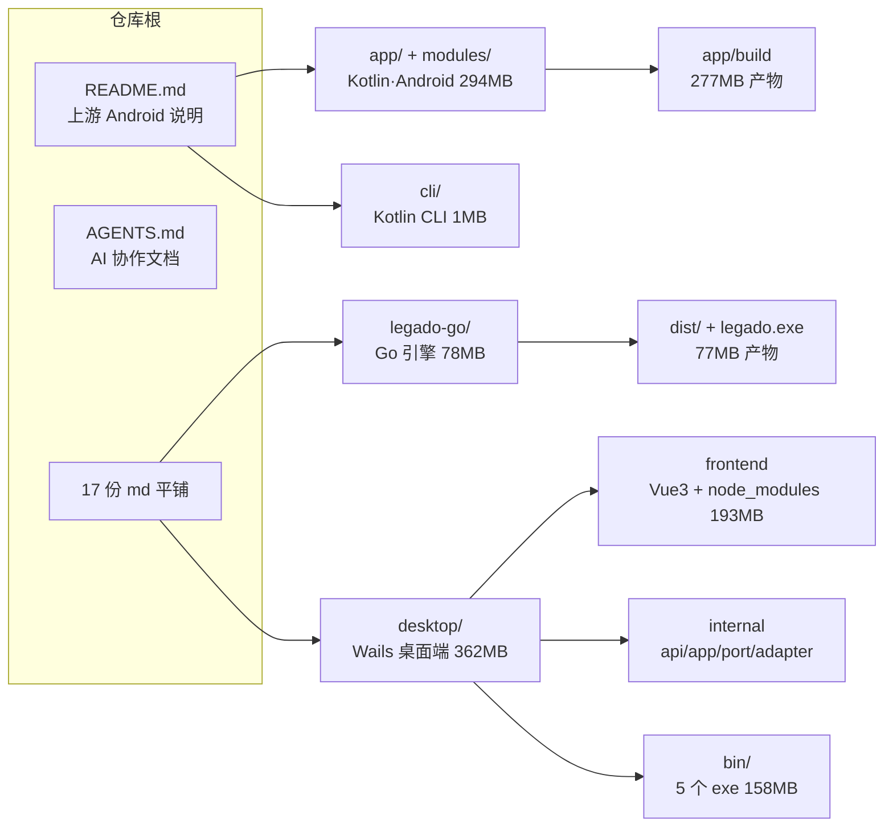
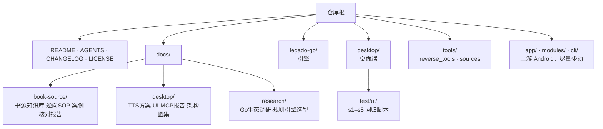

# 项目结构梳理与整理建议

> 扫描时间：2026-10-30 ／ 扫描方式：只读统计，本报告不改动任何文件（文中的命令均为待确认后执行）

## 一、结论先行

1. **体积不是问题，垃圾才是**：工作区共约 **805 MB**，其中 **≈750 MB（93%）是可再生成的构建产物与依赖**（`app/build`、`desktop/bin`、`node_modules`、`legado-go/dist`、`tmp/`）。它们已在 `.gitignore` 里，但磁盘上一直没清，导致"目录看起来巨大"。
2. **真正的复杂度来自"一个仓库装了四条技术栈"**：Kotlin/Android 主工程（`app/`、`modules/`、`cli/`）+ Go 书源引擎（`legado-go/`）+ Go/Wails 桌面端（`desktop/`）+ 逆向脚本与书源样本（`reverse_tools/`、`sources/`）。三条主线在顶层平铺，没有任何分区。
3. **有 1 处脏数据已经进了 git**：`legado-go/out/` 下抓取的正文样本 txt 被提交入库，必须 `git rm --cached`。
4. **文档层面**：根目录 17 份 md 平铺，而顶层 `README.md` 是**上游 Android 版**的说明——真正的开发主线（desktop / legado-go）没有顶层入口，只靠 `AGENTS.md` 口口相传。

## 二、体量现状

| 目录 | 磁盘 | 文件数 | git 跟踪 | 说明 |
| --- | --- | --- | --- | --- |
| `app/` | 294 MB | 13 142 | 1 508 | 上游 Android 主工程；277 MB 是 `app/build`（已忽略） |
| `desktop/` | 362 MB | 15 463 | 215 | 桌面端；`bin/` 158 MB + `node_modules/` 193 MB（已忽略） |
| `legado-go/` | 78 MB | 135 | 130 | 书源引擎；`dist/` 52 MB + `legado.exe` 25 MB（已忽略） |
| `modules/` | 24 MB | 705 | 263 | Gradle 模块，`rhino` 的 jar 18 MB |
| `tmp/` | 45 MB | 7 | 0 | 本地抓包样本 + `tF.exe`（43 MB），已忽略 |
| `cli/` | 1 MB | 66 | 66 | Kotlin CLI（已恢复） |
| 其它 | ~3 MB | — | 20 | `sources/`、`reverse_tools/`、`gradle/`、根脚本 |
| **合计** | **≈805 MB** | 29 500+ | **≈2 240** | `.git` 仅 15 MB，仓库本身是健康的 |

## 三、目录地图（现状）



## 四、问题清单

### P0 — 建议立即处理（低风险、有明确收益）

| # | 问题 | 证据 | 影响 | 建议动作 |
| --- | --- | --- | --- | --- |
| 1 | 抓取的正文样本进了 git | `git ls-files legado-go/out` 有 1 个 txt（草榴站点正文） | 仓库夹带无关数据、含敏感站点内容 | `git rm --cached "legado-go/out/*"` + `.gitignore` 加 `legado-go/out/` |
| 2 | 本地构建垃圾 750 MB | `desktop/bin` 158 MB（含 `mL4.exe`/`tD.exe` 各 43 MB 试验二进制）、`legado-go/dist` 52 MB、`tmp/tF.exe` 43 MB | 占满磁盘、备份/同步变慢、`du` 失真 | 删（都是一条命令就能重新生成的） |
| 3 | 重复图标文件 | 已删 `desktop/build/icon.ico`（与 `windows/icon.ico` 同 md5） | — | 已完成 |

### P1 — 结构问题（建议一周内收敛）

| # | 问题 | 证据 | 建议动作 |
| --- | --- | --- | --- |
| 4 | 根目录 17 份 md 平铺、无索引 | `ls *.md`：书源类 8 份、desktop 类 3 份、生态调研 2 份、基线 4 份 | 建 `docs/`，按 `book-source/`、`desktop/`、`research/` 分类；根目录只留 `README.md`、`AGENTS.md`、`CHANGELOG.md`、`LICENSE` |
| 5 | 顶层 README 是上游 Android 说明，主线（desktop/legado-go）没有入口 | `README.md` 仍是 gedoor/legado 的内容 | 保留上游 README 不动，新增 `docs/README.md` 作为本仓库索引，并在根 README 顶部加一行"桌面端/引擎开发见 docs/" |
| 6 | `desktop/frontend/public/` 有 6 个未引用资源 | `bg-desktop.jpg`、`bg-mobile.jpg`、`vue.svg`、`wails.png`、`Inter-Medium.ttf`(315 KB)、`style.css` 引用数均为 0 | 删除，约省 1 MB 仓库体积、少一层视觉噪音 |
| 7 | desktop 模块根散落 Go 源码 | 根目录有 `main.go`、`serve_image.go`、`serve_image_test.go`、`spa_fallback_test.go` | `serve_image.go`（图片代理）移到 `internal/adapter/http/`；`spa_fallback_test.go` 保留（测 main 的 SPA 兜底） |
| 8 | desktop 有 5 个本地试验目录 | `tmp-mcptest`(16 个 py)、`tmp-pdfspike`、`tmp-sourcedl`、`tmpcheck`、`downloads` | `tmp-mcptest` 的 s1–s8 是可复用的 UI 回归资产 → 转正为 `desktop/test/ui/`；其余三个删 |
| 9 | 两套 AI 工具配置策略不一致 | `.opencode/skills/` 入库（6 个文件），`.workbuddy/` 被忽略 | 二选一：把 skill 统一放 `docs/skills/` 或 `.opencode/skills/` 并明确入库范围 |
| 10 | desktop 三份文档职责重叠 | `README.md` 14 KB、`ARCHITECTURE.md` 10 KB、`ARCHITECTURE-FLOWS.md` 27 KB | 明确分工：README=怎么用、ARCHITECTURE=怎么分层、FLOWS=数据流图集；在三份头部互相链接 |

### P2 — 长期演进（需要单独排期）

| # | 问题 | 建议动作 |
| --- | --- | --- |
| 11 | 四条技术栈在顶层平铺 | 迁到 `apps/android/`、`apps/desktop/`、`engine/go/`、`tools/`（改动大，建议在 CI 与文档同步就绪后一次性做） |
| 12 | `.gitignore` 分散在 3 处（根、desktop、.opencode），规则口径不一 | 根 `# 构建产物` 统一收口 `*.exe`、`out/`、`dist/`、`node_modules/`，模块内只保留差异项 |
| 13 | CI 对所有路径全量触发 Android 构建 | `.github/workflows/test.yml` 的 `paths: '**'` → 增加 `paths-ignore: ['desktop/**','legado-go/**','docs/**']`，并为 Go 两端各建一条 `go test ./...` 流水线（目前 Go 代码完全没进 CI） |
| 14 | 上游代码与本地改动混在同一条 master 上 | 长期考虑 `upstream/master` 只读跟踪 + 本地分支开发，降低同步成本 |

## 五、建议的目标结构



## 六、三步执行计划

**第 1 步：零风险清理（可立即做，约 5 分钟）**

```bash
# 1. 把已入库的抓取样本移出版本库
git rm --cached "legado-go/out/（连载）前世殺我的仙子，今生是我的母親 （1至6） - 成人文學交流區 _ 草榴社區 - t66y.com.txt"
printf '\n# 引擎抓取的正文样本，本地调试产物\nlegado-go/out/\n' >> .gitignore

# 2. 删除纯构建产物（均可一条命令重建）
rm -rf desktop/bin legado-go/dist legado-go/legado.exe tmp
rm -rf desktop/frontend/public/{bg-desktop.jpg,bg-mobile.jpg,vue.svg,wails.png,Inter-Medium.ttf,style.css}

# 3. 删除一次性试验目录
rm -rf desktop/tmp-pdfspike desktop/tmp-sourcedl desktop/tmpcheck

git commit -m "chore: 清理构建产物与误入库的抓取样本"
```

**第 2 步：结构收敛（1–2 小时）**

1. 建 `docs/{book-source,desktop,research}/`，把根目录 17 份 md 按类移动，`git mv` 保留历史。
2. `docs/README.md` 写索引表；根 README 顶部加一行指引。
3. `desktop/tmp-mcptest` → `desktop/test/ui/`，改名去掉 `tmp-` 前缀并纳入 git。
4. `desktop/serve_image.go` → `internal/adapter/http/imageproxy.go`，同步测试。
5. 三份 desktop 文档互相加链接，明确分工。

**第 3 步：工程化（按需）**

1. CI 加 `paths-ignore` + 新建 `go-test.yml`（`legado-go`、`desktop` 两个 job）。
2. `.gitignore` 口径统一。
3. 若确定要"四栈分区"（`apps/` + `engine/` + `tools/`），单独开分支做，避免与功能开发混在一起。

## 七、需要你拍板的 4 件事

| 决策 | 选项 |
| --- | --- |
| `desktop/tmp-mcptest` 的 16 个 UI 回归脚本 | A. 转正进 `desktop/test/ui/`（推荐）／ B. 直接删 |
| 根目录 17 份 md | A. 全部归入 `docs/`（推荐）／ B. 只归档研究类，方案类留在根 |
| `.opencode/skills/` | A. 保持入库（推荐，团队共享）／ B. 改为本地忽略 |
| 是否做四栈分区（`apps/`、`engine/`） | A. 暂不做，先完成第 1、2 步／ B. 本期一起做 |
