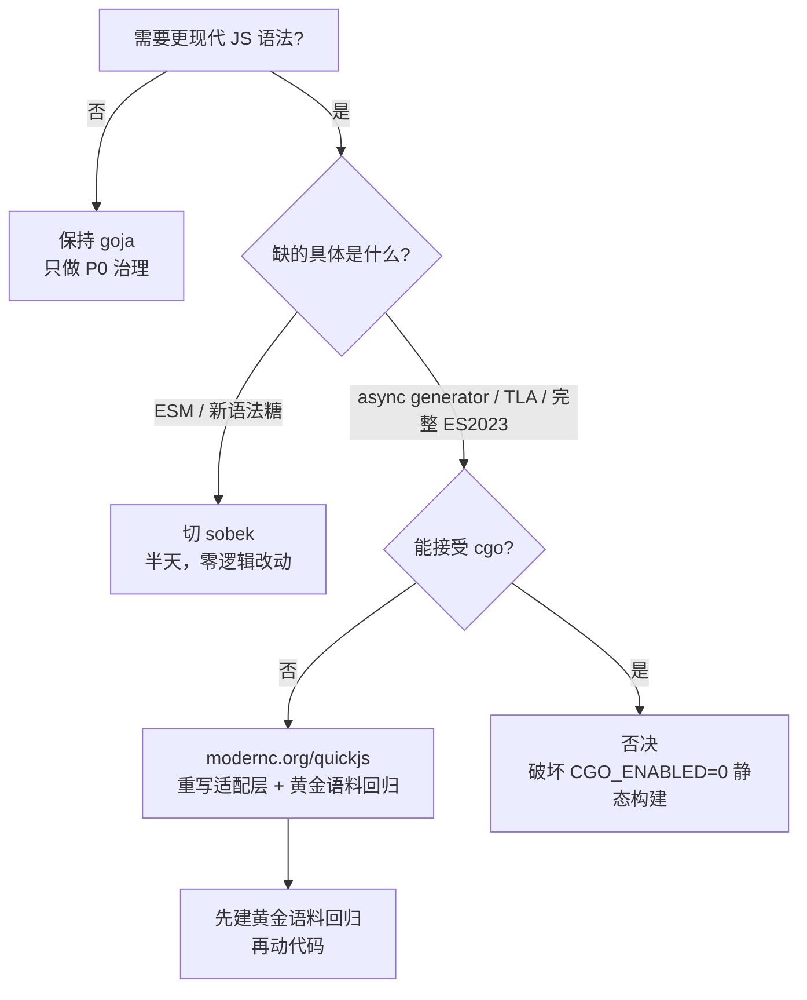

# goja 替换评估：能否换成更现代的 JS 引擎

> 评估日期：2026-10-27　适用版本：`legado-go`（goja `v0.0.0-20261024144015`）
> 方法：源码测绘 + 58 项语法/运行时探测 + 真实基准 + 一次「换库编译」实验

---

## 0. 结论

**不建议为了「支持更现代的语法」而替换 goja。** 理由是三条彼此独立的证据：

1. **语法缺口比预期小得多。** 当前 pin 的 goja 已支持 `async/await`、`BigInt`、`?.`、`??`、`||= &&= ??=`、
   class 字段/私有字段/static block、`String.replaceAll`、`Array.at/findLast`、`Object.groupBy`、
   `Promise.withResolvers/try`、Set 方法、Iterator helpers、重复命名捕获组。58 项探测中 46 项通过，
   真实语言缺口只有 8 项（ESM、动态 import、async generator、顶层 await、WeakRef、正则 `d` 标志、正则修饰符）——
   而这 8 项在书源规则场景里**全部没有用武之地**（见 §2.2）。

2. **兼容基准是 Rhino，不是 V8。** 书源要同时在官方客户端（Rhino 1.8.1，默认语言级 ES6）和本项目上跑，
   真实语法面是两者的**交集**。Rhino 的 ES2015 完成度到 1.9.0 也只有约 71%，`async/await` 至今未实现。
   也就是说：能写进书源的语法，goja 早已全覆盖；换一个更强的引擎，书源作者也用不上。

3. **架构上异步没有落脚点。** `js.Engine.Eval` 是同步返回的，60 个宿主函数（`java.ajax`/`java.get`/`java.post`…）
   全部同步阻塞。没有事件循环，`await` 无法表达任何东西——实测微任务要等 `RunProgram` 返回之后才结算，
   而此时规则返回值早已定格。换引擎带来的 async 能力是「有语法、无语义」。

如果将来确实要动，只有两个候选值得进入决策：

| 方案 | 改造量 | 收益 | 建议 |
| --- | --- | --- | --- |
| **A. grafana/sobek**（goja 同源 fork） | 实测**零逻辑改动**，只改 import 与标识符前缀，约半天含回归 | ESM、更新维护节奏更快 | goja 停更或需要 ESM 时首选 |
| **B. modernc.org/quickjs**（纯 Go 移植 QuickJS，ES2023） | 重写 `pkg/js` 全部 1213 行 + 建语料回归，1~2 周 | 真 ES2023（模块/async generator/BigInt 完整） | 仅在「必须全量 ES2023 且不能上 cgo」时做 |

**明确排除**：`v8go`、`buke/quickjs-go` 等 cgo 引擎。它们会破坏 README 承诺的
`CGO_ENABLED=0` 静态单文件产物与交叉编译/Termux 能力（见 §4）。

---

## 1. 现状测绘：耦合面到底有多大

| 文件 | 行数 | 职责 | 与 goja 的关系 |
| --- | --- | --- | --- |
| `pkg/js/engine.go` | 299 | 运行时池、`jsLib` 预编译、脚本编译缓存、超时中断、`Eval` | 深度绑定（`goja.Runtime/Program/Value`） |
| `pkg/js/ext.go` | 914 | 60 个 `java.*` 宿主函数、`cookie`/`cache`/`source`/`book`/`chapter` 对象、`ElementWrap`（jsoup 模拟） | 深度绑定（`goja.FunctionCall/Value/Object`） |
| `pkg/source/validate.go` | 2 处 | 校验 `jsLib` 与规则内 JS 块的语法 | 只用 `goja.Compile` |

外部调用点共 **21 处**，只用到 `js.Bindings`、`js.DefaultEngine().Eval`、`js.ElementWrap`
（与 `NewElementWrap`/`WrapNodes`）、`js.Hooks`、`js.OnLog`、`SetTimeout`。
`pkg/rule`、`pkg/urlx`、`pkg/webbook` 全部通过 `Eval(jsStr, *Bindings) (any, error)` 这一条窄接口访问 JS。

**结论：抽象边界其实是干净的。** JS 引擎的爆炸半径 = `pkg/js` 一个包 + `validate.go` 两行。
换引擎不是「重构半个项目」，而是「重写一个适配层」。这也意味着**现在换的成本主要由适配层决定，而不是由业务代码决定**。

API 使用密度（grep 计数）：`vm.ToValue` 151、`goja.Value` 104、`goja.FunctionCall` 102、
`goja.Undefined` 16、`goja.Null` 12、`goja.Runtime` 12、`vm.NewObject` 11、`goja.Object` 7、`goja.Program` 7。

---

## 2. 实测能力矩阵

### 2.1 探测结果（58 项）

| 分组 | 通过 | 说明 |
| --- | --- | --- |
| ES5.1 基线 | ✅ | `var`/函数/正则/严格模式 |
| ES2015 | ✅ | `let/const`、箭头、模板串、解构、展开/剩余、`for-of`、class（getter/static）、`Map/Set/Symbol`、`Promise`、generator、默认参数 |
| ES2016–2019 | ✅ | `**`、`includes`、`async function`、`Object.entries`、对象 rest/spread、`Promise.finally`、命名捕获组、lookbehind、dotAll、可选 catch、`flat/flatMap`、`fromEntries`、`trimStart` |
| ES2020–2022 | ✅ | `?.`、`??`、`BigInt`、`allSettled`、`globalThis`、`??=`、数字分隔符、`replaceAll`、`Promise.any`、class 字段/私有字段/static block、`Array.at`、`Error cause` |
| ES2023–2025 | ✅ | `findLast`、`Object.groupBy`、`Promise.withResolvers`、Set 方法（`union` 等）、Iterator helpers（`toArray`）、`Promise.try`、重复命名捕获组 |
| **缺口** | ❌ 8 项 | `import`/`export`、`import()`、async generator、顶层 `await`、`WeakRef`、正则 `d` 标志、正则修饰符 `(?i:)` |

> 另有 4 项探测失败但**与引擎无关**，不在缺口内：`console`/`setTimeout`/`require` 属宿主环境
> （`console` 我们已自行注入，`setTimeout` 需要事件循环所以不需要），`JSON.parse('{"a":1,}')`
> 本来就应当报错（标准引擎同样拒绝）。

### 2.2 缺口逐条对照书源场景

| 缺口 | 书源会不会用 | 判断依据 |
| --- | --- | --- |
| `import` / `export` / `import()` | 不会 | 书源 JS 是内联在 JSON 字段里的**单条表达式**，没有模块系统；Legado 侧靠 `java.importScript` 取字符串，也不是 ESM |
| async generator | 不会 | 上面同理，且 Rhino 无 async 体系 |
| 顶层 `await` | 不会 | 规则必须**同步**返回一个值给解析器，`await` 无处落地 |
| `WeakRef` | 极罕见 | 需要手动 GC 语义，宿主没有暴露；Rhino 也没有 |
| 正则 `d` 标志 / `(?i:)` 修饰符 | 极罕见 | 检索本地全部书源，现代语法只出现过 1 处 `?.`（已被 goja 支持） |

### 2.3 真实语料验证

`sources/`（4 源）+ `testdata/sources`（2 源）离线校验：**0 个 JS 语法错误**
（`validate -dir ../sources` → 共 4 个书源，0 个存在错误）。

---

## 3. 兼容基准其实是 Rhino 1.8.1

| 事实 | 数据 | 出处 |
| --- | --- | --- |
| Legado 的 JS 引擎 | Rhino **1.8.1** | `gradle/libs.versions.toml: rhino = "1.8.1"` |
| 默认语言级 | `VERSION_ES6` | Rhino 1.8.0 发布说明 |
| ES2015 完成度 | 1.8.0 ≈ 62%，1.9.0 ≈ 71% | Rhino 官方兼容表 |
| `async/await` | 未实现 | Rhino 1.8.x/1.9.0 发布说明与兼容表均未包含 |

推论：**goja 已经是 Rhino 的语法超集**。一个书源如果用了 `?.`、`??`、`||=`、`replaceAll` 之类，
在官方客户端就已经报错；书源作者不会这么写。因此「比 Legado 更现代」这个目标本身没有消费方。

反过来说，真正需要对齐的不是「JS 规范版本」，而是 **Rhino 的怪癖**（比如 Rhino 的 `String.replace`
对 `$&`、`$1` 的处理，`Number.prototype.toString` 的格式化，`JSON.stringify` 的键顺序）。
换引擎只会让这些偏差**变大而不是变小**——这是被忽略的隐性成本（见 §5）。

---

## 4. 候选库横评（2026-10 现状）

| 引擎 | 许可 | cgo | ES 覆盖 | 与本项目适配 | 维护状态 | 主要风险 |
| --- | --- | --- | --- | --- | --- | --- |
| **goja**（现状） | MIT | 否 | ES5.1 + ES2015~2025 绝大多数（缺 ESM/async gen/TLA） | 原生 | 活跃（pin 于 2026-10-24） | 上游合并节奏慢于 fork |
| **grafana/sobek** | MIT | 否 | goja 全部 + 实验性 ESM（含顶层 await/命名空间） | **100% API 兼容**（实测零逻辑改动编译通过） | 活跃，k6 主线驱动，定期 merge 上游 | 为 k6 服务而分叉，ESM API 自述「不稳定」；需事件循环才完整 |
| **modernc.org/quickjs** | BSD-3 | 否（CCGO 纯 Go 移植 QuickJS） | **ES2023**：modules、async generator、BigInt、Proxy | 需重写适配层（`Value` 手动 `Dup/Free`、`RegisterHostFunc([]any)`、`ExecutePendingJobs`） | 活跃（每月多版） | 内存管理从 GC 变引用计数，误用即泄漏/崩溃；无 `Program` 概念（改用字节码，且版本绑定）；32 位平台性能极端劣化 |
| buke/quickjs-go | MIT | **是** | ES2023 | 需重写适配层 | 一般 | 破坏 `CGO_ENABLED=0` 静态构建 |
| Gaurav-Gosain/quickjs（wazero+wasm） | MIT | 否 | ES2023 | 需重写适配层 | 个人项目，规模小 | wasm 边界开销 + 成熟度风险高 |
| v8go | BSD-3 | **是**（C++ 工具链） | ES2023+ 全量 | 需重写适配层 | 分叉维护 | 产物 ~100MB、构建链重，完全不适合本项目 |
| otto | MIT | 否 | ES5 | — | 已停更 | 直接排除 |

### 4.1 已验证的换库实验（sobek）

把 `pkg/js` 原样复制，仅做 `github.com/dop251/goja` → `github.com/grafana/sobek` 与 `goja.` → `sobek.`
的机械替换：

```
go build ./tmp_sobek/js   →   EXIT=0（零报错、零逻辑改动）
冒烟：java.get('a') + "|" + (null ?? "d") + "|" + typeof 10n
      →  got:a|d|bigint
      [1,2,3].map(x=>({n:x})).Export()
      →  [map[n:1] map[n:2] map[n:3]]     // 与我们 toJSValue 的期望一致
```

结论：sobek 的迁移是**一次机械改名**，风险主要来自「行为回归」而不是「编译失败」。

### 4.2 性能量级（本条动摇了「换引擎为性能」的动机）

`modernc.org/quickjs` 官方基准（相对 CCGO libquickjs = 1.000，越低越好）：
GOJA 在 darwin/amd64 1.385、linux/amd64 1.768、windows/amd64 1.435。
即 goja 比 QuickJS 慢 **1.4~1.9 倍**——这是「同一个人写同样逻辑」的差距，不是数量级差距。

而本项目实测（本机 Windows，一条真实风格的字符串清洗规则）：

| 场景 | 单次耗时 |
| --- | --- |
| 复用已编译 `Program` 执行 | **8.35 µs** |
| 每次重新 `Compile` + 执行 | 23.10 µs |
| 新建 runtime + 注入 8 个全局函数 | 3.77 µs |

一次 `toc` 解析通常只有几十次 JS 求值（多数规则走 jsoup/XPath，根本不进 JS）→ **< 1 ms**；
而一次网络请求是 **100~2000 ms**。JS 占总耗时 < 0.5%。
即使 JS 快到 2 倍，端到端差异也落在噪声里，测不出来。

---

## 5. 迁移成本清单（真正花钱的地方）

| 成本项 | sobek | modernc/quickjs |
| --- | --- | --- |
| 改 import / 标识符 | 2 个文件，机械替换 | 全量重写 |
| 宿主函数（60 个 `java.*`） | 0 改动 | 逐个改写签名（`FunctionCall` → `[]any`） |
| 对象方法（72 处 `o.Set`） | 0 改动 | 逐个改写 + `Value` 生命周期管理 |
| `ElementWrap`（jsoup 模拟） | 0 改动 | 需重做 `Object` 封装与 `Export` |
| 值映射（`null`/`undefined`/`[]any`/`map`） | 一致（实测） | 需重新定义：`null→nil`、`undefined→Undefined` 哨兵、BigInt→`*big.Int` |
| 超时中断 | `Interrupt` 同签名 | `SetEvalTimeout`，语义不同 |
| 脚本编译缓存 | `Compile` 同签名 | 改字节码，且**与 QuickJS 版本绑定**，升级需重编 |
| 并发模型 | 同为「单 goroutine + `sync.Pool`」 | VM 同样非并发安全，但 `Value` 跨 goroutine 需协调释放 |
| 语义漂移风险 | 低（同源） | **高**（数值格式化、Date 解析、正则回溯、JSON 键序、异常栈） |
| 语料回归 | 现有 6 个源够用 | **不够**，需先建黄金语料（见 §7） |
| 估算工时 | 0.5 天（含回归） | 1~2 周 + 长期维护 |

**最容易被低估的一项是语义漂移。** 书源是「几千个陌生人写的、不可测的代码」，
换引擎后行为差异只会在特定站点、特定字段上偶发暴露，排查成本远高于编译错误。

---

## 6. 收益盘点

| 维度 | 换 goja→sobek | 换 goja→quickjs |
| --- | --- | --- |
| 语法收益 | 几乎为 0（我们已有的语法它也有；多的只有 ESM） | 理论上有（ES2023 全量），但书源用不上 |
| 性能收益 | ≈0（同源同实现） | JS 单次快 1.4~1.9x，端到端 < 0.5%，不可测 |
| 维护收益 | **中**（k6 驱动，merge 上游更勤，ESM 有人做） | 中（现代引擎，但依赖 CCGO 移植质量） |
| 风险 | 低 | 中高（内存管理 + 语义漂移 + 平台性能陷阱） |
| 战略价值 | 低 | 低（除非产品要支持「通用 JS 脚本」而不只是书源规则） |

---

## 7. 建议路线



### P0（建议立刻做，1~2 小时，零风险）

1. **把 goja 收进接口**：在 `pkg/js` 定义
   `type ScriptEngine interface { Eval(js string, b *Bindings) (any, error); SetTimeout(d time.Duration) }`，
   `gojaEngine` 作为唯一实现。外部 21 个调用点不动（它们本来只碰 `Eval`）。
   收益：**将来换引擎只改一个实现文件**，而非重写整包。
2. **把 §2 的探测固化成 `pkg/js/compat_test.go`**：58 条断言，每条标注「必须通过 / 允许缺失」。
   收益：升级 goja 或换引擎时，语法能力变化**可度量**，不再靠猜；也让本文结论可复现。

### P1（按需，0.5 天）

切 **sobek**。触发条件（任一）：
- goja 上游停更超过 12 个月；
- 出现真实书源需要 ESM 或 goja 缺失的语法；
- 需要 `goja_nodejs` 之外更完整的事件循环生态。

落地方式：`go get github.com/grafana/sobek` → 替换 import → `go test ./...` →
重点回归 `pkg/js`、`pkg/rule`（JS 语法糖）、`pkg/urlx`（`@js:` 与 URL 规则）。

### P2（触发条件严格，1~2 周）

`modernc.org/quickjs`。**前置门槛全部满足才动**：
1. 有真实书源明确用到 goja 不支持且无法绕过的语法；
2. 黄金语料回归已建成（≥20 个可用源 × 全字段快照，见下）；
3. 明确要求保持 `CGO_ENABLED=0` 单文件静态产物。

### 黄金语料回归（换任何引擎前的前置工程）

对每个可用源，固定输入（书籍 URL / 章节 URL），把 `search/explore/info/toc/content`
的结构化输出序列化成快照 JSON，作为 diff 基线。当前可用源只有
`kantianxia.json`（VISTA 18 条发现、神奇漫画 24 条）、`testdata/sources`（yumanhua 9 条 / 1201 章），
**样本不足以支撑引擎替换的判定**——这也是不建议现在换的关键工程理由。

---

## 8. 决策信号（出现即重新评估）

| 信号 | 阈值 | 指向 |
| --- | --- | --- |
| 书源校验中 `jsLib`/JS 块语法错误率 | > 2% 且错误信息为「不支持的语法」 | P1（sobek） |
| goja 上游 commit 间隔 | > 12 个月无更新 | P1（sobek） |
| 实测 JS 求值占总耗时 | > 20%（profiler 证据） | 考虑 P2 |
| 需要支持「通用用户脚本」而非书源规则 | 产品需求变更 | 重新做选型（可能需要真 V8） |
| 社区反馈某书源在官方客户端可用、在本项目失败 | 且定位到 JS 语法 | 先试 sobek，仍不行再 P2 |

---

## 附录：探测用例与结果

| # | 用例 | 结果 |
| --- | --- | --- |
| 1–10 | ES5 基线、`let/const`、箭头、模板串、解构、展开/剩余、`for-of`、class、默认参数、`Map/Set/Symbol` | ✅ |
| 11–14 | `Promise`、generator、`**`/`includes`、`Object.entries` | ✅ |
| 15 | `async function` + `await` | ✅（语法与 Promise 结算均正常） |
| 16–21 | 对象 rest/spread、`Promise.finally`、命名捕获组、dotAll、lookbehind、可选 catch | ✅ |
| 22–25 | `flat/flatMap`、`fromEntries`、`trimStart`、`?.` | ✅ |
| 26–32 | `??`、`BigInt`、`allSettled`、`globalThis`、`??=`、数字分隔符、`replaceAll` | ✅ |
| 33–38 | `Promise.any`、class 字段/私有字段、static block、`.at()`、`Error cause` | ✅ |
| 39–45 | `findLast`、hashbang、`Object.groupBy`、`Promise.withResolvers`、Set 方法、Iterator helpers、`Promise.try` | ✅ |
| 46 | 重复命名捕获组 | ✅ |
| 47–54 | **ESM `import`/`export`、`import()`、async generator、顶层 `await`、`WeakRef`、正则 `d` 标志、正则修饰符** | ❌ 缺口 |
| 55–58 | `require` / `console` / `setTimeout` / `JSON.parse` 尾逗号 | 与引擎无关（宿主或应为报错） |

复现方式：把上表用例写成 `goja.Compile/ RunString` 的表驱动测试即可（建议随 P0 落地）。
