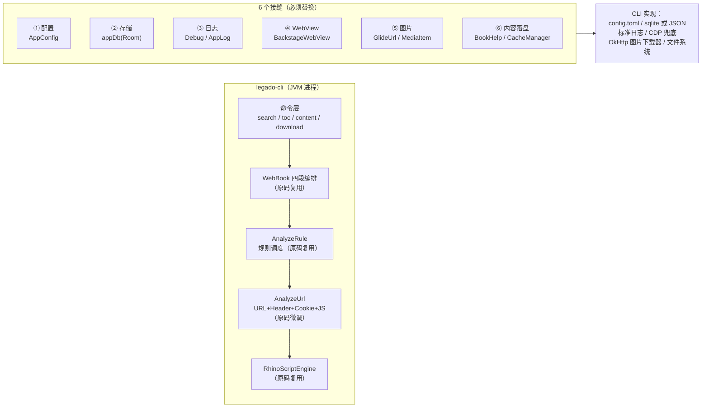
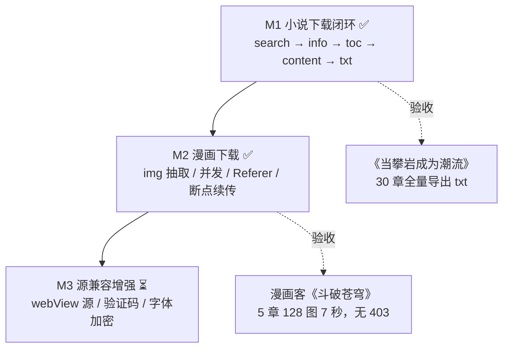

# legado 书源引擎 CLI 化可行性方案

> 结论先行：**可以，而且成本比预想的低**。书源引擎核心约 20 个文件、6.9k 行 Kotlin，全部 Android 依赖只有 **27 处 import**，且集中在 6 个可替换的"接缝"上。
> 仓库内已附带可运行的验证模块 `cli/`，规则解析层与 JS 执行层**未改一行源码**即可在桌面 JVM 上运行。

---

## 一、先看实测数据

用依赖闭包脚本扫描 `app/src/main/java` 得到的事实（不是估算）：

| 分层 | 代表文件 | 行数 | Android 引用 | 能否直接用 |
|---|---|---|---|---|
| 规则解析 | AnalyzeByJSoup | 524 | 1（`@Keep`） | ✅ 需注解替身 |
| | AnalyzeByXPath | 155 | 2（`TextUtils.join`） | ✅ 需 1 个替身 |
| | AnalyzeByJSonPath / AnalyzeByRegex | 231 | 2（`@Keep`） | ✅ |
| | RuleAnalyzer / RuleData | 406 | 0 | ✅ 零改动 |
| 规则调度 | AnalyzeRule | 907 | 2 | ✅ 少量替身 |
| 传输 | AnalyzeUrl | 851 | 4 | ⚠️ 需裁剪 4 处 |
| JS 引擎 | modules/rhino（20 文件） | — | 3 处 | ✅ 需 3 个替身 |
| JS API | JsExtensions | 1003 | 2 | ⚠️ 79 个成员中 9 个依赖 WebView |
| HTTP | HttpHelper / CookieManager / StrResponse | 436 | 2 | ✅ 纯 OkHttp |
| 业务编排 | WebBook / BookList / BookInfo / BookChapterList / BookContent | 1375 | 2 | ✅ 只调 Debug/AppConfig 副作用 |
| 实体 | BookSource 及 rule 子类 | 886 | 8（Room/Parcelize） | ⚠️ 去注解即可 |

关键结论：**真正"粘"在 Android 上的不是算法，而是运行时设施**——WebView、Glide、Media3、Room、SharedPreferences、Toast。这些恰好是一个下载器根本不需要的东西。

---

## 二、只需要替换 6 个接缝



| 接缝 | App 里的实现 | CLI 里换成 | 工作量 |
|---|---|---|---|
| ① 配置 | `AppConfig`（SharedPreferences，742 行） | 25 个字段的 `data class Config` + TOML | 小 |
| ② 存储 | `appDb`（Room，章节缓存/书源表） | SQLite JDBC 或直接 JSON/文件 | 中 |
| ③ 日志 | `Debug` / `AppLog`（含 UI 回调） | SLF4J + `--verbose` | 小 |
| ④ WebView | `BackstageWebView`（Android WebView） | 默认禁用；CDP 兜底可选 | 中 |
| ⑤ 图片 | `GlideUrl` / `MediaItem` / `ExoPlayerHelper` | `OkHttp Request(headerMap)` | 小 |
| ⑥ 落盘 | `BookHelp.saveContent` / `CacheManager` | `Files.write` + 内存/磁盘缓存 | 小 |

---

## 三、三种落地方式，怎么选

| | A. 复用源码 + 编译期替身 | B. 抽 `:engine` 模块，App 反向依赖 | C. 独立仓库 fork |
|---|---|---|---|
| 改动 App | 0 | 30+ 处引用点、Room/Parcelize 解耦 | 0 |
| 与上游同步 | 自动跟随（文件不复制） | 需一次重构，之后自动 | 永久漂移，手动合并 |
| 启动速度 | 当天能跑通 | 2~3 周 | 1 周 |
| 风险 | `compat` 层要跟着上游补 | 回归面大，影响 App 发版 | 后续维护成本高 |

**推荐：A 起步，B 收敛。**
先用 A 把下载链路跑通（PoC 已验证这条路可行），等规则引擎在 CLI 侧稳定后，再把公共部分抽成 `:engine` 模块让 App 反向依赖，此时改动面已经被实际使用验证过。

`cli/` 模块采用的就是 A 的核心技巧：**不复制源码**，用 Gradle `Copy` 任务把 `app/.../analyzeRule`、`modules/rhino` 的文件同步进 build 目录参与编译；再在 `cli/src/main/kotlin` 里提供 `androidx.annotation.Keep`、`android.text.TextUtils`、`android.os.Build`、`androidx.collection.LruCache`、`android.content.Context` 五个替身。上游改规则引擎，CLI 下次编译自动生效。

---

## 四、已完成的验证（仓库内可复跑）

```bash
# 需要 JDK 17+（本机 C:\Program Files\Microsoft\jdk-21.0.7.6-hotspot）
export JAVA_HOME="C:/Program Files/Microsoft/jdk-21.0.7.6-hotspot"
./gradlew :cli:run --args="selftest"
```

实测输出（10/10 通过）：

```
CSS 规则解析（AnalyzeByJSoup，legado 原码）
  PASS  class.list@tag.li@tag.a@text => 斗破苍穹 盗墓笔记
  PASS  class.list@tag.li.1@tag.span@text => 南派三叔
  PASS  tag.img@data-src => /img/cover.jpg
  PASS  属性兜底 tag.img@src||data-src => /img/placeholder.png
XPath 规则解析（AnalyzeByXPath，legado 原码）
  PASS  //ul/li/a/text() => 斗破苍穹 盗墓笔记
JSONPath 规则解析（AnalyzeByJSonPath，legado 原码）
  PASS  $.data.books[*].name => 斗破苍穹 盗墓笔记
JS 脚本执行（modules/rhino，legado 原码 + 2 处替身）
  PASS  1+1 => 2.0
  PASS  baseUrl 绑定 => https://example.com/search?q=%E6%96%97%E7%A0%B4
  PASS  Java 互操作 => 1970
  PASS  正则替换（书源常见写法） => 斗破苍穹 作者:天蚕土豆
```

已验证的能力：
- ✅ CSS / XPath / JSONPath / 正则四类规则，含 `||` 兜底、`@` 链式、索引取值
- ✅ Rhino 脚本引擎在 JVM 上正常执行，`java.*` 互操作可用（书源大量 `@js:` 的前提）
- ✅ OkHttp 抓取（`legado-cli fetch --url https://example.com` 返回 200）
- ✅ 中文输出无需额外配置

原先列为"待验证"的部分（AnalyzeUrl 的 URL 选项/JS 注入、Cookie 持久化、WebBook 四段编排接线、图片下载）已在 M1/M2 中全部落地并用真实书源验证，见第五节。

### 真实书源验收结果（`yumanhua_comic_source.json` + `sources/kantianxia.json`）

| 能力 | 命令 | 实测结果 |
|---|---|---|
| 多源并发搜索 | `search 海贼` | 3 源并发，989ms 返回 9 条；无 searchUrl 的源自动跳过并提示 |
| 详情解析 | `info 1` | 书名/作者/分类/最新/封面/目录页/简介全部命中，766ms |
| 目录解析 | `toc 1` | 681 章（含 `@js:` 规则里的 `java.ajax` POST 二次请求），1.3s |
| 单章正文 | `content 1 --index 1` | 39 张图片地址还原（base64+XOR 解密链路完整跑通） |
| M1 文本下载 | `download <url> --from 1 --to 3` | 《当攀岩成为潮流》30 章，产出 `书名.txt` + 分章文件，正文格式无损 |
| M2 图片下载 | `download 1 --chapters 1-5 --jobs 16` | 5 章 128 张图，7.0s，JPEG 头 `ffd8ff` 校验通过，无 403 |
| 断点续传 | 追加 `--resume` | 第二轮 跳过 62 项、0 下载、文件数不变 |
| JSON 输出 | `--json` | stdout 只有 JSON，过程信息走 stderr |

---

## 五、实施路线



### M1（核心，先跑通一本小说）—— ✅ 已完成

实际落地的分层（后一层依赖前一层）：

| 层 | 内容 | 做法 |
|---|---|---|
| 规则引擎 | `analyzeRule/**` | **原码零改动**，由 Gradle `Sync` 同步进 `build/generated` 参与编译 |
| 实体 | Book / BookChapter / BookSource / SearchBook / 6 个 rule 类 | 手写裁剪版：去 Room/Parcelize/ReadConfig，字段名与书源 JSON 键名保持一一对应 |
| 平台替身 | annotation / TextUtils / Build / Log / Base64 / LruCache / View / FlexboxLayout / Parcelize / appCtx / R | 17 个 5~30 行的小文件，集中在 `cli/src/main/kotlin/android*` |
| 基础设施 | AppConst、AppPattern、AppLog、CacheManager（JSON 文件）、CookieStore、HttpHelper（OkHttp+文件 CookieJar） | 与 App 同名同签名，行为对齐 |
| JS 运行时 | `modules/rhino` 原码 + JsExtensions 全量移植 | 79 个成员仅 9 个 WebView 相关抛 `NoStackTraceException` |
| 编排 | `WebBook.kt` / `BookList.kt` / `BookInfo.kt` / `BookChapterList.kt` / `BookContent.kt` | **原码零改动**，只提供 `appDb` / `AppConfig` / `BookHelp` 的内存实现 |
| CLI 壳 | `Cli.kt` / `SourceStore.kt` / `Pipeline.kt` / `Download.kt` / `Main.kt` | 参数解析、书源仓库、流水线调度、并发下载、表格输出 |

关键技术决定：

- **不 fork 上游代码**。`syncEngineSource` 同步的是 `app/src/main/java` 里的原始文件，legado 升级后 `./gradlew :cli:installDist` 自动跟随，不需要手工合并。
- **实体手写而非注解剥离**。`@Entity`/`@Parcelize` 分布在十几个文件里，剥注解比手写 8 个精简实体更容易出错；手写版字段名必须与 JSON 键名逐一对应（这是脚本里 `book.xxx` 能取到值的前提）。
- **`by lazy` 委托字段不能进 JSON**。`variableMap`/`origins` 会序列化成 `xxx$delegate`，读回时无法反序列化，CLI 用带 `ExclusionStrategy` 的 `CLI_GSON` 屏蔽。
- **OkHttp Dispatcher 线程非 daemon**。命令结束不 `exitProcess` 会让进程白挂 60 秒，`main` 末尾统一退出。

完成标准：✅ 对 `yumanhua`（图片）与 `sources/kantianxia.json`（文本）均能产出完整目录结构与正文。

### M2（漫画）—— ✅ 已完成

| 需求 | 实现位置 | 说明 |
|---|---|---|
| 抽图片 URL | `Download.extractImageUrls` | 复用 `HtmlFormatter.formatKeepImg` 的输出，jsoup 取 `img[src]`，兼容 `data-src`/`data-original`、`data:` 内联、纯 URL 列表（`\n` 分隔）、完全无 `<` 的正文 |
| Referer + 源 header | `Download.fetchBinary` | 先套 `source.getHeaderMap(true)`，再叠图片自带的 `,{"headers":...}`，最后兜底章节页 URL 作 Referer |
| 限速 | `ConcurrentRateLimiter(source)` | 与 `AnalyzeUrl` 共用同一张 static 记录表，`concurrentRate` 对图片请求同样生效 |
| 并发 | `Semaphore(Cli.jobs)` | 章节内图片并发，章节间串行（避免一次打满整本） |
| 断点续传 | `existingImage()` | 以 `0001.` 前缀判断已落盘；下载先写 `.part`，`renameTo` 后才算正式文件，杜绝读到半截 |
| 失败清单 | `_failures.txt` | 记录"第几章 第几张 + 原因 + 原 URL"，可直接对照重跑 |

实际产出结构：

```
books/<书名>/
├─ 00001-01/
│  ├─ 0001.jpg … 0036.jpg
└─ 00002-02/
   └─ 0001.jpg …
```

文本源产出：

```
books/<书名>/
├─ 书名.txt              # 合并稿：元信息 + 全部章节
└─ chapters/
   ├─ 00001-第一章.txt    # 分章缓存，--resume 复用
   └─ 00002-第二章.txt
```

### M3（可选增强）
- `webView: true` 的源：Android WebView 无替代，用 headless Chrome（CDP）实现 `java.webView(html, url, js)`，或用 curl-impersonate 兜底
- 验证码：`getVerificationCode` 只能跳过或接 OCR
- 字体加密：`QueryTTF.java` 依赖 Android 的 TTF 解析，需换 `fontbox`

---

## 六、CLI 命令（已实现）

```bash
# 构建
export JAVA_HOME="C:/Program Files/Microsoft/jdk-21.0.7.6-hotspot"
./gradlew :cli:installDist          # 产物在 cli/build/install/legado-cli/bin/

# 书源管理
legado-cli source add ./yumanhua_comic_source.json   # 也支持目录批量
legado-cli source list
legado-cli source show 漫画客
legado-cli source remove 漫画客

# 搜索 / 发现 / 详情 / 目录
legado-cli search "斗破苍穹"                        # 全源并发
legado-cli search "海贼" --source 漫画客 --json
legado-cli explore --source VISTA --list            # 看分类
legado-cli explore --source VISTA --kind 看天下 --page 2
legado-cli info 1                                   # 序号来自上次 search/explore
legado-cli info https://www.example.com/book/123
legado-cli toc 1 --limit 20
legado-cli content 1 --index 3

# 下载
legado-cli download 1 --from 1 --to 50 --jobs 8
legado-cli download 1 --chapters 1,5,9-12 --resume
legado-cli download <url> --out ./books --resume

# 全局选项（任意命令）
--dir <数据目录>  --jobs <n>  --retries <n>  --timeout <秒>  --proxy <地址>
--verbose（书源执行日志）  --json（结果转 JSON）  --quiet（无进度）

# 调试（等价 App 的"调试书源"）
legado-cli selftest                                 # 规则引擎自检 10 项
legado-cli rule --rule "class.list@tag.li" --html page.html
legado-cli js --code "baseUrl + '/x?q=' + key"
legado-cli fetch --url https://example.com --output out.html
```

数据目录（默认 `~/.legado-cli`）：

```
~/.legado-cli/
├─ sources.json        # 已导入书源
├─ last-search.json    # 上次搜索结果，供 info/toc/download 用序号引用
├─ cache/              # 书源脚本缓存、cookie（cookies.json）、kv-cache.json
└─ books/              # 下载产物
```

下载产物：

```
books/书名/
├─ 书名.txt            # 文本源：合并稿
├─ chapters/           # 文本源：分章（续传用）
└─ 00001-第一章/       # 图片源：每章一目录
   └─ 0001.jpg
```

---

## 七、风险清单

| 风险 | 影响 | 应对 |
|---|---|---|
| `webView: true` 的源无法执行 | 少数源不可用 | 一期直接报错跳过，二期接 CDP |
| Cronet 独有行为 | 极少数站点 TLS/HTTP2 指纹 | OkHttp 兜底，失败再考虑 curl-impersonate |
| `JsExtensions` 的 `java.*` API 缺失 | 源脚本报 `undefined` | 一期把 79 个成员除 9 个 WebView 外全保留 |
| App 升级导致 `compat` 失效 | 编译报错 | 编译期暴露，修 5 个替身即可，不会静默出错 |
| 内容清洗规则（`ContentProcessor`）依赖 `appDb` | 去广告/替换规则不生效 | 单独抽成纯函数，替换规则用 JSON 文件加载 |
| 站点风控 | 403/验证码 | 按源配置限速、UA、Cookie；不做绕过 |

---

## 八、工作量判断（实际结果）

- 引擎源码改动量：**0 行**。上游 `analyzeRule/**`、`webBook/*.kt`、`modules/rhino` 原样编译。
- 新增代码约 5.5k 行，其中：
  - 平台替身 17 个文件 ≈ 500 行（平均 30 行/个）
  - 基础设施移植（Http/Cookie/Cache/JsExtensions/Utils）≈ 3.3k 行
  - CLI 壳（参数、书源仓库、流水线、下载器、输出）≈ 1.7k 行
- 结论：**难点不在"改写引擎"，而在"凑齐引擎周边"**。一旦把 6 个接缝补齐，M1+M2 就是接线工作；真正的工程风险集中在平台相关 API（WebView、字体解析）上，与书源规则引擎本身无关。

---

## 附：`cli/` 模块结构

```
cli/
├─ build.gradle.kts               # 纯 JVM；Sync 任务同步 app/modules 源码，不复制
└─ src/main/kotlin/
   ├─ android/{annotation,os,text,util,view,content}/   # 平台替身（Build/Log/Base64/TextUtils/…）
   ├─ androidx/{annotation,collection}/                 # Keep/SuppressLint/IntDef、LruCache
   ├─ com/{google/android/flexbox, bumptech/glide}      # FlexboxLayout、GlideUrl 占位
   ├─ kotlinx/parcelize/                                # Parcelize 注解空实现
   ├─ splitties/init/AppCtx.kt                          # appCtx.getString(resId)
   ├─ io/legado/app/
   │  ├─ R.kt                                           # 文案资源常量
   │  ├─ constant/                                      # AppConst/AppPattern/BookType/BookSourceType
   │  ├─ data/{AppDb,entities}/                         # 内存 DAO + 8 个精简实体
   │  ├─ exception/                                     # 与 App 同名异常
   │  ├─ help/{http,config,book,coroutine,source}       # Http/Cookie/Cache/JsExtensions/BookHelp
   │  ├─ model/{Debug,SharedJsScope}                    # 调试日志、jsLib 作用域缓存
   │  └─ utils/                                         # GSON/NetworkUtils/StringUtils/HtmlFormatter…
   └─ io/legado/cli/
      ├─ Main.kt          # 命令分发 + usage + selftest
      ├─ Cli.kt           # 全局选项、参数解析、表格/进度输出
      ├─ Json.kt          # CLI_GSON（屏蔽 lazy 委托字段）
      ├─ SourceStore.kt   # 书源导入/检索/按详情页反查
      ├─ Pipeline.kt      # search/explore/info/toc/content 调度 + 搜索缓存
      └─ Download.kt      # M1 文本、M2 图片（Referer/并发/续传/失败清单）
```

上游源码在 `build/generated/` 下：

```
cli/build/generated/
├─ legado-engine/io/legado/app/{analyzeRule,webBook,entities/rule,utils,help/http}/
└─ legado-rhino/                # modules/rhino 全量
```
